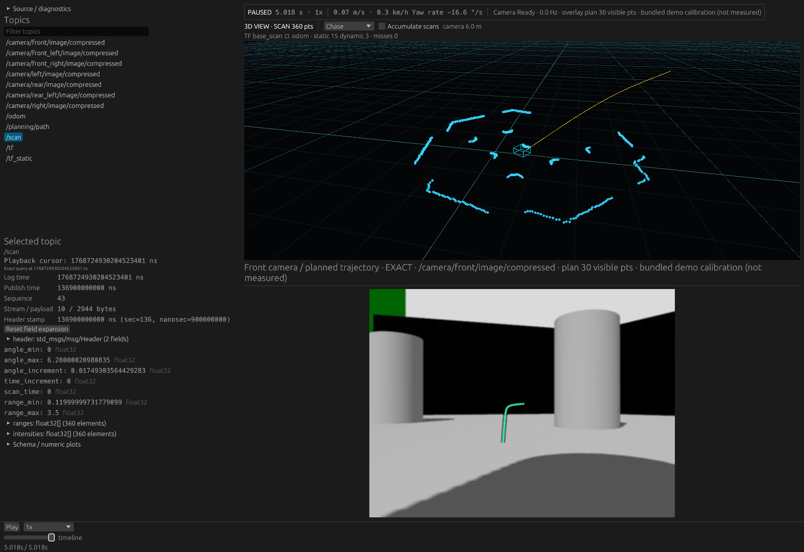
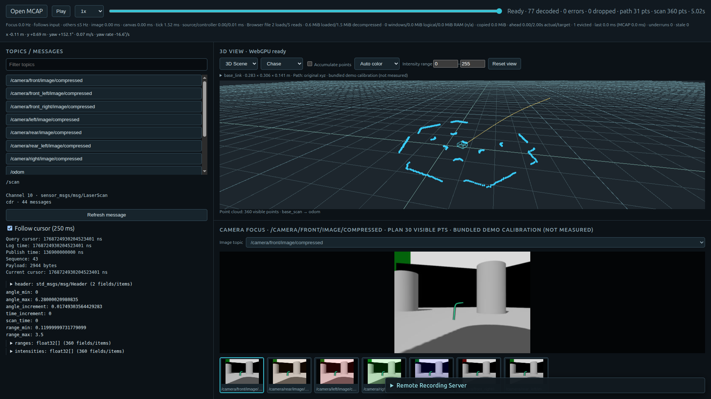
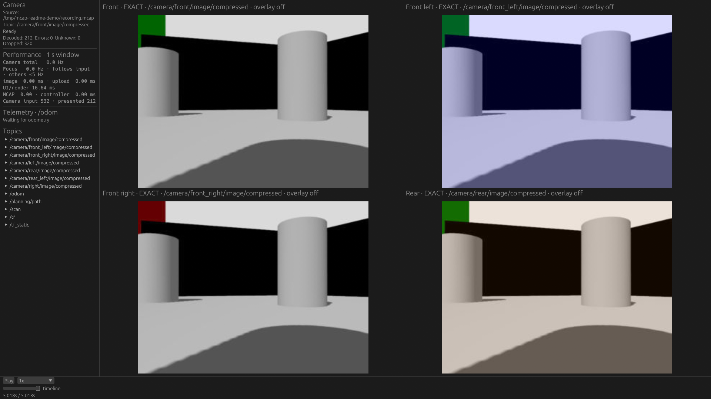
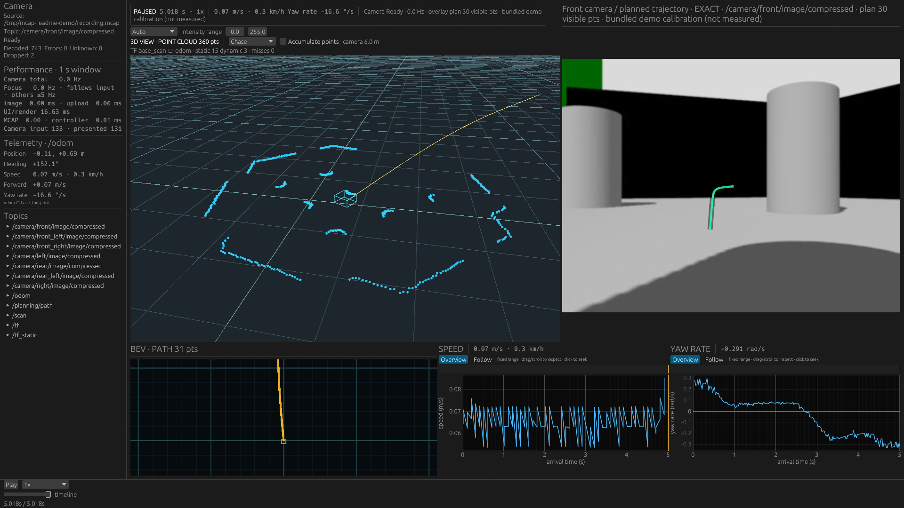
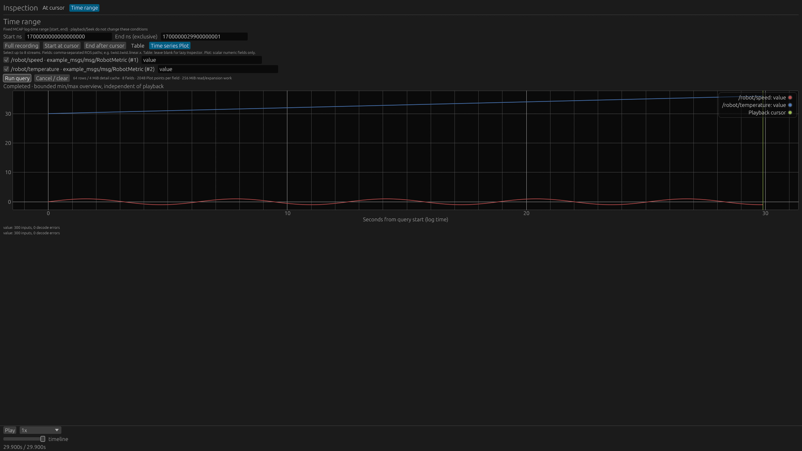

# MCAP Player

ROS 2のMCAPを再生し、カメラ映像・点群・計画経路・Topicの値を同じ時刻で確認するRust製ビューアです。
Nativeアプリとブラウザで利用でき、Recording Server経由のリモート再生とNativeのROS 2 Live入力にも対応します。

大きな記録から表示・解析に必要なトピックと時刻範囲を読み、デコード済みの全履歴を常駐させない設計です。
圧縮Chunk内に複数トピックが混在すると、非表示データを含むChunkの展開が必要になる場合もあります。
性能の特徴と限界は[計測結果](docs/performance/README.md)にまとめています。

[ブラウザ版を開く](https://ryo45.github.io/mcap_player/) · [Nativeで試す](#nativeで試す) · [手持ちの記録を開く](#手持ちの記録を開く) · [対応範囲と制約](#対応範囲と制約)

## どんな画面で使えるか

**Native — 左にTopics / Inspector、右に3D SceneとCamera**



**ブラウザ — ローカルMCAPを選択して同じ配置で確認**



いずれも同梱のシミュレーション由来データを使った実画面です。水色はLaserScan、黄色は計画経路、緑色はCamera overlay。
Pathは生成データ、Camera calibrationはデモ値です。[再現手順](docs/screenshots.md)を公開しています。

Nativeには用途別レイアウトもあります。

| 複数カメラを一覧する | 映像・空間・動きを照合する | Topicの値と時系列を調べる |
| --- | --- | --- |
|  |  |  |
| `--layout cameras` | `--layout navigation` | `--layout inspection --inspect-topic /scan` |

複数カメラのデモは同じ元映像の色違いで、異なる実視点ではありません。
各画面の目的・入力トピック・大きい画像は[レイアウトギャラリー](docs/layout_gallery.md)を参照してください。

## Nativeで試す

Rust **1.91.1**でビルド・検証しています。**通常の記録再生にDocker・ROS 2・Trunkは不要です。**
先にC/C++・CMake・NASMとGUI関連の[ビルド依存を導入](docs/building.md#nativeのビルド依存)してください。
以下はリポジトリのルートで実行します。

```sh
GIT_LFS_SKIP_SMUDGE=1 git clone https://github.com/Ryo45/mcap_player.git
cd mcap_player
cargo build --release
./target/release/viewer-native --layout monitor
```

`cargo run --release -- --layout monitor`でもビルド・起動できます。
通常の`cargo build`も使えますが、性能を評価する際は`--release`を使用してください。
同梱の約5秒の記録を再生し、再生・停止・Seek、Cameraのトピック切り替えを試せます。
起動にもリポジトリのルートを使い、GUIとGPUドライバーが利用できる環境で実行してください。
[OS依存パッケージ・ビルド対象・初回ビルドについて](docs/building.md)も参照できます。

## ブラウザで試す

[GitHub PagesのWeb版](https://ryo45.github.io/mcap_player/)を開き、**Open MCAP**から手持ちのMCAPを選びます。インストールは不要です。
記録をアップロードせず、ブラウザ内で必要な範囲を読みます。Linux上のChrome / WebGPUで動作確認しています。
自分の環境で起動する場合は[Webのビルド手順](docs/building.md#webをホストで起動する)、配信の仕組みは[GitHub Pages公開](docs/github_pages.md)を参照してください。

## 手持ちの記録を開く

```sh
./target/release/viewer-native --mcap /path/to/recording.mcap \
  --layout monitor --no-platform-geometry
```

Nativeではファイルや分割MCAPのディレクトリをウィンドウへドロップすることもできます。
画像トピックはschemaから候補を抽出し、Cameraパネルのプルダウンで選べます。
**Path・Odometry・PointCloud・TFのトピック名も、JSONで指定でき、再ビルドは不要です。**
[入力設定ガイド](docs/recording_usage.md)にJSONの例、点群の座標系、Inspector / Plotの使い方をまとめています。

同梱の車体はTurtleBot3 Waffle Piです。別の機体では上の例のように非表示にするか、実際のgeometryを指定します。
Sceneは **1.0 = 1 metre**。[車体形状・TF・Camera calibration](docs/physical_geometry.md)も記録に合わせて設定できます。

## 対応範囲と制約

| 機能 | Native | ブラウザ |
| --- | --- | --- |
| 索引付きMCAPの再生・Seek | 単一ファイル・分割ディレクトリ | 単一ファイル・Recording Server |
| Camera / Scene / BEV / Inspector | 対応 | 対応 |
| 数値Plot・Topic Health・Diagnostics | 対応 | 未対応 |
| Preview / bookmarks・用途別レイアウト | 対応 | 未対応 |
| ROS 2 Live | 対応 | 未対応 |

- **索引付きMCAPが必要です。** 非索引記録は[明示的に変換](docs/fastwrite.md)します。自動の全走査は行いません。
- JPEG / PNG・Raw Image、LaserScan / PointCloud2に対応。深度画像・H.264/H.265は未対応です。
- 同梱Camera calibrationはデモ値です。実カメラの投影には対応する校正が必要です。
- 巨大Chunkや高解像度画像では、一時メモリやSeek遅延が増えます。

[対応形式・入力上限の詳細](docs/recording_usage.md#対応範囲と制約)と[Native / Webの差分](docs/native_web_parity.md)を参照してください。

## 詳細ドキュメント

- [入力設定・トピック名・座標系](docs/recording_usage.md)
- [Recording Server](docs/filesystem_recording_server.md) — LAN上の記録をWebから再生。TLS・認証は提供しません。
- [ROS 2 Live](docs/ros2_live.md)
- [性能検証](docs/performance/README.md)
- [ビルド・開発・拡張機構を含むドキュメント一覧](docs/README.md)

## ライセンス

[MIT License](LICENSE)
