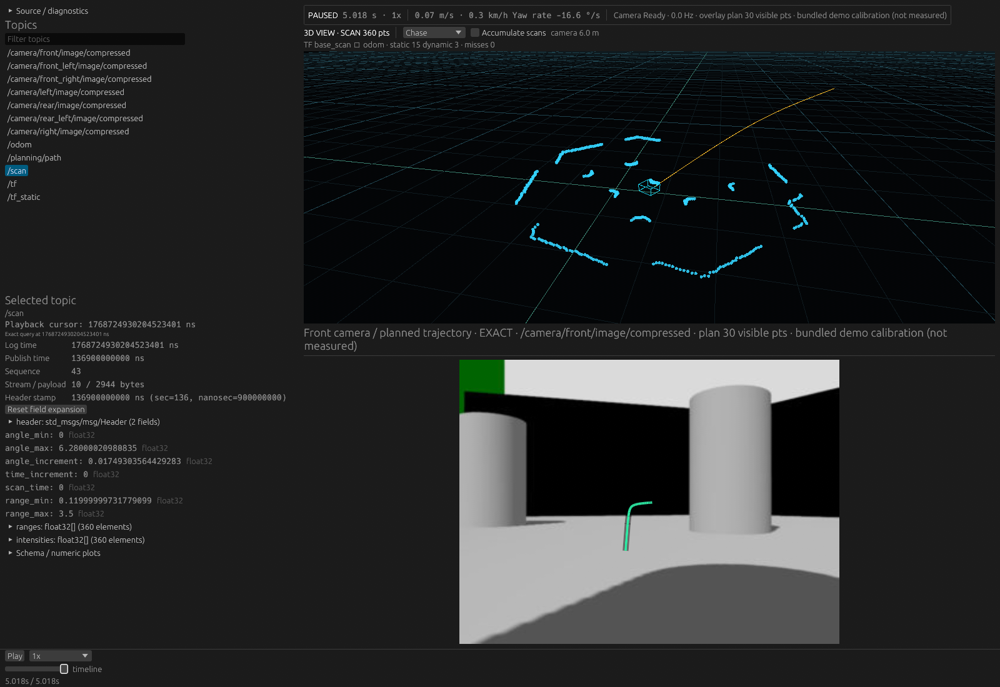
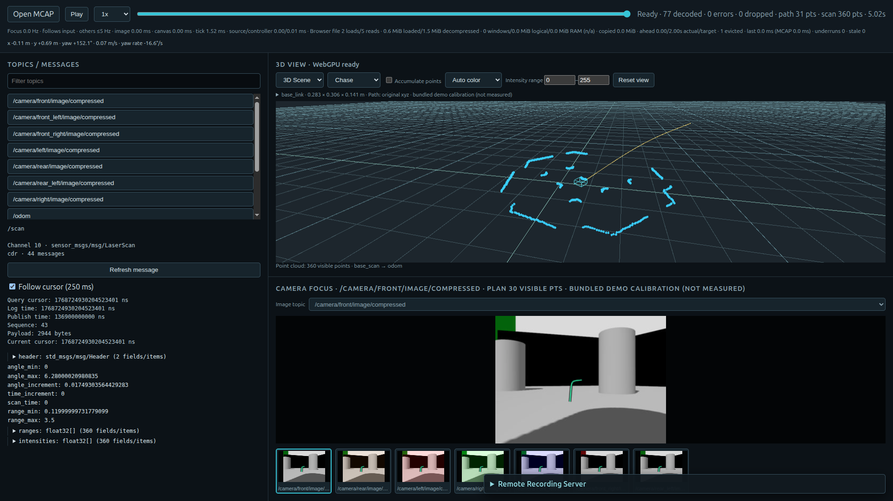
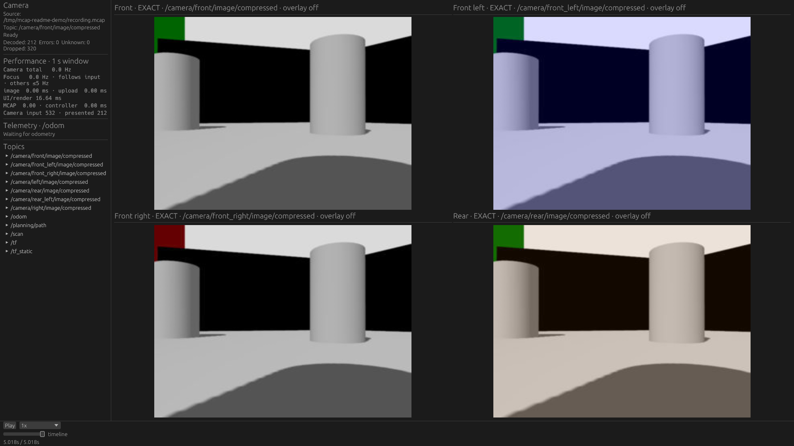
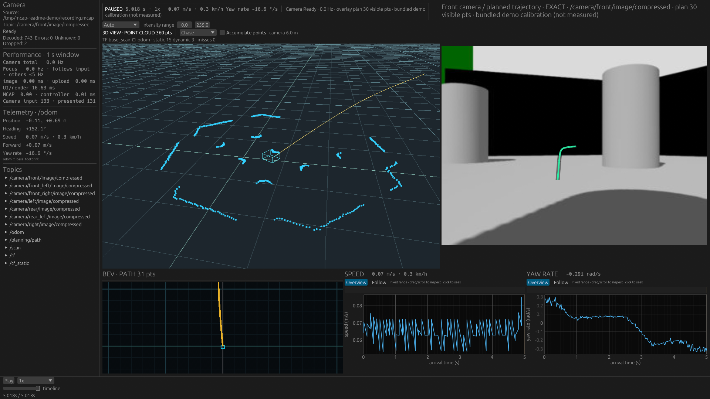
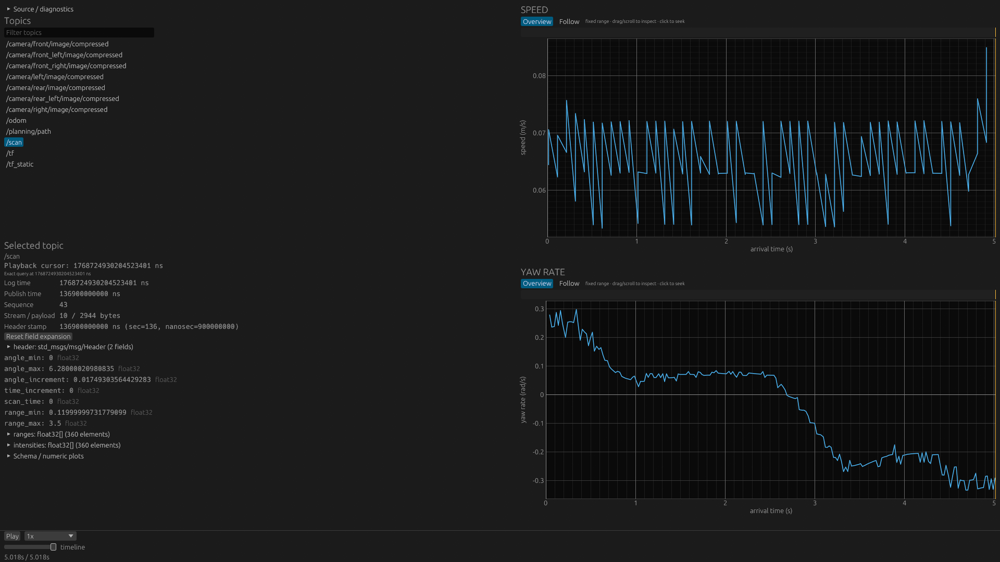

# MCAP Player

ROS 2のMCAPを再生し、カメラ映像・点群・計画経路・Topicの値を同じ時刻で確認するRust製ビューアです。
Nativeアプリとブラウザで利用でき、Recording Server経由のリモート再生とNativeのROS 2 Live入力にも対応します。

大きな記録から表示・解析に必要なトピックと時刻範囲を読み、デコード済みの全履歴を常駐させない設計です。
圧縮Chunk内に複数トピックが混在すると、非表示データを含むChunkの展開が必要になる場合もあります。
性能の特徴と限界は[計測結果](docs/performance/README.md)にまとめています。

[Nativeで試す](#nativeで試す) · [ブラウザで試す](#ブラウザで試す) · [手持ちの記録を開く](#手持ちの記録を開く) · [対応範囲と制約](#対応範囲と制約)

## どんな画面で使えるか

**Native — 左にTopics / Inspector、右に3D SceneとCamera**



**ブラウザ — ローカルMCAPを選択して同じ配置で確認**



いずれも同梱のシミュレーション由来データを使った実画面です。水色はLaserScan、黄色は計画経路、緑色はCamera overlay。
Pathは生成データ、Camera calibrationはデモ値です。[再現手順](docs/screenshots.md)を公開しています。

Nativeには用途別レイアウトもあります。

| 複数カメラを一覧する | 映像・空間・動きを照合する | Topicの値と時系列を調べる |
| --- | --- | --- |
|  |  |  |
| `--layout cameras` | `--layout navigation` | `--layout inspection --inspect-topic /scan` |

複数カメラのデモは同じ元映像の色違いで、異なる実視点ではありません。
各画面の目的・入力トピック・大きい画像は[レイアウトギャラリー](docs/layout_gallery.md)を参照してください。

## Nativeで試す

以下のコマンドはリポジトリのルートで実行します。
Rust **1.91.1**でビルド・検証しています。通常の記録再生にROS 2のインストールは不要です。
NativeのビルドにはC/C++ツールチェーン、CMake、NASM、pkg-configが必要です。
LinuxのGUI関連パッケージを含む環境例は[Docker開発環境](docs/development_container.md)と[Dockerfile](docker/Dockerfile)を参照してください。
Dockerの既定サービスはビルド・テスト用で、Native GUI/GPUのホスト接続は別設定です。

```sh
GIT_LFS_SKIP_SMUDGE=1 git clone https://github.com/Ryo45/mcap_player.git
cd mcap_player
cargo run --release -p viewer-native -- --layout monitor
```

同梱の約5秒の記録を再生します。再生・停止・Seekを操作し、Cameraパネルのプルダウンから画像トピックを選べます。
Inspectorまでスクリーンショットと同じ状態で試すには、依存schemaを補完した[撮影用デモ](docs/screenshots.md)を生成してください。
初回ビルドには時間がかかります。性能を評価する際は`--release`を使用してください。
任意の計測成果物は取得せずにビルドできます。[成果物の保存・取得方針](docs/repository-storage/README.md)を参照してください。既存履歴のLFS移行はまだ実施していません。

## ブラウザで試す

ローカル起動には、Rust・WASM用clang・Trunkを揃えたDocker環境を使えます。

```sh
docker compose build dev
docker compose run --rm --service-ports dev bash -lc \
  'cd apps/viewer-web && trunk serve --release --address 0.0.0.0'
```

`http://localhost:8080`を開き、**Open MCAP**からファイルを選択します。
Browser Localでは記録をサーバーへアップロードせず、ブラウザ内で必要な範囲を読みます。
Cameraのない記録も開けます。動作確認にはLinux上のChrome / WebGPUを使用しています。

ホスト側にツールが揃っている場合は、次の手順でも起動できます。

```sh
rustup target add wasm32-unknown-unknown
# clang-18を用意したLinux環境の例
export CC_wasm32_unknown_unknown=clang-18
export CXX_wasm32_unknown_unknown=clang++-18
cargo install trunk --locked --version 0.21.14
(cd apps/viewer-web && trunk serve --release)
```

WebはTopics / Inspector・Scene / BEV・Cameraの固定配置です。
Plot、Preview、bookmarks、用途別レイアウトは現在Nativeのみです。

## 手持ちの記録を開く

### カメラ・Scene・Topicの値を一緒に見る

```sh
cargo run --release -p viewer-native -- \
  --mcap /path/to/recording.mcap --layout monitor --no-platform-geometry
```

ファイルや分割MCAPのディレクトリを、Nativeのウィンドウへドロップして開くこともできます。
分割入力はディレクトリ直下の`.mcap`を1本のlog-time軸として扱います。

**画像トピック名をコードに合わせる必要はありません。**
`Image` / `CompressedImage`のschemaとCDR encodingから候補を抽出し、Cameraのプルダウンで切り替えられます。
Nativeの複数パネルはそれぞれ独立して選択できます。
`--camera-topic TOPIC`は初期カメラの希望値で、固定パネルの設定を一括置換する引数ではありません。
[選択・フォーカス・プレビューの動作](docs/camera_topic_selection.md)を参照してください。

同梱の車体形状はTurtleBot3 Waffle Piです。ほかの機体では上記のように非表示にするか、
`--platform-geometry FILE.json`で実際の形状を指定します。Sceneは **1.0 = 1 metre** を維持します。

### 点群のトピックや座標系を合わせる

```sh
cargo run --release -p viewer-native -- \
  --mcap /path/to/recording.mcap --layout scene \
  --point-cloud-topic /points --fixed-frame lidar --no-platform-geometry
```

`/points`と`lidar`は、記録内の実際のトピック名・frame名に置き換えてください。
表示先frameが入力frameと異なる場合は、それらを結ぶTFが必要です。
SceneではAuto / Solid / RGB・RGBA / Intensityを選び、強度範囲も変更できます。
Webではファイルを開く前にSceneの設定でPoint cloud topicとWorld frameを指定します。
[PointCloud2の対応形式と上限](docs/point_cloud2.md)を参照してください。

### Topicの中身とグラフを調べる

CameraやSceneが不要な記録には、`--layout explore`が使えます。
Topicsから対象を選ぶと、現在のMCAP log time以前の最新メッセージをInspectorで確認できます。
配列はページ単位で表示し、Nativeではnumeric fieldの「+」から概要Plotを追加できます。
InspectorやPlotで対象を選んでも、Cameraなどのcontinuous playback対象は増えません。

ほかに`health`（到着周期・Diagnostics）、`inspection`（Inspector・速度/ヨーレート）があります。
引数なしの既定レイアウトは`standard`です。`standard` / `navigation`などはデモ用のPath・Odometry等を要求するため、
手持ちの記録の入口には、利用可能なScene入力を使う`monitor`か、query中心の`explore`を勧めます。

### Path・TF・Camera overlayを合わせる

| 入力 | 既定値・変更方法 |
| --- | --- |
| Camera | schemaから検出し、パネルで選択 |
| LaserScan / PointCloud2 | `/scan`。Nativeは`--point-cloud-topic`、WebはScene設定で変更 |
| 表示先frame | `odom`。Nativeは`--fixed-frame`、WebはWorld frameで変更 |
| Path | `/planning/path` |
| Odometry | `/odom` |
| 動的TF / 静的TF | `/tf` / `/tf_static` |

Path・Odometry・PointCloud・TFのトピック名は、[workspace bindings](config/workspace_bindings.json)と同じ形式のJSONを実行時に指定できます。再ビルドは不要です。

```sh
cargo run -p viewer-native --release -- \
  --mcap recording.mcap --layout monitor --workspace-bindings my_robot.json
# ROS 2 Liveでも起動時に指定できます（購読の実行中切り替えは行いません）。
cargo run -p viewer-native --release --features ros2-live -- \
  --live --workspace-bindings my_robot.json
```

```json
{
  "pathTopic": "/planning/path",
  "odometryTopic": "/odom",
  "pointCloudTopic": "/scan",
  "dynamicTfTopic": "/tf",
  "staticTfTopic": "/tf_static"
}
```

Nativeの優先順位は、明示的な`--point-cloud-topic` > 外部JSON > 同梱デフォルトです。
外部JSONは5項目すべて指定してください。未知キー・欠落項目・空文字などの不備は起動エラーになります。

Webでは **Open MCAPの隣のWorkspace bindings JSON** で先にファイルを選択し、valid表示を確認してから記録を開きます。
Browser LocalとRecording Serverの両方で利用でき、JSONはブラウザ内で処理されます。サーバーへのアップロードや追加APIは不要です。
Scene設定のPoint cloud topic欄は、**空欄ならJSONの値**を使い、入力した場合だけJSONを上書きします。
設定未指定時は従来のデフォルトを使います。エラー中・読み込み中は新しい記録を開けません。
訂正したJSONを選ぶか、Use bundled bindingsで明示的に同梱設定へ戻してください。PointCloud欄の手入力は引き続き優先され、空欄にするとJSON／同梱値へ戻ります。
設定は次に開く記録に適用され、開いているセッションには反映しません。Camera切り替えやSeekでも、そのセッションの設定を維持します。
JSONはUTF-8・16 KiB以下、トピック名は1〜1024バイトで空白・制御文字を含めないでください。
実際のtopic/schemaの解決は既存の必須・任意入力ルールに従い、自動推定は行いません。[Native／Web Local／Remoteの検証結果](docs/verification/workspace-bindings/README.md)を参照してください。
レイアウトの配置も同梱presetで、外部JSONの実行時load/saveやGUIでの配置編集は未対応です。

Camera overlayにはPath・TF・実カメラに対応したcalibrationが必要です。
同梱のcalibrationはデモ値で、別カメラの実測値としては使えません。
Nativeは`--camera-calibration FILE.json`、WebはScene設定のCamera calibration JSONから読み込みます。
[物理geometry・座標系・ground frame](docs/physical_geometry.md)に設定例をまとめています。

## 対応範囲と制約

| 項目 | Native | Browser Local | Recording Server → Web |
| --- | --- | --- | --- |
| 索引付きMCAP | 単一ファイル・分割ディレクトリ | 単一ファイル | 設定した単一ファイル |
| MCAP圧縮 | 非圧縮・Zstd・LZ4 | 非圧縮・Zstd・LZ4 | 非圧縮・Zstd |
| Camera / Scene / BEV / Inspector | 対応 | 対応 | 対応 |
| 数値Plot・Topic Health・Diagnostics | 対応 | 未対応 | 未対応 |
| Preview / bookmarks | 対応 | 未対応 | 未対応 |
| ROS 2 Live | 対応 | 未対応 | 未対応 |

- **索引が必要です。** Summary・Chunk Index・選択streamのMessage Indexがない場合はエラーを表示します。
  巨大ファイルを黙って全走査することはありません。rosbag2 fastwriteなどは[明示的な変換](docs/fastwrite.md)を行ってください。
- CameraはJPEG / PNGの`CompressedImage`と、`rgb8 / bgr8 / rgba8 / bgra8 / mono8`のRaw `Image`に対応します。
  16bit・深度画像・compressedDepth・H.264/H.265は未対応です。
- Inspectorとnumeric field PlotはROS 2 plain CDRと完全なros2msg依存定義を使います。
  schemaが不足・未対応の場合はメタデータと理由を表示します。
- PointCloud2は記録入力に対応します。Liveの点群入力はLaserScanです。
- Nativeの画像Previewは任意の追加sidecarです。なくても再生・exact Seekは使えます。
  **旧schema 1のsidecarは現在のpreview-builderで再生成が必要です。** 分割記録全体のPreview生成は未対応です。
- 大きなChunkや高解像度画像は、展開時間・一時メモリ・Seek遅延に影響します。入力経路ごとに読み込み・保持・query上限があります。
  すべての記録で一定のFPSやメモリ量を保証するものではありません。

対応差分の詳細は[Native / Web一覧](docs/native_web_parity.md)、分割MCAPの制約は[入力互換性](docs/issue/015-split-mcap-and-web-lz4/README.md)を参照してください。

## Recording Serverを使う

LAN上の記録をブラウザから開く場合に使用します。

```sh
cp config/recording-server.toml.example config/recording-server.toml
# MCAPの絶対パスと、実際にブラウザを開くOriginを設定
cargo run --release -p recording-server -- --config config/recording-server.toml
```

Web画面のRemote Recording Serverを開き、サーバーURL（既定は`http://localhost:8081`）へ接続します。
サーバーは信頼できるLAN向けで、TLS・認証は提供しません。
パス・Origin・リクエスト/Chunk上限は[サーバーの設定](docs/filesystem_recording_server.md)を参照してください。

## ROS 2 Live入力を使う

ROS 2 Jazzyの環境で`ros2-live`を有効にします。画像形式は起動時に指定します。

```sh
source /opt/ros/jazzy/setup.bash
cargo run --release -p viewer-native --features ros2-live -- \
  --live --layout standard --camera-topic /camera/front/image/compressed

# Raw Imageの場合
cargo run --release -p viewer-native --features ros2-live -- \
  --live --layout standard --live-raw-camera-topic /camera/image_raw
```

Raw topicは複数指定でき、CompressedImageと混在できます。既定QoSはbest effort / volatileで、`--reliable`も指定できます。
プルダウンの切り替えは購読済み画像の範囲です。ROSグラフからの追加発見・動的な購読変更、LiveのGeneric Inspectorは未対応です。
[Live入力の検証](docs/verification/2026-10-21-camera-formats/raw-live.md)と[fixtureツール](tools/ros-fixture/README.md)を参照してください。

## 性能検証・開発資料

性能は圧縮方式、Chunk構成、選択トピック、画像形式、記録長、Seekの条件を変えて評価しています。
比較対象と表示内容を揃えた測定、成功・失敗例、リソース上限を記録しています。

- [性能検証の入口](docs/performance/README.md) / [継続性能計測の実行方法](tools/performance-probe/README.md)
- [Lichtblick Desktopとの表示パターン別比較](docs/performance/2026-10-20-desktop-workloads/README.md)
- [Webの巨大Chunk・20GiB単一Chunkの境界試験](docs/performance/2026-10-24-web-chunk-streaming/README.md)
- [画像トピック選択・Preview修正の最終検証](docs/verification/2026-10-27-camera-focus-followup/README.md)
- [アーキテクチャ](docs/message_centric_architecture.md) / [module構成](docs/module_structure.md)
- [Native JPEG](docs/native_jpeg.md) / [Web画像処理](docs/web_jpeg.md) / [Native health panels](docs/native_recording_health.md)

[Docker開発環境](docs/development_container.md)から、ビルド・テスト一式を実行できます。

```sh
docker compose build dev
docker compose run --rm dev mcap-dev-check
```

fmt、workspace Clippy、workspace tests、WASM check、Web release build、ROS Live testsを実行します。
通常のホスト環境では、まず`cargo fmt --all -- --check`と`cargo test --workspace`を利用してください。

## ライセンス

[MIT License](LICENSE)
