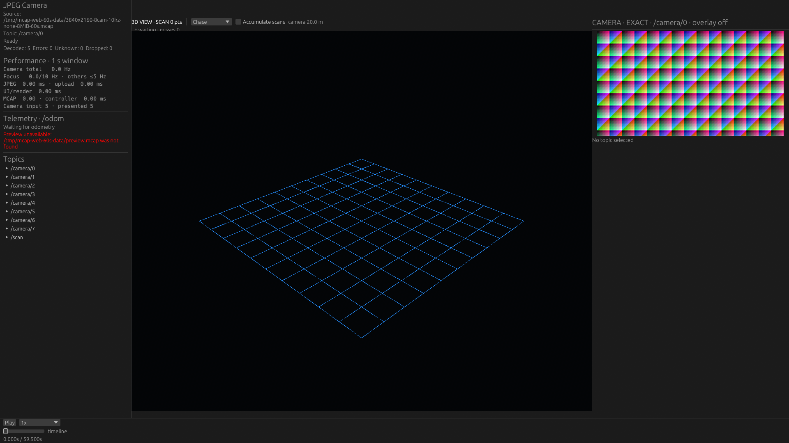
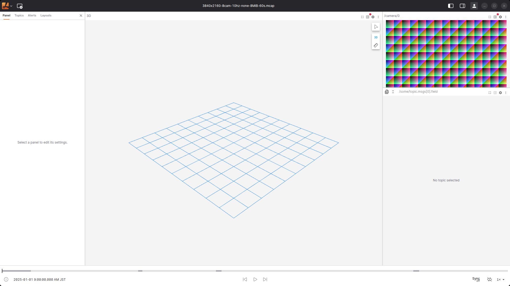
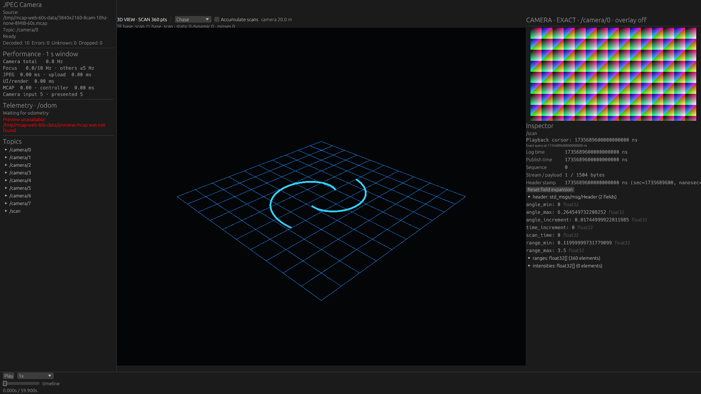
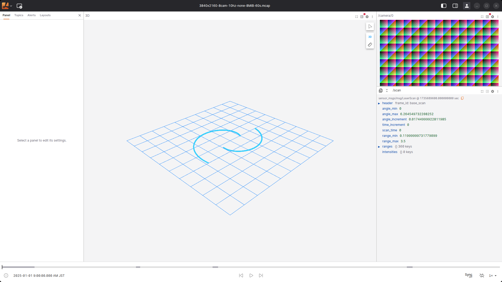

# Desktop: Lichtblickのデフォルト構成に表示内容を合わせる

**訂正: CPU・PSSの比較は無効です。** 当時のprocess_sampleはLinuxのmain threadのchildrenだけを辿り、Electronのrenderer / utilityを取りこぼしていました。保存された値は全アプリの資源量ではありません。以下のCPU・PSSに基づく比較と結論を撤回します。元データは監査用に残し、[修正した計測](../2026-10-20-desktop-workloads/README.md)で取り直します。画素観測と入力・GPU選択の記録とは区別してください。

2026-10-20。NativeとLichtblick Desktop 1.29.1について、「何を表示するか」を明示した比較。カメラだけの前回測定と区別し、3D・Image・Raw Messagesの同じ配置を出発点にする。目的は各製品の総合順位ではなく、表示内容による負荷の違いを調べること。

## 結果

各条件3反復の中央値。P95はrunごとのP95の中央値で、全sampleをpoolしたP95ではない。CPU・PSSの旧値は比較から除外した。

| 表示  |  app  |  画像更新 Hz  |  画像の遅れ 中央値 / P95 ms |
|---|---|---:|---:|
| default  |  Native  |  9.86  |  136 / 167 |
| default  |  Lichtblick  |  9.86  |  114 / 166 |
| + Scan  |  Native  |  9.86  |  155 / 167 |
| + Scan  |  Lichtblick  |  9.86  |  107 / 165 |
| + Scan + Raw  |  Native  |  9.86  |  154 / 168 |
| + Scan + Raw  |  Lichtblick  |  9.94  |  106 / 163 |

- **この表示内容では双方が約10 Hzに追従する。** Scan追加時のScene画素変化も約9.94〜9.95 Hz。Nativeの大幅な速度優位は確認できない。
- Nativeの画像lag中央値は大きいが、P95は両アプリとも約163〜168 ms。Lichtblickのlag中央値にはrun間で約50 msの変動があり、観測粒度や再生開始位相も含む。数十ms差をそのままcodec速度の差とは扱わない。

18試行すべて成功。72回のSeekで期待画像を確認し、Nativeの36回はtextureの絶対log timeもpredecessorと一致した。画像識別は4320/4320 sampleで成功、識別済みsampleの最大gapは104.3 ms。Rawのtimestampは両アプリ・全反復で単調に前進した。観測処理の中央値はrunにより4.3〜6.4 ms、P95は8.7〜18.4 ms。記録全60秒の連続再生、巨大PointCloud、Zstd、大Chunk、8カメラ同時表示の検証へは一般化しない。

[全指標](summary.md)、[反復別の値・範囲と追加検証](summary.json)、[実行順](manifest.json)、[binaryとscriptの識別情報](environment.json)を保存した。製品Rustコードは変更せず、測定専用releaseビルド、Python compile、18回の実機end-to-end、Scan投影検査、patch適用可能性と製品ソース復元を確認した。製品変更がないためworkspace全テストの再実行はしていない。終了後は専用process/windowの消滅を確認し、locked/idleのままの画面電源を開始前のOffへ戻した（[cleanup](cleanup.json)）。

次の比較を増やすなら、Rawの配列展開有無、実データの大きいPointCloud、画像表示面積をそれぞれ独立に変える。この360点Scan・配列を閉じたRawは軽い表示条件であり、「3Dあり」の一語で高負荷画面を代表させない。前回の960×540画像測定とはNativeのcadence、viewport、測定負荷も異なるため、表示サイズ変更だけのA/B比較には使わない。

## 比較スクリーンショット

両アプリとも先頭0秒へ戻した、計測直前の実ウィンドウ。1920×1080のcontent全体を撮影し、Electronの枠・影だけを除く。画像・Scan・Rawの同じ時刻を比較できる。背景色、文字、metadata、sidebar等は各アプリのまま。

デフォルト相当（grid + Image、Raw未選択）:

| Native | Lichtblick Desktopの初期表示 |
|---|---|
|  |  |

Scan + Raw Messagesを追加した構成:

| Native | Lichtblick Desktop |
|---|---|
|  |  |

校正時3.11秒の両画面も保存する。既知の360点を同じcameraで投影し、それぞれの位置の±3 px以内にcyan画素が360/360か所あることを[検証](scan-projection.json)した。これはScanと視点の一致を確かめる検査で、全画面のpixel equalityや全再生フレームの時刻検証ではない。

## 条件

| case | 3D | Image | Raw Messages / Inspector | 選択トピック |
|---|---|---|---|---|
| default  |  gridのみ  |  `/camera/0` |
| scan | grid + `/scan` 360点 | 同上 | 未選択 | `/camera/0`, `/scan` |
| raw | 同上 | 同上 | `/scan` の最新メッセージ、配列は閉じる | 同上 |

`default` のLichtblickは新規専用プロファイルの初期レイアウトをそのまま使い、layout JSONをimportしない。3D panelがあることとScanを表示することは異なる。実際に購読するrecording内トピックをReact storeから監査し、defaultは画像1台だけ、残り2条件でのみScanが選択されることを要求した。NativeでもSessionPlanの選択を記録する。

Lichtblickの初期構成は左70%が3D、右30%の上30%がImage、下70%がRaw Messages。Nativeには測定専用patchで対応する配置とviewportを与える。これは製品Nativeの未加工デフォルトUIの測定ではない。

- アプリ内容領域1920×1080、DPR=1。Electronは枠・影を含むX11 windowを1952×1122にし、`_GTK_FRAME_EXTENTS`で補正する。Nativeは1920×1080。
- 3D viewport1120×926、Image canvas480×255、実画像453⅓×255。画像はcontainで表示し、観測には内側449×251を使う。FHDのアプリ画面だが、**画像単体をFHDで表示する実験ではない**。
- 3Dは10×10 mのgrid、間隔1 m、視点距離20 m、仰角30°、垂直FOV45°、near0.5 m / far5000 m。同じ360点のScanを同じ視点で描く。物理geometryの倍率補正はしない。
- scan/rawのLichtblickはScanを有効にし、点5 px・円・単色cyan・decay0へ設定。余分なTF軸とラベルは非表示。Nativeの既存点描画に合わせる。これら2条件は初期設定そのままとは扱わない。
- Rawは同じLaserScanのscalarとheader/ranges/intensitiesの閉じた枝を表示する。Nativeはmetadata/型表示、Lichtblickはinline previewを持ち、UI全体は画素単位で同一ではない。
- NativeのSource/diagnostics sidebarとLichtblickの空のpanel設定sidebarは異なる。grid描画はNativeが各線を分節し、Lichtblickが長い線で描く差を残す。UI・rendererの実装を同じアルゴリズムへ置き換える比較ではない。

入力は前回と同じ14,944,878,140 bytesの60秒記録。3840×2160 JPEG quality85、8 camera×10 Hz、LaserScan360点×10 Hz、MCAP圧縮なし・mixed・目標8 MiB Chunk。同時表示はカメラ1台であり、8台同時表示の限界を測っていない。Path、TF、車体、overlay、thumbnail、Plotは表示しない。

RTX5070Ti / NVIDIA610.57.04、Nativeはwgpu/Vulkan、LichtblickはElectron/ANGLE/OpenGL。X11 `:1`、2560×1440 / 約60 Hzの共有ホスト。DPMS Onを前後に確認し、ロックは解除しない。他用途のGPUプロセスは止めない。各run前に入力SHA256を読むcache-allowed条件であり、cold I/O測定ではない。

## 観測方法と限界

各case/appを新しいプロセス・専用profileで3反復、反復ごとにアプリ順を交替。連続再生は各12秒。各runの前に25.31 / 48.71 / 16.11 / 0秒へSeekし、期待する画像を画素で確認する。起動・オープンは測定区間外。操作はNativeの既存UI action handler / Lichtblickの時刻入力componentへ注入するため、通常のマウス操作全体のレイテンシーではない。

小さい表示画像では縮小フィルタの差が大きいため、事前校正で**アプリごとに実表示した32枚の参照画像**を採取する。Nativeはtextureの絶対log time、Lichtblickは校正時だけcreateImageBitmapへ渡るJPEGのSHA256を検証する。全参照が相互に識別可能であることを確認する。JPEGハッシュ計算・Scan draw hookは校正だけに入れ、主計測には入れない。

主計測はXGetImageで画像内88か所の5×5 patchを20 Hz目標で観測する。平均絶対誤差18未満、次候補との差1超を採用し、95%以上の識別成功・最大gap1.5秒未満・前進差分16以下を要求する。32枚は3.2秒周期で繰り返すので画素だけでは絶対時刻の一意性を証明しない。大きな時刻飛びに耐える鮮度証明には一意な画像内frame IDが必要。

画像Hzは識別できた変化の下限。遅れは`Play指示からのwall time − 画像の相対log time`で、最初の1秒を除く。撮像からdisplay走査までの遅延ではなく、観測周期は約50 ms。SceneのCRC変化も実画素の変化の下限で、GPU FPSやScanの絶対時刻ではない。defaultではSceneが静止、scan/rawでは4 Hz以上の画素変化を要求する。

Rawのtimestampも記録する。ただしNativeのcursorログは100 ms bucketが変わるときに出し、Lichtblickは観測時のcursorを読む。Native側のRaw lagは最大約100 ms過小評価し得るため、アプリ間のRaw鮮度順位には使わない。Nativeは既存exact latest-before query、Lichtblickはstream subscriptionを維持し、その処理負荷の差も結果に含める。

PSS / CPUは全子プロセスを含む意図だったが、renderer等を取りこぼしていたため比較に使わない。当時の設計は、約250 ms周期のPSS最大値を報告する。CPUは1 core=100%。観測用Python、X server、compositor、GPU VRAMは含まない。PSS2 GiBの停止ガードを持つ。SceneのXGetImage自体もGPU readback・観測負荷を加える。各sampleのobserver_work_msを保存し、無観測の製品性能とは区別する。

Nativeは既存TurboJPEGの表示サイズに応じたIDCT縮小を使い、この寸法では480×270へdecodeする。Lichtblickの既存ImageModeはresizeWidth未指定でcreateImageBitmapへ渡す。**同じ表示領域でもdecode解像度・縮小画質は同一ではない**。CPU/PSS差をMCAPの選択読み込みだけの効果とは結論しない。Lichtblickは配布版の起動制約から`--no-sandbox`を使う。

## 再現

基準commitは`8b1bfd7`。製品Rustソースの変更は残さず、[native-measurement.patch](native-measurement.patch)を適用した測定専用binaryを使う。patchはlayout/viewport/viewの設定、default時のScan未選択、未選択Inspector、操作注入、選択・cursor・texture・Inspector時刻のログを含む。I/O、JPEG、worker、admission、query、cacheのアルゴリズムを置き換えない。追加のファイル読取・ログ出力の負荷はある。

```bash
# Prefer an isolated checkout. Build the measurement binary, then restore sources.
git apply docs/performance/2026-10-20-desktop-default-layout/native-measurement.patch
docker compose run --rm dev bash -lc \
  'cargo build --release -p viewer-native --locked && mkdir -p target/gpu-native && cp /home/dev/target/release/viewer-native target/gpu-native/viewer-native-default-layout'
git apply -R docs/performance/2026-10-20-desktop-default-layout/native-measurement.patch

# Extract the 32 source JPEGs, using the fixture path on this host.
target/release/performance-probe extract-jpeg \
  /tmp/mcap-web-60s-data/3840x2160-8cam-10hz-none-8MiB-60s.mcap \
  /tmp/mcap-gpu-comparison-jpegs /camera/0 32

# Run separately for --app native / lichtblick, with distinct --output directories.
python3 tools/performance-probe/measure_desktop_layout.py \
  --app native --case raw --calibrate --jpeg-dir /tmp/mcap-gpu-comparison-jpegs \
  --data /tmp/mcap-web-60s-data/3840x2160-8cam-10hz-none-8MiB-60s.mcap \
  --output /tmp/native-calibration

python3 tools/performance-probe/run_desktop_layout_comparison.py \
  --data /tmp/mcap-web-60s-data/3840x2160-8cam-10hz-none-8MiB-60s.mcap \
  --native-references /tmp/native-calibration/references.json \
  --lichtblick-references /tmp/lichtblick-calibration/references.json \
  --output /tmp/desktop-layout-results-new
```

PythonはPillow、libX11と既存のCDP helperを使う。binary/data/harness/patch/referenceのSHA256、操作、購読、GPU、DPMS、raw samplesを保存する。通常終了で専用ElectronをBrowser.closeし、残った自分のprocess groupだけを停止する。

Lichtblickの固定sourceは[95713edb309d77589b130286642ab149995a5f7b](https://github.com/lichtblick-suite/lichtblick/tree/95713edb309d77589b130286642ab149995a5f7b)、実行はLinux x64配布版1.29.1。初期layoutは`packages/suite-base/src/providers/CurrentLayoutProvider/defaultLayout.ts`、Scan設定は`panels/ThreeDeeRender/renderables/LaserScans.ts`、購読はMessagePipeline storeを確認した。
