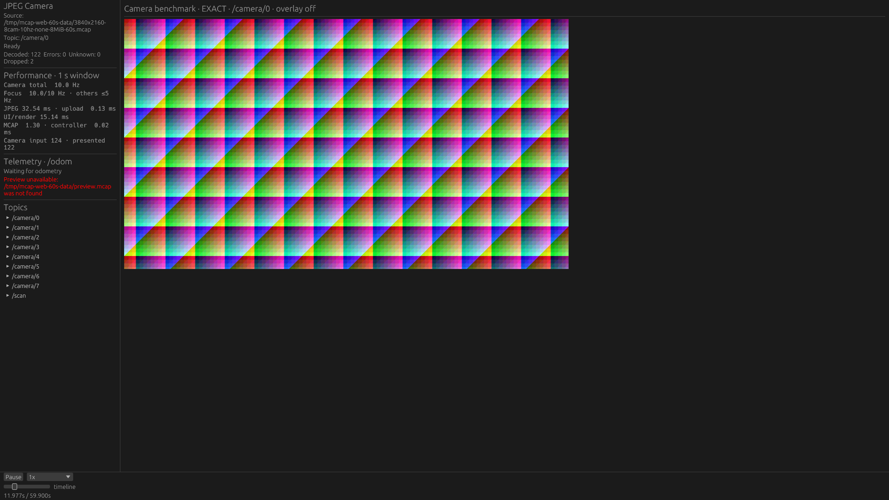
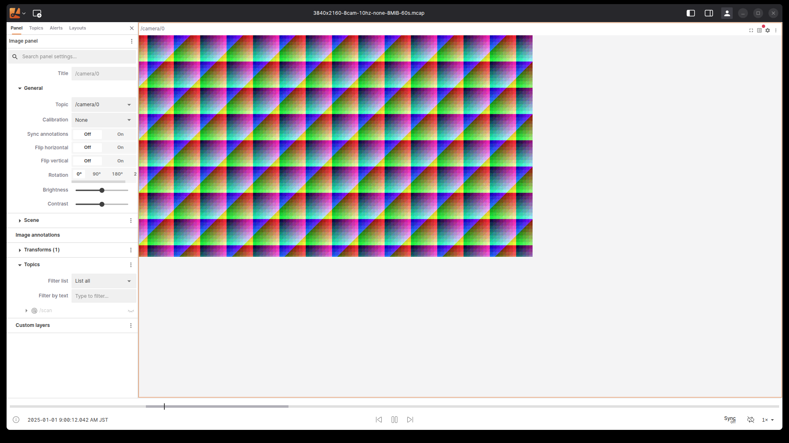

# Native / Lichtblick Desktop: hardware-GPU camera pilot

**訂正: CPU・PSSの比較は無効です。** 当時のprocess_sampleはLinuxのmain threadのchildrenだけを辿り、Electronのrenderer / utilityを取りこぼしていました。保存された値は全アプリの資源量ではありません。以下のCPU・PSSに基づく比較と結論を撤回します。元データは監査用に残し、[修正した計測](../2026-10-20-desktop-workloads/README.md)で取り直します。画素観測と入力・GPU選択の記録とは区別してください。

2026-10-20. mcap_player Native と Lichtblick Desktop 1.29.1 の、ローカル MCAP からの画像表示を比較する。目的は優劣の証明ではなく、選択したカメラの更新・鮮度と、そのための CPU / 常駐メモリの比較である。

## 結果と判断

12試行すべてで実GPUの選択と画像更新を確認し、計48回のSeek / 先頭復帰で期待するJPEGを確認した。Nativeの24回についてはtextureの絶対log timeも期待するpredecessorと一致した。下表は**約14.94 GB・8カメラ記録から1カメラだけ表示**した条件の3反復中央値である。

| 指標 | Native | Lichtblick Desktop |
|---|---:|---:|
| 画素で観測した更新 Hz（下限） | 9.69 | 9.94 |
| 画像時刻の前進 Hz | 9.85 | 9.94 |
| wall timeに対する画像の遅れ 中央値 / P95 ms | 173 / 220 | 113 / 171 |
| Seek 指示→期待画像 ms | 119 | 128 |

[全条件の集計](summary.md)、[各反復と範囲](summary.json)、[実行順](manifest.json)、[binary / fixture / script識別情報](environment.json)も保存した。P95欄は各runのP95の中央値であり、全サンプルをpoolしたP95ではない。Seekは各条件9回の中央値で、操作注入経路と観測粒度が違うため9 ms差を優劣と扱わない。

- **この条件では両方とも約10 Hzに追従する。** Nativeの大幅な性能優位は確認できない。約14 GBの記録を開いて表示できたが、アプリ全体のメモリ量はこの測定から結論しない。
- 画像を識別できず除外したサンプルは、長いログでNative 2/720、Lichtblick 9/720、短いログでは双方0/720。最大の識別済みサンプル間隔は約104 ms。Nativeの画像時刻の前進と観測更新数の差には、frame skipと観測による取りこぼしの両方が含まれ得る。

H1については「少数表示で大きな記録を扱える」が双方で成立するケースを確認した。全トピック表示との対照がないため、選択による削減率は求められない。圧縮なし / 小ChunkだけなのでH2・H5や1 GiB Chunkの解凍負荷は未検証。H3の長時間安定性、H4のcache / Seekの因果的トレードオフもこの比較だけでは決めない。

次に比較を広げるなら、8カメラ同時表示のfocus / backgroundそれぞれの鮮度、ZstdとChunkサイズ、実写、全期間再生を別軸で追加する。記事向けに絶対的な画像年齢まで主張する場合は、一意な画像内フレームIDのfixtureも必要になる。先に「Nativeが高速」と結論してから条件を探す材料にはしない。

代表画面（再生後。入力は合成テクスチャ）:

| Native | Lichtblick Desktop |
|---|---|
|  |  |

## 比較条件

- 同じホスト、RTX 5070 Ti / NVIDIA 610.57.04。Native は wgpu/Vulkan、Lichtblick は Electron / ANGLE OpenGL。選択されたアダプタと実際のアプリの画素を両方確認する。
- X11 `:1`、2560×1440 / 約60 Hz、DPR=1。アプリの X11 ウィンドウは1920×1080、表示画像は960×540。Electron の影・枠は `_GTK_FRAME_EXTENTS` で補正する。Webコンテンツ領域は1888×1038。
- DPMS On を各試行の前後で確認する。セッションはロックしたまま。ロック解除、画面ロックの無効化、電源設定の変更は行わない。Native / Electron の双方で実ウィンドウの画像更新を観測するが、通常のアンロック済み対話セッションとは異なる条件である。
- `/camera/0` の画像1枚だけを表示する。Scene / Scan / Plot / overlay / thumbnail は対象外。8カメラ記録でも**同時表示は1カメラ**であり、8カメラ表示の容量限界を測った実験ではない。
- 入力は3840×2160 JPEG、10 Hz、quality=85、32種類の決定的なテクスチャを反復する合成ログ。圧縮なし、mixed、目標8 MiB Chunk。実写、Zstd、大きなChunkへ結果を一般化しない。
- 1カメラ・20秒 / 622,973,335 bytes と、8カメラ・60秒 / 14,944,878,140 bytes。両方に360点 / 10 Hzの `/scan` があるが表示しない。後者は約13.92 GiB（14.94 GB）。時間とトピック数が同時に変わるため、それぞれの影響を独立には推定できない。
- 各条件3回、新しいアプリプロセス、Lichtblickは新しい専用プロファイル。反復ごとにアプリの順を入れ替え、同時には起動しない。各試行でファイル全体のSHA256を読んでから開始する cache-allowed 条件であり、cold-storage I/Oの比較ではない。
- 他用途のGPUプロセスが存在する共有ホスト。バックグラウンド処理は停止しない。起動・ビルドを計測区間に重ねない。

## 計測の境界

### 画像更新と鮮度

XGetImageでアプリ自身のウィンドウ内の960×540領域を20 Hz目標で取得する。88か所の5×5領域のRGB平均を、入力JPEGを縮小した32種類の参照と照合する。単なるカーソル前進、描画APIの呼び出し数、内部のpresentedカウンタは画像更新の代用にしない。

候補の平均絶対誤差が18未満、次候補との差が1超のサンプルだけを画像識別に使う。画像切替中など識別が曖昧なサンプルもraw JSONに保存し、除外数を報告する。95%以上が識別でき、連続する識別済みサンプルの間隔が1.5秒未満であることを要求する。32種類の周期を跨ぐ際は前方差分でフレーム番号を復元し、16フレームを超える跳躍を拒否する。テンプレートは3.2秒周期で反復するため、画素だけでは絶対時刻を一意に証明できない。Seekは指示時刻に対応する画素を照合し、再生中のUI状態とNativeのtexture時刻ログを併記する。巨大な時刻飛びを含む汎用の鮮度検証には、画像自体に一意なフレームIDを埋め込んだfixtureが必要になる。

更新Hzは識別できた画像変化の数 / 観測時間であり、表示更新の下限である。20 Hzの観測では全presentationを保証しない。鮮度は `Play指示後のwall time − 画素から得たメッセージの相対log time` とする。ログ時刻を実時間1倍速で追う場合の遅れであり、センサ撮影からディスプレイ走査までの遅延ではない。最初の1秒を除いて中央値 / P95を計算する。観測周期による約50 msの粒度がある。

### Seek

短いログでは0.31 / 1.71 / 4.11秒、長いログでは25.31 / 48.71 / 16.11秒へ移動し、最後に0秒へ戻す。各targetの最新画像が期待するJPEGと一致することを画素で検証する。

開始は既存UI action handlerへの指示、終了は期待する画像を最初に検出した時点。Nativeは計測専用ファイルを描画ループで読み、通常の`apply_frame_actions`経由でSeekする。Lichtblickは既存時刻入力コンポーネントの`onSeek`をCDPから呼ぶ。**OSのクリック入力や通常GUI操作の全体レイテンシーではない**。Nativeのフレーム待ちとファイルポーリング、LichtblickのCDP通信を含む異なる注入経路があり、数ms差のランキングに使わない。画像確認のポーリング目標は10 ms。

起動・ファイルオープン時間は順位付けしない。NativeはCLIでファイルを開き、Lichtblickは起動後にレイアウトとファイル入力を設定するため、同じ開始境界ではない。

### 資源

再生区間12秒についてアプリと子プロセス全体のPSS / CPUを取得する。当初はElectronのrenderer / GPU / utility等も含む意図だったが、実際には取りこぼしがあり、この資源比較は無効である。PSSは約250 ms周期のサンプル最大値であり、OSが記録した厳密なpeakではない。共有メモリを重複加算するsum RSSは比較の主指標にしない。GPU VRAM、X server / compositor、観測用PythonプロセスはPSSに含めない。

再生区間のPSSに2 GiBの停止ガードがある。セットアップには各段階のtimeoutがあり、再生を含むwall-timeも制限する。これは汎用の安全な任意ファイル実行環境ではなく、既知のfixture専用プローブである。

Lichtblickは配布tarballの実行制約のため`--no-sandbox`を使用する。実際の引数は各resultに保存する。両アプリは既存のデコード経路を使う。Nativeは表示領域960×540を既存のTurboJPEG IDCT scalingへ渡し、この入力では1/4サイズを選ぶ。一方、固定したLichtblickのImageModeは`renderable.setImage(image, /*resizeWidth=*/ undefined, ...)`を呼び、圧縮画像を`createImageBitmap`へ渡す。この実装差を揃えるパッチは加えていない。したがって同じ表示サイズでもデコード解像度・縮小フィルタ・画質は同一ではなく、VRAM / CPU差をキャッシュ設計だけの効果へ帰属できない。この実験はJPEG codec単体や同等画質のベンチマークではない。

## 再現

製品Rustコードは変更しない。Nativeには測定用レイアウト・画像領域固定・操作注入・texture時刻ログだけを加えた専用ビルドを使う。[native-measurement.patch](native-measurement.patch)が変更の全量で、読み込み・admission・JPEG worker・rendererのアルゴリズムは変更しない。ファイルの読み取りとログ出力の追加コストはある。結果はこのビルドのもので、未加工のデフォルト画面を測ったとは扱わない。

```bash
# Source baseline: 8ce2533. Prefer an isolated checkout; restore the patch after building.
git apply docs/performance/2026-10-20-native-lichtblick-gpu/native-measurement.patch
docker compose run --rm dev bash -lc \
  'cargo build --release -p viewer-native --locked && mkdir -p target/gpu-native && cp /home/dev/target/release/viewer-native target/gpu-native/viewer-native-comparison'
git apply -R docs/performance/2026-10-20-native-lichtblick-gpu/native-measurement.patch

# performance-probe extract-jpeg exports the 32 /camera/0 variants from the fixture.
target/release/performance-probe extract-jpeg \
  /tmp/mcap-oss-compare-data/3840x2160-1cam-10hz-none-8MiB-20s.mcap \
  /tmp/mcap-gpu-comparison-jpegs /camera/0 32

python3 tools/performance-probe/run_native_desktop_comparison.py \
  --small /tmp/mcap-oss-compare-data/3840x2160-1cam-10hz-none-8MiB-20s.mcap \
  --large /tmp/mcap-web-60s-data/3840x2160-8cam-10hz-none-8MiB-60s.mcap \
  --jpeg-dir /tmp/mcap-gpu-comparison-jpegs \
  --output /tmp/mcap-native-desktop-gpu-results-new
```

PythonはPillowとlibX11を使用する。比較専用のプロセス・ウィンドウのみ操作し、通常終了ではElectronのBrowser.closeを使う。各試行のコマンド、binary / dataset / harness / patch SHA256、選択GPU、DPMS状態、sample間隔、除外サンプルをresult.jsonへ保存する。

Lichtblickのソース確認箇所は、固定した[v1.29.1](https://github.com/lichtblick-suite/lichtblick/tree/95713edb309d77589b130286642ab149995a5f7b)の`useHandleFiles.tsx`（JSON layout import）、`UnconnectedPlaybackTimeDisplay.tsx`（Seek action）、`ImageMode/ImageMode.ts` / `Images/decodeImage.ts`（Image panelのdecode要求）である。ソースは`95713edb309d77589b130286642ab149995a5f7b`、測定にはLinux x64配布版を使う。
