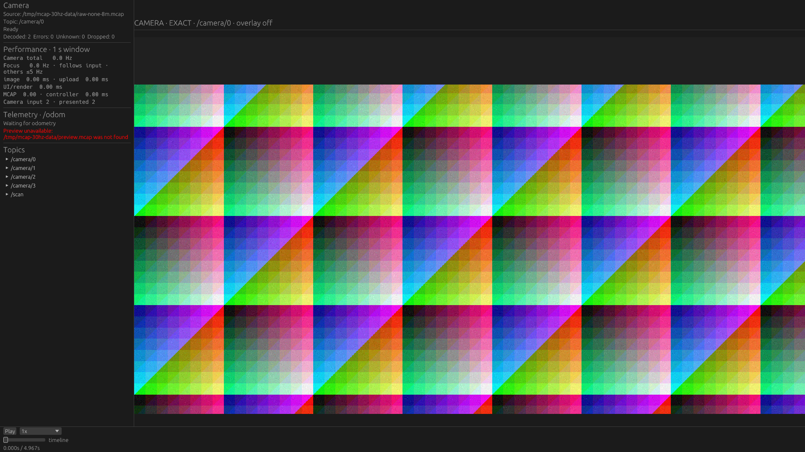
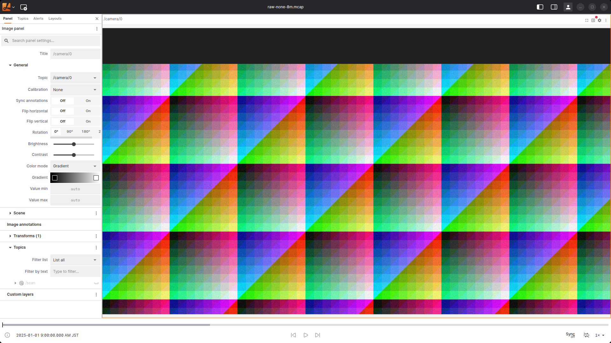
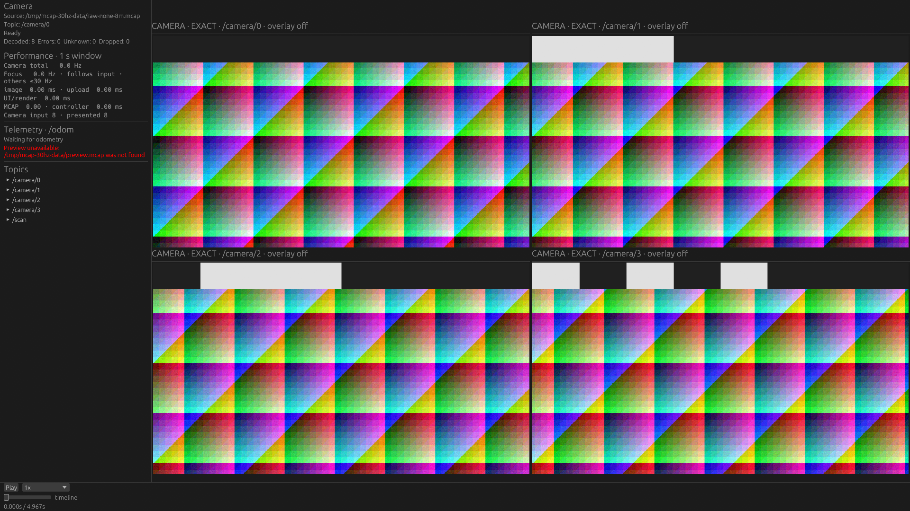
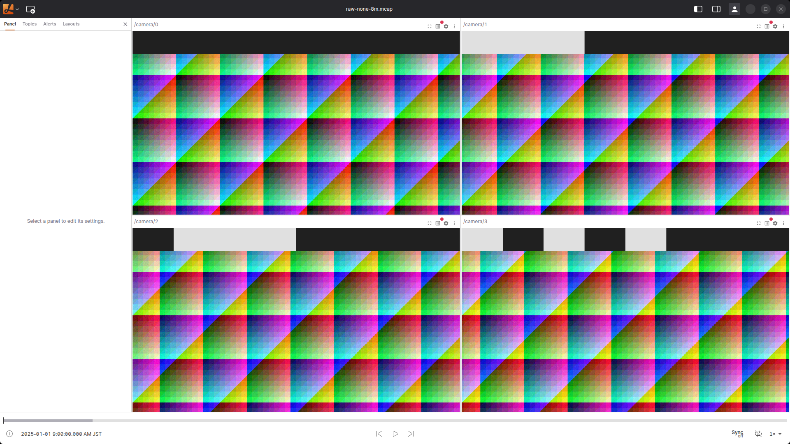

# FHD Raw 30Hz: フォーカスを入力周期へ追従させる

2026-10-22開始、23日完了。製品変更は`dd31ca0`。
固定10Hzだったフォーカスのadmissionを外し、入力に追従する設計へ変更した上で、NativeとLichtblick Desktop 1.29.1を実GPUで比較した。

## 設計上の変更

設計上の大きな障害はなかった。既存`CameraController`はカメラごとに最新1件のserializedメッセージを保持し、frontend tickでmaterializeしていた。この仕組みを維持して、フォーカスの100ms gateだけを撤去した。

- フォーカスは各tickで届いている最新画像を採用する。入力Hzの推定、専用タイマー、30Hzの新しい固定上限は追加しない。
- 入力がないtickでは再decodeしない。1tickに複数届いた場合は最新だけにcoalesceする。
- 背景の200ms周期・位相分散は維持する。フォーカス変更時は旧フォーカスを背景のdeadlineへ戻し、新フォーカスは即時に追従できるようにする。
- Seekの厳密なpredecessor復元は従来通りschedulerを迂回する。workerのbounded queueとgeneration cancellationも維持する。
- 共有viewer-coreの変更なのでNative/Webへ同じ意味で適用される。UIの固定「Focus .../10Hz」は撤去し、実測Hzと入力追従方針を表示する。

「入力追従」は意図的な間引き上限がないという意味であり、処理能力を超えた入力の全frame表示を保証しない。frontend tick、画面の更新、pixel変換、worker待ち、GPU転送が上限になる。過負荷時は古い画像を蓄積せず最新へ追いつく。画面更新以上に裏で再描画する変更はしていない。

## 実GPUでの結果

各条件3反復、すべて成功。値は各runの集計値の中央値。CPUは1 core=100%、PSSは再生中sample最大。背景最低Hzは各run内で最も低い背景の更新Hz。

| 圧縮 | 表示・app | focus Hz | 背景最低 Hz | CPU % | PSS MiB |
|---|---|---:|---:|---:|---:|
| none | 1台・Native | 29.51 | — | 30.75 | 270.20 |
| none | 1台・Lichtblick | 29.54 | — | 165.40 | 1803.56 |
| Zstd | 1台・Native | 29.26 | — | 47.14 | 279.25 |
| Zstd | 1台・Lichtblick | 29.78 | — | 269.91 | 1572.33 |
| none | 4台・Native 製品既定（背景5Hz） | 29.53 | 5.00 | 36.92 | 352.03 |
| Zstd | 4台・Native 製品既定（背景5Hz） | 29.52 | 5.00 | 69.58 | 370.17 |
| none | 4台・Native 全台30Hz実験 | 29.30 | 29.00 | 56.92 | 329.83 |
| none | 4台・Lichtblick | 16.26 | 15.76 | 278.71 | 3396.92 |
| Zstd | 4台・Native 全台30Hz実験 | 29.27 | 29.27 | 84.55 | 335.38 |
| Zstd | 4台・Lichtblick | 10.27 | 9.52 | 238.43 | 2842.89 |

**このFHD・表示面積ではNativeのフォーカスは約30Hzへ追従できた。** 製品の背景5Hzを維持した条件と、全台30Hzを要求する比較条件は分けて評価する。背景も30Hzへ上げるとCPUは増えたが、この短い試験では全台が約29Hzで表示された。製品の背景既定値は変更していない。

Lichtblickは1台では約30Hzだったが、4台では画像更新が落ちた。表示画像のlog timeの進みもnoneで最低約20.03 frame/s、Zstdで約12.51 frame/sになった。これは表示画像の進みであり、playerのcursor速度ではない。主計測中のcursorを追っていないので、player clockの減速かdecode/renderの遅延かは切り分けていない。

CPU・PSSは低くても同じ処理量とは限らない。特にLichtblickのZstd・4台は表示画像の進み自体が遅く、noneより小さいPSSを「同じ速度でより省メモリ」とは解釈しない。アプリ間の差にはI/O、保持、UI、pixel変換、縮小、upload等が混在する。MCAP data planeだけ、同画質の画像変換器だけの速度比較ではない。

背景5HzのNativeは全台30Hz実験よりCPUが小さかった。一方、PSSは全台30Hz実験の方が約22〜35MiB小さかった。古いRaw画像が`Bytes`でChunk backingを保持し得るため、表示回数の削減がそのまま省メモリになるとは限らない。ただし今回の差をbacking保持とallocator等へ完全に分解していないため、主因の断定はしない。

[全条件の集計](summary.md)、[各反復の範囲](summary.json)、[校正・smokeを含む全39試行のmanifest](manifest.json)を保存した。主計測30試行、smoke5試行、校正4試行が成功し、PSS guardによる打ち切りはなかった。

## 入力と表示条件

- `sensor_msgs/msg/Image`、rgb8、1920×1080、4カメラ各30Hz、5秒。画像600件＋LaserScan50件。Scanは表示しない。
- 1台／4台とも同じ4カメラ記録を開き、表示するtopicだけを選ぶ。画像payloadだけで約746 MB/s。
- noneとZstdで同一メッセージを保持し、どちらも目標8 MiB Chunk。実最大は約12.44 MB、300 Chunk。画像レコードは分割しない。
- none入力は約3.73 GB、Zstdは3,158,555,427 bytes。全変換の論理CRC32は2929447860。
- 128種類の決定的な画像と、上部1/8高さの8セルのID bandを使用する。IDは0〜127の7bitで、カメラごとにvariantを7ずつずらす。自然画像や自然画像の圧縮率を代表しない。
- 時刻は`floor(frame_index * 1e9 / 30)`を使う。30Hzで1秒を整数nsへ丸めても、各秒の境界や10Hz Scanをずらさない。生成とpredecessor計算を境界値でテストした。
- ウィンドウはFHD 1920×1080。画像領域は1台で約1600×900、4台で各約795×447。4枚を各FHD等倍で並べる条件ではない。
- 同じviewport・選択topic・source画像を使う。縮小フィルタや内部texture寸法まで同一にする比較ではない。
- RTX5070Ti、NativeはNVIDIA Vulkan、LichtblickはハードウェアWebGLを各runで確認する。LichtblickはLinux x64配布版1.29.1。

格納情報は[generated.json](generated.json)／[storage.json](storage.json)。各runのdata／binary／harness／patch／reference SHA256、GPU、購読、画面状態も保存した。

## 更新Hzの測り方

アプリ別・表示台数別に128種類の画素を校正する。Nativeではtextureの絶対log time、Lichtblickでは確定Seek cursorを確認した上で参照を作る。同一binary・入力メッセージ集合・表示領域に限って校正を共有する。Nativeの背景5／30Hzは同じ計測binaryを使い、paused Seekによる校正には背景admissionを使わない。

主計測は4秒、画面を90Hz目標で観測する。ID bandから7bitを読み、対応する参照との全sample画素誤差も検査する。多数の参照へ毎回総当たりする負荷を避ける。IDのthresholdから24超、全vectorの平均絶対誤差18未満を採用する。校正時には全128 IDの一致と参照の識別性を検査する。

128種類は30Hzで約4.27秒周期。4秒観測中は一周分のframe飛びが起きる曖昧さを避けられる。カメラoffsetによるIDのwrapはmoduloで追跡する。これを任意の長時間・高速Seekに対する絶対frame IDとは扱わない。

実sample頻度は約88.0〜89.5Hz。主計測全体で無効sampleは5件、全runが95%以上の有効率を満たした。sample gapの最大は75.3msで、短い表示を一部見落とした可能性は残る。更新Hzは観測できた画像変化の下限であり、window present回数ではない。[観測負荷とsample gap](observation.json)も保存した。

timeline frame/sは、画像のlog timeから換算した相対frameの進み。壁時計から画像時刻を引いたwall位相は実cursorと画像間の年齢ではなく、操作開始位相や観測時間も含む。Nativeの制御ファイルとLichtblickのCDPでplay指示の配送が異なるため、小さい位相差をcodecの差と決めつけない。

## 計測専用設定と資源量

製品変更はフォーカスの固定周期撤去と、それに伴うUI/API・テスト・設計文書の更新。比較用patchは配置・操作注入・ログに加え、背景周期を5／30Hzへ切り替える測定専用環境変数を持つ。これは製品の設定APIではない。フォーカスには比較用30Hz gateも置いていない。

毎回新しいプロセス／Lichtblick profileを順次起動し、同時起動しない。3反復でアプリ順を交代する。校正とsmokeは主計測から分ける。開始前のGPU使用率は0%だったが、共有ホストの専有を保証しない。他用途のプロセスは停止していない。

ファイルSHA256を起動前に読むcache-allowed条件。cold disk、NAS、長時間記録、4K画像、8台30Hzへ一般化しない。起動・Seekは再生CPU測定区間外。

CPUは全子孫プロセスを含み1 core=100%。PSSは独立threadで約250ms間隔のsample最大で、VRAMや厳密な瞬間最大ではない。画素観測Python、X server、compositorの資源量は表に含めないが、その観測負荷は環境へ加わる。

実験のPSS guardは両者とも6GiBに設定した。開始時のavailable memoryは約7GiB、swapはほぼ使用済み。これは共有ホストを保護する実験上限で、製品のmemory ceilingではない。今回の全試行はguardへ到達しなかった。

## スクリーンショット

再生前の同じ先頭frame。配置・画像領域・表示内容の確認用で、速度は画素の時系列で判定する。

| 1台・Native | 1台・Lichtblick |
|---|---|
|  |  |

| 4台・Native | 4台・Lichtblick |
|---|---|
|  |  |

## 再現と検証

必要な環境は[既存Desktop比較](../2026-10-20-desktop-workloads/README.md)と同じ。case JSONのdata／binary／patchパスを環境へ合わせる。生成先は新しい場所を使う。

```sh
python3 tools/performance-probe/build_storage_probe.py --variant input-rate
mkdir -p /tmp/mcap-30hz-data
target/gpu-native/performance-probe-input-rate generate /tmp/mcap-30hz-data/raw-none-8m.mcap none 8388608 mixed 5 raw 1920 1080 128 30 4
target/gpu-native/performance-probe-input-rate storage /tmp/mcap-30hz-data/raw-none-8m.mcap /tmp/mcap-30hz-data/raw-zstd-8m.mcap zstd 8388608 0
python3 tools/performance-probe/run_camera_30hz.py --output /tmp/camera30-new --stage calibrate
python3 tools/performance-probe/run_camera_30hz.py --output /tmp/camera30-new --stage smoke
python3 tools/performance-probe/run_camera_30hz.py --output /tmp/camera30-new --stage measure
python3 tools/performance-probe/summarize_raw_storage.py --input /tmp/camera30-new --output /tmp/camera30-report --title '30Hz Camera比較の集計'
```

workspace Clippy全target・全テスト、core/renderersのWASM check、Web WASM checkとTrunk releaseが成功した。ROS 2 Jazzyをsourceした`viewer-native --features ros2-live`テストも84 passed / 3 ignoredで成功。無視された実DDS smokeを実行したという意味ではない。

30Hz fixtureの正確な時刻とScan時刻、画像ID、Pythonのns境界値・曖昧なmarkerの拒否も回帰テストした。フォーカスは30Hzだけでなく50Hz入力、周期変動、UI tick間でのcoalescing、stall後の最新値、focus切替、Seekを検証した。製品コードと計測patchの境界・binary識別情報・検証ログは[implementation.json](implementation.json)に保存した。
