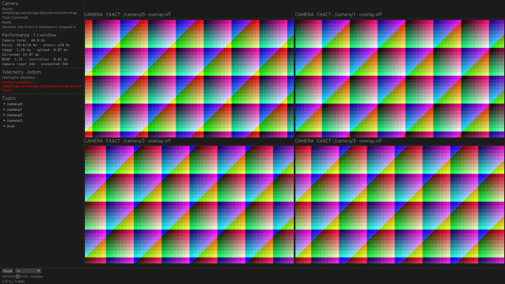
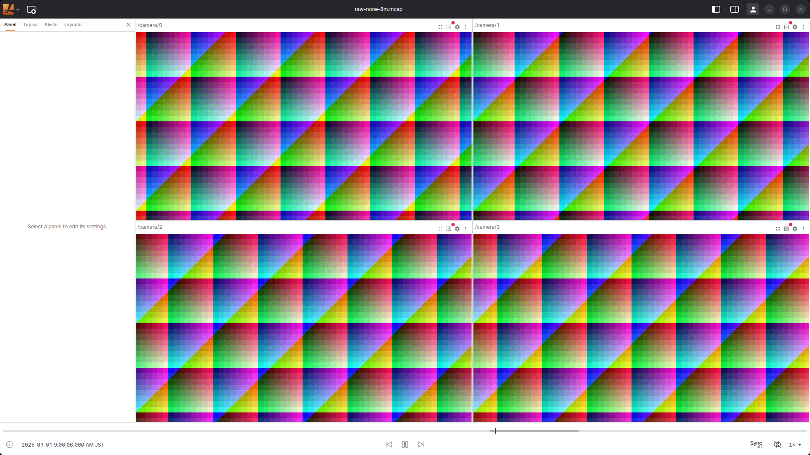

# Raw ImageとMCAP格納形式のDesktop比較

2026-10-22。Native mcap_player（基準 `1bb3a9d`、改善後 `e7ab10f`、メモリ予算緩和前は `4d715ad`）とLichtblick Desktop 1.29.1の比較。
結果は今回の合成画像・短い記録・共有ホストでの値であり、一般的な順位付けを目的としない。

今回の「巨大Chunk」は、**ファイル全体を1つのChunkに格納するケース**を含む。Chunkレコードが存在しないケースとは別である。後者は最初の解釈で実行した補助検証として残す。

約1GBの単一Chunkは、同じ入力の先頭4秒（Raw Image 160件＋Scan 40件、論理CRC32 `3089428338`）を使う。none / Zstd / LZ4でそれぞれ1 Chunk、展開サイズは `995,403,840 bytes`。8 MiB設定の同じ4秒を対照とし、各実再生は3秒とする。[格納情報](single-chunk-datasets.json)、[変更前の試行](single-chunk-before/summary.md)、[改善後](prefetch-single/summary.md)を参照。

Nativeの改善はデータプレーン内の「1 Chunk先の準備」と「Seek内での展開結果共有」。[変更内容と前後比較](chunk-preparation.md)にまとめる。

## 条件

- `sensor_msgs/msg/Image`、`rgb8`、1920×1080、4カメラ、各10 Hz、10秒。画像400件とLaserScan100件。同じ記録から1台または4台を表示し、Scanは表示しない。
- 入力の画像データだけで約249 MB/s。32種類の決定的な模様を循環し、カメラごとに7フレームずらす。自然画像や深度画像の圧縮率を代表しない。
- MCAPのlog time・publish time・sequence・topic・payloadを変えずに再格納する。全変換の論理CRC32は `922564451`。各実行では入力ファイルごとのSHA256も記録する。
- **none / 8 MiB Chunk、Zstd / 8 MiB、LZ4 / 8 MiB、Zstd / 128 MiB、Zstd / 256 MiB、Zstd / 8 MiBを3ファイルへ分割、Chunkレコードなし**。Chunkなしは非圧縮Chunkとは別物。
- 分割は4秒・4秒・2秒、重複なし。Nativeはディレクトリを開き、Lichtblickは3ファイルを一度に渡す。Seek検証では4.31→1.71→9.11→0秒でファイル間の前後移動も確認する。再生の主計測は連続Seekを行わず、先頭の画像とcursorを確認して開始する。
- ウィンドウ1920×1080。同じ画像領域を使用する。1台では約1600×900、4台では約795×447の画像を表示するため、元のFHD画像を全画素等倍で4枚並べる負荷ではない。
- NVIDIA RTX 5070 Ti。NativeはVulkan、LichtblickはハードウェアWebGLを各実行で確認する。Nativeの計測専用patchは配置・操作・ログ出力と、背景カメラも100 ms周期へ変更する。製品の背景5 Hzという既定値は変更しない。
- 各条件3反復、実再生6秒。毎回新しいプロセス・Lichtblick profileを作り、同時起動しない。runnerは反復ごとにアプリ順を交代できるが、今回の主matrixは途中の計測修正後にアプリ別で再実行した。時間的に交互の比較とは扱わない。起動は再生CPUの測定区間に含めない。初回再生に並行する先読み・変換・展開は含む。
- 入力SHA256を起動前に読むため、cache-allowed条件。cold disk、NAS、長時間再生の比較ではない。共有ホストの他アプリは停止していない。開始時点でavailable memory約5 GiB、swapはほぼ全量使用済みだった。

格納サイズ・実Chunk数・最大展開Chunkサイズは[datasets.json](datasets.json)、環境と実行物のSHA256は[environment.json](environment.json)。8 MiBはwriterの目標値であり、画像レコードを分割しないため実Chunkは約12.44 MBになる。256 MiB設定の最大値は約273.74 MB。

## 測り方と制約

画面内の88箇所のRGBを約20 Hzで観測し、アプリ別に校正した32種類の画像と照合する。新しい画像が見えた頻度（updates Hz）、メッセージ時刻の進行（progress Hz）、開始後のwall timeに対する画像の遅れを分ける。GPU呼び出し回数やwindow present回数を画像更新Hzとは扱わない。低頻度のサンプリングで短い表示を見落とす可能性がある。

別枠のSeek検証は対象cursorの確定と画像の一致を待つ。次の操作まで300 ms待機し、この待機はSeek latencyに加えない。主計測は0秒への位置確認だけを行い、これをrandom Seek性能とは扱わない。Nativeではログのtexture時刻も確認する。Raw校正ではJPEG Blobのhash検査を使わず、cursor・画素の一意性・Nativeのtexture時刻を検査する。同じメッセージ列であることを検査済みの格納バリアント間だけ参照を共有し、binary hashと画像領域も一致させる。出力品質を全画素で一致させた画像変換器の比較ではない。

CPUは1 core=100%。NativeとElectronの子孫プロセスを集計する。PSSは約250 ms間隔のsample最大値であり、厳密な瞬間最大やGPU VRAMではない。別の1秒間隔の監視も起動・校正・Seek中から行い、アプリ全体のPSSが4 GiBを超えたら専用プロセスだけ終了する。これは実験の保護上限で、製品の上限ではない。観測処理とログの負荷も結果に含まれる。

起動からreadyまでの時間にはウィンドウ・layout設定・検査用の待機が含まれ、アプリ固有のファイルopen所要時間とは比較しない。改善後NativeではChunk展開と先読みの診断ログも採取する。ただし両アプリ共通のByte I/Oや展開量を直接計測していないため、DesktopのCPU差をChunk pruningだけへ帰属しない。Rawの縮小・pixel変換、保持・先読み、描画にも違いがある。

ChunkなしのNativeは本番 `McapSource::open_file` で明示的に拒否する。全走査へは変更していない。[拒否の記録](unchunked-native.json)は再生性能とは別で、拒否が速いことを性能上の勝利とは扱わない。

## 再現

必要な環境は既存の[Desktop比較手順](../2026-10-20-desktop-workloads/README.md)と同じ。Lichtblick 1.29.1配布binary、物理X11 display `:1`、NVIDIA Vulkan ICD、Python Pillowと既存CDP/X11 helperを使用する。

```sh
python3 tools/performance-probe/build_storage_probe.py --variant prefetch
mkdir -p /tmp/mcap-raw-storage-data
target/gpu-native/performance-probe-prefetch generate /tmp/mcap-raw-storage-data/raw-none-8m.mcap none 8388608 mixed 10 raw 1920 1080 32 10 4
target/gpu-native/performance-probe-prefetch storage /tmp/mcap-raw-storage-data/raw-none-8m.mcap /tmp/mcap-raw-storage-data/raw-zstd-8m.mcap zstd 8388608 0
target/gpu-native/performance-probe-prefetch storage /tmp/mcap-raw-storage-data/raw-none-8m.mcap /tmp/mcap-raw-storage-data/raw-lz4-8m.mcap lz4 8388608 0
target/gpu-native/performance-probe-prefetch storage /tmp/mcap-raw-storage-data/raw-none-8m.mcap /tmp/mcap-raw-storage-data/raw-zstd-128m.mcap zstd 134217728 0
target/gpu-native/performance-probe-prefetch storage /tmp/mcap-raw-storage-data/raw-none-8m.mcap /tmp/mcap-raw-storage-data/raw-zstd-256m.mcap zstd 268435456 0
target/gpu-native/performance-probe-prefetch storage /tmp/mcap-raw-storage-data/raw-none-8m.mcap /tmp/mcap-raw-storage-data/raw-split-zstd-8m zstd 8388608 4
target/gpu-native/performance-probe-prefetch storage /tmp/mcap-raw-storage-data/raw-none-8m.mcap /tmp/mcap-raw-storage-data/raw-unchunked.mcap none 0 0
python3 tools/performance-probe/run_raw_storage.py --output /tmp/raw-storage-new --stage calibrate --variant prefetch-zstd-8m --app native
python3 tools/performance-probe/run_raw_storage.py --output /tmp/raw-storage-new --stage measure --variant prefetch-zstd-256m --app native
```

生成先は新しい場所を使用する（既存ファイルを上書きしない）。case JSONはこのディレクトリのものを使い、異なるrepo/dataパスなら `data` / `data_files` / `native_binary` / `native_patch` を更新する。Lichtblick校正が確定した画像領域は、同じ表示台数の全caseへ反映する。

## 大Chunkの再生予算の変更

最初の実験では、Nativeの256 MiB backing上限で実274 MB Chunkを拒否した。ユーザーの方針に従い、`1bb3a9d`でこの固定ゲートを取り除いた。Chunkは現在の時間順マージに必要な分だけ確保し、消費後に解放する。64-bit Nativeでは同時に保持するforward backingの安全弁を4 GiB、単一Chunkの圧縮入力・展開出力を各2 GiBとした。起動時の大きなcache確保や、記録全体の保持は追加していない。

Seek復元は圧縮入力＋展開量の累積work予算を8 GiBまで許容する。これも予約メモリではない。Inspector等の明示的なquery予算や、Summary・Message Index等の読み込み制限は別に残す。大Chunkのpayload読み込みには専用の上限を渡し、分割ファイルの内側にも同じ上限を伝える。宣言された展開サイズは圧縮payloadを読む前に検査する。

forwardの4 GiBはプロセス全体のRSS/PSS上限ではない。展開時の圧縮入力、transaction staging、返却メッセージ、pixelやGPU resourceは別途存在する。使用量がホストの空きメモリへ必ず収まる保証や、OSのmemory pressureを予測する仕組みは追加していない。

[Scanのみを10秒全体へ流した検証](large-chunk-forward.json)では、実274 MB Chunkを10個読み、100件を正しく処理して最後のforward backingは0になった。約2.49 GBの展開総量に対してHWMは約517 MiBだった。この検証は描画なしのNative物理読み込み経路であり、GUIのPSSや別アプリの性能と直接比較しない。Scanしか選択していなくても、全ChunkにScanが混在するため全Chunkの展開が必要だった。

## 集計の読み方

今回の入力はすべてFHDのRaw Imageである。過去の4K JPEG比較とは画像形式・解像度・記録時間が違うため、過去結果との差をJPEG対Rawの効果とは扱わない。

[summary.md](summary.md)は主計測だけを集計する。Seek検証、変更前の途中試行、計測操作の修正前の試行は[manifest.json](manifest.json)に別枠で保存する。成功した反復だけを選んで3反復のように見せず、成功数／試行数を併記する。4 GiBの実験PSS guardで止まった結果は保護上限による打ち切りであり、アプリのクラッシュや製品の最大対応容量を意味しない。

## 計測手順の修正と打ち切り

Lichtblickの初回ロード中のcursor=0を「Seek完了」と誤認する経路と、Nativeで既に先頭画像が表示されているためSeek処理の完了前にplayを送る経路があった。現在はLichtblick初回ロードの確定を待ち、Nativeでは操作IDの完了ログも待つ。修正前の結果はmanifestに残し、主集計から外す。Native 256 MiB・4台の旧3試行もこの対象である。[変更前256 MiBの1／4台を同じ手順で各3回再計測](baseline-acknowledged/summary.md)し、改善後との比較にはこちらを使う。

単一Chunkの変更前試行は性能改善を優先するため第2反復の途中で中断した。3反復の比較として扱わない。改善後は新しいbinaryで画素校正をやり直し、Native単独で各条件3反復する。画素照合の失敗も残し、成功試行だけを選び直さない。

改善後の単一Chunkを再現する場合、生成済みの分割先頭partから次のように変換する。

```sh
target/gpu-native/performance-probe-prefetch storage /tmp/mcap-raw-storage-data/raw-split-zstd-8m/part-000.mcap /tmp/mcap-raw-storage-data/raw-zstd-single-4s.mcap zstd 1073741824 0
python3 tools/performance-probe/run_raw_storage.py --output /tmp/raw-single-new --stage calibrate --variant prefetch-zstd-8m-4s --app native
python3 tools/performance-probe/run_raw_storage.py --output /tmp/raw-single-new --stage measure --variant prefetch-zstd-single-4s --app native --seconds 3
```

`--variant`は出力binaryのラベルであり、製品コードを過去版へ切り替える指定ではない。変更前Nativeは`1bb3a9d`に`native-storage.patch`を適用したbinary、変更後は`e7ab10f`に`native-prefetch.patch`を適用したbinaryを使った。caseと各resultのSHA256を確認する。計測用patchを製品動作の変更に含めない。

## 表示内容の比較

同じ4台のRaw Image、none / 8 MiB設定。製品のRaw展開等の違いはあるが、画像領域と表示トピックを揃えた。スクリーンショットの時刻や各フレームの一致は比較条件にしない。

| Native（変更前基準） | Lichtblick Desktop 1.29.1 |
|---|---|
|  |  |
