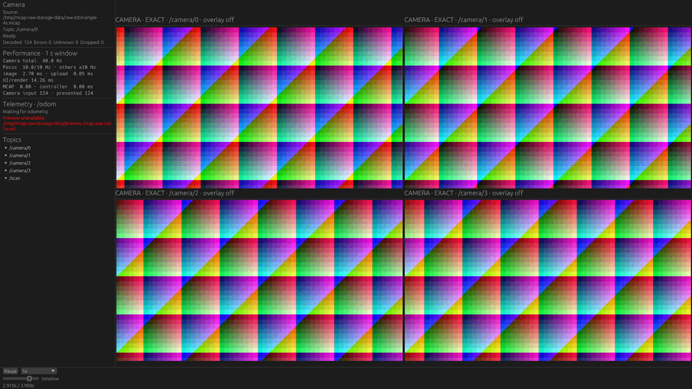
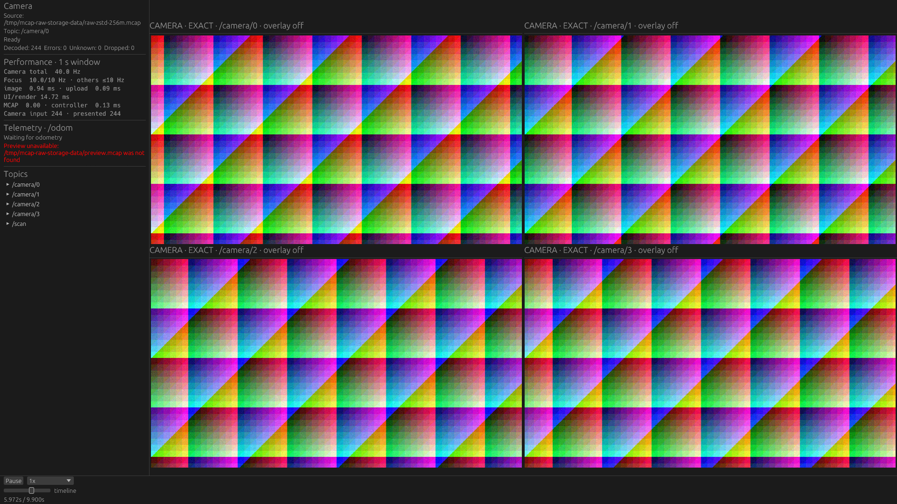

# Native Chunk準備と単一巨大Chunkの展開共有

製品変更: `e7ab10f`。比較基準: `1bb3a9d`（大Chunkを拒否する256 MiB固定ゲートの緩和後）。
最小メモリそのものを目標にせず、再生性能を出すために必要なserialized backingを保持する。

## 責務と実装

`viewer-mcap::McapSource`が物理データプレーンを担当する。トピック選択とChunk Indexで対象を絞り、読み込み、CRC検査、展開、物理レコードの切り出しまで行う。ROSの意味解釈やRaw Imageのpixel変換は従来のfeature側に残す。

`McapPlayback`は再生中に次Chunkの準備を促し、停止・Seekでキャンセルする。clockとsource positionの確定も従来通り担当する。UI、renderer、`viewer-core`へMCAP圧縮方式の知識は持ち込まない。

- 再生中は次の対象Chunkを1個だけ`mcap-chunk`スレッドで準備する。対象外のChunkは飛ばす。今のChunkを表示している時間に次のI/O・展開を重ねる。
- 開始判定はactive backing＋次Chunkの圧縮入力＋展開出力。非圧縮では入力と出力を重複計上しない。4 GiBのserialized backing安全弁へ収まる場合に準備する。feature、返却バッチ、Vecの管理情報、GPUのメモリはこの見積もりに含まない。
- 準備済みの結果は読み取り側で受け取り、二重に展開しない。間に合わなければ待つ。欠けたデータを飛ばしてcursorを進めない。
- 停止・Seek・選択変更・source破棄時は古いworkerをキャンセルしてjoinする。展開処理自体は途中中断できない区間があり、その完了を待つ可能性がある。古いsourceの作業を裏に残さない。
- 通常queryのforkとWASM経路にはこのNative workerを追加しない。

**単一巨大Chunkには「次Chunk」がない。** ここではSeekの最新値復元と再生開始位置の構築が、同じChunkを重複展開していた。Seek専用の短命なreaderで1個の物理解析結果を共有し、返却メッセージと再生位置は同じ`Bytes` backingを参照する。scratch cacheはfeature状態を確定する前に破棄する。必要な再生用backingだけが残る。

このcacheは記録全体の履歴でも、任意ChunkのLRUでもない。複数の異なるChunkを往復する復元で全再展開をなくすものではない。Seek前の状態は失敗時のrollbackのため、処理が成功するまで保持する。

## 実GPUの前後比較

共通条件はFHD Raw rgb8、4カメラ各10 Hz、NVIDIA Vulkan、画面1920×1080。表示1台／4台で同じ領域を使う。計測patchで背景も10 Hz対象とした。製品の背景カメラ既定5 Hzは変更しない。

256 MiB設定では実Chunk最大273,736,897 bytes。10秒入力を6秒再生し、同じ操作完了待ちを使って変更前も改めて3回計測した。以下は各3/3成功、中央値。

| 条件 | 最低画像更新 Hz | timeline frame/s | wall位相P95 ms | CPU % | 再生中PSS MiB |
|---|---:|---:|---:|---:|---:|
| 256 MiB・1台・変更前 | 7.38 | 9.88 | 458.14 | 38.61 | 985.44 |
| 256 MiB・1台・変更後 | 9.89 | 9.89 | 159.51 | 45.10 | 971.47 |
| 256 MiB・4台・変更前 | 7.21 | 9.73 | 463.16 | 45.93 | 983.25 |
| 256 MiB・4台・変更後 | 9.73 | 9.73 | 165.59 | 53.07 | 972.94 |
| 8 MiB・4台・変更前 | 9.73 | 9.73 | 165.31 | 33.95 | 310.13 |
| 8 MiB・4台・変更後 | 9.73 | 9.73 | 165.19 | 34.78 | 323.13 |

8 MiBの変更前行は既存matrixの3試行。256 MiBの変更前は[操作完了待ち修正後の再計測](baseline-acknowledged/summary.md)、変更後は[prefetch/summary.md](prefetch/summary.md)。wall位相は再生開始からの差であり、実cursorと表示画像の年齢ではない。

変更後256 MiBの6試行では、表示中に消費した先読みは各5回すべてready hit、未完了workerへの待ちは0回。停止時に消費しなかった次Chunkの準備も存在する。画面観測の改善と診断ログの両方から、同期展開の停止を先読みで隠せたと判断する。展開処理量を減らしたとは解釈しない。

CPUは増えたが、この入力では再生中PSSを増やさずに画像更新を改善できた。PSSはallocatorの再利用等にも依存するため、先読みが常に無料のメモリで済むという意味ではない。8 MiBでは元から約10 Hzを満たしており、速度差はなく、少しのメモリ増加が観測された。

## ファイル全体が約1GBの単一Chunk

同じ入力の先頭4秒をnone / Zstd / LZ4のそれぞれ1 Chunkへ格納。展開サイズは995,403,840 bytes、画像160件＋Scan40件。3秒再生で、下表の変更後は各3/3成功。

| 条件・4台表示 | 最低画像更新 Hz | CPU % | 再生中PSS MiB |
|---|---:|---:|---:|
| Zstd単一Chunk・変更前の成功1試行 | 9.47 | 21.97 | 2110.51 |
| Zstd単一Chunk・変更後3試行中央値 | 9.47 | 24.30 | 1191.73 |
| LZ4単一Chunk・変更後3試行中央値 | 9.47 | 22.97 | 1169.40 |
| Zstd 8 MiB・変更後3試行中央値 | 9.47 | 35.93 | 325.75 |

変更前の単一Chunk matrixは途中で中断したので、対称な3反復比較ではない。Zstd・4台の先頭へのSeek確認は変更前1試行2,533 ms、変更後3試行中央値1,312 ms。ここは同じ先頭への復元であり、任意時刻へのrandom Seek一般を代表しない。起動処理とこのSeek確認を含む再生開始前の`rchar`は約3.85 GBから約1.93 GBになったが、OS物理ディスクI/Oの値ではない。

変更前のZstd・1台とLZ4・1／4台には実験用4 GiB PSS guardによる打ち切りがあった。変更後の単一Chunk15試行にはPSS guard打ち切りはなく、13試行が有効。Zstd・1台の1試行とnone・4台の1試行は画素照合が不安定だったため失敗として残した。速度・メモリの代表値をそれぞれ3/3成功と偽らない。

none・4台は有効2/3の中央値9.48 Hz、1170.68 MiB。Zstd・1台は有効2/3の中央値9.64 Hz、1179.33 MiB。詳しくは[全試行の集計](prefetch-single/summary.md)。PSS表は再生中のsample最大であり、Seekを含む瞬間最大を保証しない。

今回、約1GBを保持して再生できる状態を保ちつつ、二重展開に由来する余分な保持を削減できた。ただし単一Chunkでは、少ないトピックの短い範囲を表示してもChunk全体の展開が必要である。小Chunkと同じメモリやopen/Seek応答にはならない。

## スクリーンショット

同じ4カメラ配置。表示画像の同一性は画素校正とメッセージ時刻で検証し、静止画の見た目だけで速度を判定しない。

| 改善後・単一約1GB Chunk | 改善後・256 MiB設定 |
|---|---|
|  |  |

Lichtblickとの画像比較、4 GiB実験guardによる打ち切りを含む結果は[主matrix](summary.md)と[変更前単一Chunk](single-chunk-before/summary.md)に保存した。今回の最適化後にLichtblickを測り直していないため、アプリ間の改善率や一般的な優劣は主張しない。

## 検証と限界

回帰テストは対象外Chunkのpruning、順序、二重展開なし、停止中の先読みなし、選択変更、準備失敗のrollback、ファイル変更の検出、圧縮入力＋出力の予算、復元と再生位置のbacking共有を確認する。

1 Chunk先が準備できる時間がある場合に有効であり、低速ストレージ、極端な圧縮負荷、Chunk間の重なり、長時間再生のmemory fragmentationは未検証。OSの空きメモリを予測して自動調整する機構や、圧縮Chunkの部分展開cacheは追加していない。ホスト全体のmemory pressureに必ず収まる保証はない。2 GiB超の単一Chunk対応、Webでの同等の巨大Chunk改善は今回の範囲外。
