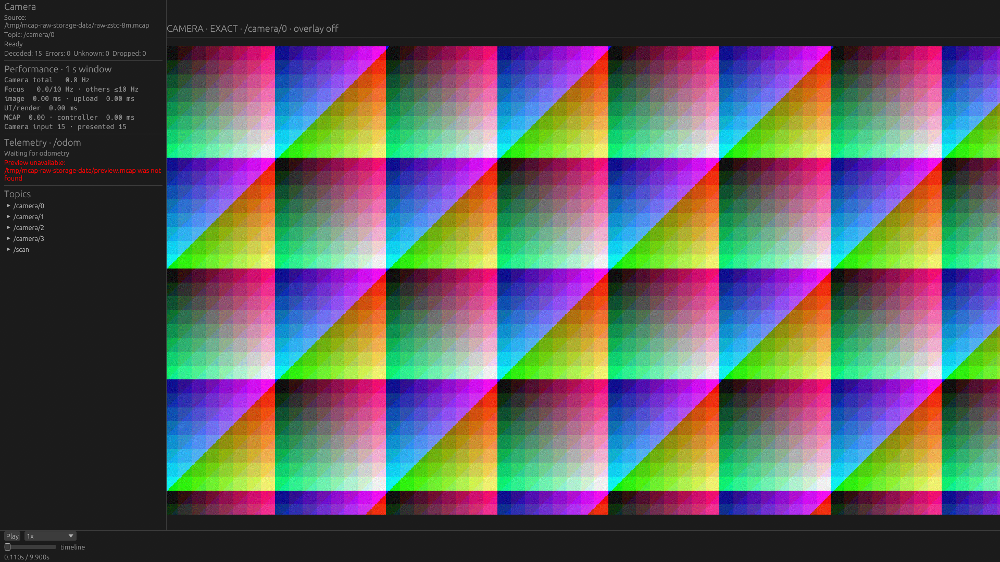

# Native: 同じシーンへ繰り返しSeekする

2026-10-22。変更前は`e81a0be`（製品コードは`e7ab10f`と同じ）、変更後は`dfea770`。
比較対象はLichtblick Desktop 1.29.1。目的は、解析で同じシーンを往復するときの待ち時間と、再利用に必要なメモリを把握すること。

## 結果

**直近のSeekで使った物理Chunkを再利用すると、大Chunkの再訪は画面反映まで約0.4〜1.3秒から約84〜86msへ短縮した。** 小Chunkでは改善は小さく、Lichtblickに残る差も確認した。

各条件3プロセス、すべて成功。操作列の後半を再訪として使い、各プロセスの中央値／nearest-rank P95を求め、その3回の中央値を示す。PSSは初回アクセスも含むSeek操作列全体のsample最大値の中央値。

| 条件 | 再訪中央値 前→後 ms | 再訪P95 前→後 ms | Seek中PSS 前→後 MiB |
|---|---:|---:|---:|
| 256 MiB設定・同じChunk内の往復 | 418.2 → 83.9 | 427.5 → 86.1 | 981.0 → 489.9 |
| 256 MiB設定・離れた2地点の往復 | 430.5 → 86.5 | 438.8 → 96.2 | 995.4 → 745.8 |
| 8 MiB設定・短距離の往復 | 100.3 → 82.7 | 108.3 → 96.3 | 269.9 → 293.4 |
| 約1GBの単一Chunk内の往復 | 1296.1 → 86.3 | 1308.3 → 96.0 | 3041.8 → 1172.9 |

8 MiB設定の短距離往復をLichtblickで同じ手順で測ると、再訪中央値59.9ms、P95 78.1ms、PSS 1063.6MiBだった。**このケースでは変更後もLichtblickの画面反映が速かった。** 配信・操作方式とUIの違いも含む値で、decoder単体の順位ではない。大ChunkのLichtblickとのSeek比較は今回の有効なmatrixには含めない。

詳細は[summary.md](summary.md)と[summary.json](summary.json)。[manifest.json](manifest.json)には初期試行、失敗、校正を含む全結果の保存先と元ファイルのSHA256を記録した。

## 見つかった原因と対策

前回は1回のSeek内の最新値復元と再生位置構築が同じ展開済みChunkを共有するようになった。しかし、その短命なreaderを破棄するため、**次のSeekでは同じChunkをまた読み込み・展開していた**。

描画を伴わない本番`McapPlayback::seek_with`＋`FeatureRuntime::restore_transactional`を計測すると、次のようになった。表示画像のpixel変換・GPU転送・presentはこの測定には含まない。

| 条件 | 全操作のChunk展開回数 前→後 | 後半の再訪の展開回数 前→後 | 再訪復元の中央値 前→後 ms |
|---|---:|---:|---:|
| 同じ256 MiB Chunk・8回 | 8 → 1 | 4 → 0 | 331.150 → 0.005 |
| 256 MiBの2地点・8回 | 8 → 2 | 4 → 0 | 344.804 → 0.005 |
| 小Chunkの短距離往復・14回 | 14 → 4 | 7 → 0 | 9.619 → 0.003 |
| 約1GB単一Chunk・8回 | 8 → 1 | 4 → 0 | 1189.472 → 0.008 |

これで「再訪なのに再展開する」というデータプレーンのボトルネックを確認し、対策後に解消したことを確認できた。マイクロ秒単位のheadless復元時間をユーザーの待ち時間として扱わない。GUIでは画像変換・upload・frame反映・観測が別途必要で、約83〜86msが残った。

実装は`viewer-mcap::McapSource`内の非公開`seek_chunks`。汎用cache serviceや新しいtraitは追加していない。

- 保存するのは検証済みの物理レコードとserialized payload。ROSの意味解釈・画像pixel・feature履歴は保存しない。
- 復元readerがcacheを埋め、次のSeek、forward読取、先読みworkerが再利用できる。通常のquery forkには引き継がず、順次読取と先読みだけではcacheを増やさない。
- 解析済みレコードは`Arc<[...]>`、payloadは`Bytes`を共有する。同じChunkを現在位置とcacheで二重に確保しない。
- バイト予算は「選択された最大Chunkの2倍」を64 MiB〜2 GiBへ制限した値。最大16 Chunk。実際に訪れた分だけ保持し、予算や個数を超えたらLRUで退避する。予約確保はしない。
- 選択変更で予算を更新し、source破棄でcacheも破棄する。cache hitでもファイル変更を検査する。
- read-aheadの見積もりはactive/cache間で共有するChunkを二重計上しない。必要なら過去のcacheを退避し、任意の過去位置の保持が次Chunkの準備を妨げないようにする。
- 読み取り／feature復元失敗時はclockとforward positionを変更しない。失敗処理で物理cacheが温まること自体は許容する。

## メモリとのトレードオフ

今回のheadless計測の最後にcacheが保持したserialized backingは以下。sourceの順次保持と同じbackingを共有し得るため、`source_cache_backing_bytes`と`seek_cache_backing_bytes`を単純に足さない。

| 条件 | cacheのbacking MiB |
|---|---:|
| 同じ256 MiB Chunk | 261.1 |
| 256 MiBの2地点 | 522.1 |
| 小Chunkの4位置 | 47.5 |
| 約1GB単一Chunk | 949.3 |

大Chunkの往復では、圧縮入力と新しい展開先を毎回作らなくなるため、Seek中のPSS最大も下がった。一方で、小Chunkでは保持する過去の位置が増える分だけPSSが増えた。

さらに、Seekのあとに連続再生へ戻る対照も測定した。256 MiB設定・1カメラ・6秒再生の3回すべてが成功し、画像更新中央値9.73Hz、CPU 45.1%、再生中PSS 1226.3MiB。前回のcacheなし対照は9.89Hz、45.1%、971.5MiBだった。**過去の初期Chunkを残す約255MiBの増加がある。** これは別時点の対照であり、小さい更新Hz差の因果までは判断しない。

順次読取ではcacheへ追加しないが、起動時の初期復元や過去のSeekで保存したChunkは残り得る。「連続再生なら追加メモリが必ず0」という設計ではない。今回の方針は、往復操作を速くするために必要な保持を許容し、常駐量・件数を制限すること。2 GiBのcache上限はプロセスPSSの上限ではなく、metadata、pixel、GPU、transaction staging等は別に存在する。

## 条件と操作列

入力は[前回のRaw Image記録](../2026-10-22-raw-storage/README.md)を再利用。1920×1080 rgb8、4カメラ各10Hz＋LaserScan10Hz。表示・購読はカメラ0の1台だけで、Scanは表示しない。画像領域は約1600×900、ウィンドウ1920×1080。全カメラが混在するChunkなので、1台表示でも対象Chunk全体の展開が必要。

| case | 入力 | 操作列（秒） |
|---|---|---|
| same | Zstd 256 MiB設定、10秒 | 0.31 ↔ 0.71を4往復分の8操作 |
| alternating | 同じ10秒入力 | 0.31 ↔ 5.71を8操作 |
| scrub | Zstd 8 MiB設定、10秒 | 0.11, 0.21, 0.31, 0.41, 0.31, 0.21, 0.11を2周 |
| single | Zstd、先頭4秒を1 Chunk | 0.31 ↔ 2.71を8操作 |

10秒入力の論理CRC32は922564451、4秒入力は3089428338。256 MiB設定の実最大Chunkは273,736,897 bytes。単一Chunkの展開サイズは995,403,840 bytes。格納形式、各runの入力SHA256、binary SHA256はcase JSONと保存したresultから確認できる。

GPUはRTX5070Ti / NVIDIA Vulkan、LichtblickはハードウェアWebGL。毎回新規process/profileを順次起動する。フェーズごとに測定したので、アプリ／変更前後をランダムに交互起動した試験ではない。共有ホストで、他用途のプロセスは停止しない。入力SHA256を起動前に読むcache-allowed条件。未訪問Chunkへの初回Seekでもcold disk条件ではない。

GUI計測はopenと先頭0秒の復元が終わってから開始する。変更後のsame／singleでは対象Chunkがこの初期復元ですでに温まる。headless計測は新しいsourceの最初のSeekから展開回数を数える。openの所要時間は今回の比較に含めない。

各操作では正しいpredecessor画像を画素で確認し、Nativeはtextureの絶対log time、Lichtblickは確定cursorも確認する。32種類の画像はアプリ・binaryごとに別runで校正し、論理メッセージ列と表示領域が一致する場合だけ校正を共有する。

操作完了確認は両者5ms間隔、画素確認の再試行は10ms間隔。Nativeは制御ファイルから既存actionへ操作を渡し、LichtblickはCDPで既存player APIへ渡すため、通常のマウス／キーボード入力全体のlatencyではない。各操作の確定後に300ms待つ。この待機はSeek latencyから除外する。**処理中に次々届く実際のドラッグ操作やcancel性能を測るものではない。**

PSSは約250ms間隔のsample最大。短い瞬間peakは取り逃し得る。全フェーズに4GiBの実験用PSS guardを置く。製品の最大対応メモリとは区別する。

## 初期試行と残る課題

最初の実験では操作完了確認に既存の50ms polling helperを使った。この待機が速いSeekの観測へ影響するため、初期Native／Lichtblick試行は主集計から外し、両者5msへ揃えて全条件を各3回測り直した。初期の大Chunk Lichtblick試行には既存portが使えず起動前に失敗したものもある。既存portの所有プロセスへは手を加えず、以降は空きportを個別に確保した。これらはLichtblickの性能失敗と解釈しない。すべてexcludedのmanifestに残す。

小ChunkではNativeの再訪復元が約0.003msでも、画面反映は約83msかかり、Lichtblickの約60msに届かない。[残る画面反映latencyの調査課題](../../issue/017-native-seek-presentation/README.md)を起こした。操作受理、worker待ち、pixel変換、upload、presentを分けて測る必要がある。今回の測定だけでその主因を特定したとはしない。

未訪問Chunkへの初回は依然として展開が必要。今回の2地点・大Chunkでは初めてBへ移動する操作は遅いままで、cacheはその処理能力自体を上げない。予算・個数を超える多地点巡回では再展開が起こる。長時間記録、多数のTF履歴、PNG/JPEG、PointCloud、Plot同時query、ネットワーク／cold I/O、Webは今回の対象外。

## スクリーンショット

同じ0.11秒への移動後。静止画は配置と表示内容の確認用で、速度の証拠は各操作の結果を使う。

| Native変更前 | Native変更後 | Lichtblick |
|---|---|---|
|  |  |  |

## 再現と検証

既存のRaw記録・前回binaryと校正を用意し、[run_seek_revisit.py](../../../tools/performance-probe/run_seek_revisit.py)を使う。case JSONはrepo/dataパスに合わせる。

```sh
# 現在の製品コードを測定用にビルド。過去版への切り替えは行わない。
python3 tools/performance-probe/build_storage_probe.py --variant seek-cache
python3 tools/performance-probe/run_seek_revisit.py --output /tmp/seek-new --phase after --calibrate
python3 tools/performance-probe/run_seek_revisit.py --output /tmp/seek-new --phase after
python3 tools/performance-probe/run_seek_revisit.py --output /tmp/seek-physical-new --phase after --headless-binary target/gpu-native/performance-probe-seek-cache
```

変更前のNativeは前回の`viewer-native-prefetch`、headlessは変更前の製品コードで新しい`seek-workload`コマンドだけを追加したbinary。測定patchは配置・制御・診断ログ・背景カメラ100ms設定で、cache等の本体アルゴリズムは置き換えない。今回の1カメラ比較では背景の違いはない。

回帰テストはA/B再訪の展開回数と正確な復元、復元後のforward delivery、失敗時rollback、cache hit時のファイル変更検知、バイト／件数／LRU退避、先読み用の退避、query forkの分離、順次読取でのcache追加なしを確認する。workspace fmt、Clippy全target、全テスト、core/mcap/renderersのWASM checkが成功した。Python compileと文書リンクも検査した。ROS live環境での追加テストとTrunk buildは実行していない。
