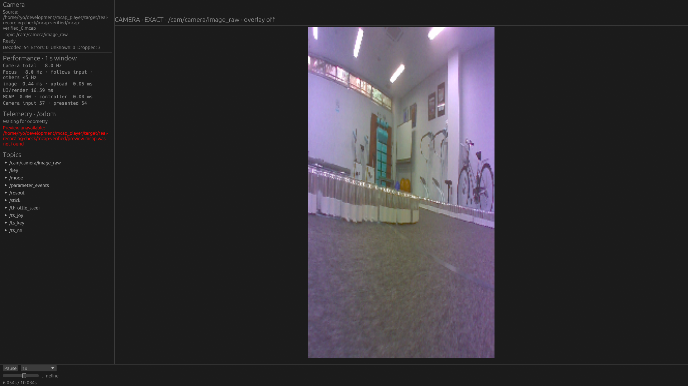
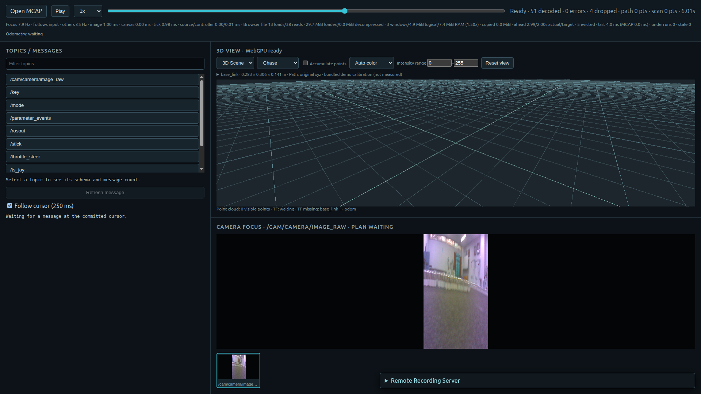

# 実収録ROS 2記録の確認と、Native Seekの画面反映時間

2026-10-23。製品コードは`dd31ca0`、調査開始時のHEADは`9db64d5`。
今回の変更は計測ツール・調査記録のみ。製品の再生・Seek・描画アルゴリズムは変更していない。

**実カメラを収録したrosbagでNative / Webの再生・前後Seekが通った。** その後、前回と同じ合成FHD記録でLichtblickと比較し、Nativeの残る待ち時間を調べた。
再訪時のデータ復元より、**変換済み画像をUIが回収するまでの待ちと、描画面の取得待ち**が大きかった。

## 実収録データで確認したこと

ローカルの`racer/tools/rosbag/rosbag2_2021_09_25-16_16_42/rosbag2_2021_09_25-16_16_42_0.db3`を使用。
2021-09-25のROS 2 SQLite記録で、室内を走行するカメラの実画像が入っている。TurtleBot3の記録とは扱わない。

| 項目 | 内容 |
|---|---|
| 記録時間 | 約10.034秒 |
| 全メッセージ | 600、画像以外に操舵・制御等のトピックも保持 |
| Camera | `/cam/camera/image_raw`、`sensor_msgs/msg/Image` |
| 画像 | rgb8、180 × 320、step 540、100枚 |
| 画像間隔 | 中央値100.011205ms。合成した等間隔時刻に置き換えない |
| 元SQLite SHA256 | `ebe5e0e155da0ce535ea907d167e68f94296213a4957575dac9d8b3a05980f65` |
| MCAP SHA256 | `f5f5b332fe6a61c2dfc91992f4aec62b5d8c9526bc97a8be77632677b469e7f7` |

ROS 2 Jazzyの`rosbag2_py.SequentialWriter`で非圧縮・20 ChunkのMCAPへ変換し、`SequentialReader`で読み直した全600件について、**topic・log time・serialized CDRが元SQLiteと一致**することを検証した。画像の回転、resize、再エンコード、時刻の正規化はしていない。元SQLiteはread-only / immutableで読み、作業用コピーだけを使用した。

このアプリがSQLite rosbagを直接開けるという検証ではない。MCAPへの格納形式の変換を挟んだ実収録ROSメッセージの互換性確認である。
元記録・変換後記録・100枚の抽出画像はコミットしない。[source.json](recorded/source.json)に元メッセージの時刻・寸法・CDRのSHA256を保存した。

NativeはNVIDIA Vulkan、Webは通常起動したChrome / X11でNVIDIA ANGLE、2D Canvas・WebGL・WebGPU enabledを確認した。両者ともFHD viewport。

- 記録先頭からの1 → 7 → 4 → 9.9 → 1秒を指定し、正しい最新画像へ前後Seekできた。
- 元画像100枚から独立に抽出した88点のRGBと画面の88点を照合し、全5地点で正しい画像が最も近かった。Nativeの平均絶対誤差は約3.5〜5.3/255、Webは約4.6〜7.7/255。表示時のsampling差を含むため画素完全一致を条件にしない。
- Nativeは画面に使用したtextureの絶対log timeが、元rosbagの正確なpredecessorと一致した。Webのsliderは正規化小数なので、元画像との独立した画素照合で確認した。
- Seek後に5秒再生・pause。Nativeは48回の新しい画像draw（時刻はすべて元記録に存在し、単調増加）、Webは46回のcamera composition、decode errorは0だった。Nativeのトレース有効対照も47回で成功した。
- 全フレーム表示の保証とは区別する。再生中のcoalescing/dropはNativeで3件、Webで4件あり、入力10Hzの全100枚を一枚も落とさず描いたという結果ではない。操作確認のpollingもあるため、5秒の値を精密な更新Hzとして扱わない。

これは小さいRaw画像1台の機能確認。実収録のFHD/4K・30Hz・巨大Chunk・多数カメラ・長時間記録・TF/Pathの物理整合性を確認した結果ではない。記録にはTF/Pathがなく、Nativeのpreview sidecar未生成の通知、WebのTF/Path待機表示は想定内。

| Native 実収録画像 | Web 実収録画像 |
|---|---|
|  |  |

Nativeのpause直後のスクリーンショットには、直前のフレームで作ったボタン表示が残っている。pauseの確認は、その後500ms texture時刻が変化しないことで行った。

## Web確認で見つかった描画条件の差

ヘッドレスChrome＋SwiftShaderでは、camera thumbnailが表示されてもfocus canvasが黒いままになる試行が2回あった。[失敗画面](screenshots/headless-canvas-failure.png)と結果も保存した。
`--disable-accelerated-2d-canvas`を加えると、同じheadless条件で画素照合と再生が成功した。
その後、**通常のheaded ChromeでCanvasアクセラレーションを無効にせず同じ検証が成功**した。

現時点の切り分けはブラウザの描画条件まで。アプリに回避コードは追加していない。全ブラウザで再現しないとは断定しないし、headlessの黒画面をMCAPのread/decode失敗とも扱わない。
headedの初期2試行はページ生成待ち／初回起動条件により開始できず、実録再生の失敗ではない。最終試行は`--no-first-run --no-default-browser-check --password-store=basic`を使用した。
これらの機能確認は性能比較の試行と分離している。

## LichtblickとのSeek比較

実収録確認の後、[前回の往復Seek](../2026-10-22-seek-revisit/README.md)と同じ合成記録・操作列を使用した。
FHD rgb8、4カメラ各10Hzの混在記録から1台だけ表示。Zstd、8 MiB設定のChunk、画像領域約1600 × 900、ウィンドウ1920 × 1080。

操作列は0.11, 0.21, 0.31, 0.41, 0.31, 0.21, 0.11秒を2周。毎回正しいpredecessorを画素で確認し、Nativeはtexture log time、Lichtblickは確定cursorも確認する。各操作後に300ms待つ。この待機はlatencyから除く。
2周目の最初は直前と同じ0.11秒なので、画像が最初から一致する。**この重複操作を集計から外し、残る2周目6操作を再訪とした。** 前回の集計値と小数点まで直接比較しない。

各条件3新規process。Nativeの同一binaryでトレースoff/onの対照を取り、Lichtblick Desktop 1.29.1も各3回実行した。順番は反転を挟む。操作・完了確認は前回同様、Native制御ファイル／Lichtblick CDP、5ms polling、画素再確認10ms。マウスからのend-to-end latencyではない。

| 条件 | 各processの再訪中央値 ms | その中央値 ms |
|---|---|---:|
| Native・トレースoff | 85.0 / 85.1 / 86.4 | 85.1 |
| Native・トレースon | 83.8 / 82.6 / 84.7 | 83.8 |
| Lichtblick | 60.5 / 62.7 / 60.8 | 60.8 |

ログ有効化による大きな中央値の増加はこの3回では見られなかった。トレースによって速くなったという結果ではなく、少数試行のばらつきがある。短いCPU区間ではログ自体の負荷を無視できない。

RTX5070Ti / NVIDIA Vulkanとhardware WebGLを各runで監査。入力SHA256を起動前に読むcache-allowed条件で、cold diskの比較ではない。この比較の実験用PSS guardは4 GiB。全9回成功、guardによる打ち切りなし。

## Nativeのどこで待っているか

同じoperation ID・画像log timeで、操作受理、復元、worker submit/start/end、結果回収、upload、image draw、surface acquire、queue submit、present呼び出しを結んだ。測定専用patchは[native-seek-timing.patch](native-seek-timing.patch)。元の処理順やworker数を変えず、ログのon/offを環境変数で切り替える。

各process内の再訪6操作の中央値を求め、さらに3processの中央値を示す。

| 区間 | ms | 解釈 |
|---|---:|---|
| Seek開始 → 復元完了 | 0.131 | 物理cacheが温まった再訪。区間内のログ負荷も含む |
| 復元完了 → decode submit | 0.941 | UI処理とworker用入力copy等を含む |
| submit → worker開始 | 0.033 | worker不足による長いqueue待ちは見られない |
| pixel変換 | 6.280 | Rawを表示サイズのRGBAへ変換 |
| 変換完了 → UIで結果回収 | 9.120 | 次のUI更新を待つ時間 |
| upload APIのCPU側区間 | 0.331 | 実GPUで転送が完了するまでの時間ではない |
| 新画像を描くframeのsurface取得 | 16.022 | `get_current_texture()`の呼び出し待ち |
| 操作受理 → 新画像frameのpresent呼び出し終了 | 33.119 | 画面に見える時刻ではない |

区間ごとの中央値を足して全体の中央値としない。計測位置間には細かい未分類処理もある。
[全操作と集計JSON](timing-summary.json)には初回のChunk未訪問時も保存した。最初の4地点の復元は約13.4〜15.8msで、キャッシュ済み再訪の0.13msと分ける。

コードとトレースは次の順序を示している。

```text
UIで完了結果を回収・新画像をsubmit
  → UIを組み立てる
  → surface取得で待つ（この間にworkerが完了しても回収しない）
  → 以前の画像のframeをsubmit/present
次のUI更新で完了結果を回収
  → 新画像をupload・UIを組み立てる
  → 再びsurface取得で待つ
  → 新画像のframeをsubmit/present
```

`CameraDecodeQueue`の完了はchannelへ渡され、UIの`upload_latest`で回収される。完了通知で、その時点の描画準備をやり直す経路はない。rendererはFIFO、`desired_maximum_frame_latency=2`、pause中もRedrawRequestedを連続して要求している。
**変換完了を確認する位置がsurface待ちより前にある**ことが、余分なframe待ちを作る具体的な構造上の候補である。

実収録の小画像でも追加トレースを実行した。前後の4地点でpixel変換は約0.15〜0.52msなのに、結果回収待ちは約15.2〜16.3ms、操作受理からpresent呼び出し終了は約33.3〜33.5msだった。
[実収録の区間結果](recorded-timing.json)も、変換速度だけでは待ち時間がなくならないことを示す。ただし、この機能確認の150ms settling込みの外部所要時間をSeek latencyとして使わない。

### まだ分離できていない約50ms

合成FHDの各操作について、外部から画素一致までの時間から、内部の「操作受理→present呼び出し終了」を引くと、再訪中央値で約49〜52msが残る。
この残差には**操作注入から受理までの待ち、FIFOに既に並んだframe、compositor、画素観測／polling**が混在している。
`frame.present()`が返ることはscanout完了ではない。これをGPU実行時間やtexture upload時間と断定しない。

今回、内部Instantと外部monotonic時刻の絶対対応、およびOS/compositorのpresentation feedbackは記録していない。したがって残差を全部「GPUの2frame queue」と数値上断定するには追加計測が必要。
Lichtblick内部に同じトレースは入れておらず、差24msを特定のLichtblick実装一つの効果とも断定しない。

## 次に試す順番

1. **surface取得の待ちが済んだ後、UI構築前に最新のdecode完了を回収できる処理順を検証する。** 新しいmanagerやdecoder cacheを作る前に、同じ画面更新回数でframe待ちが減るか調べる。
2. FIFOの最大frame latencyを2→1にした測定対照を作り、対応するGPU/backendで画面反映・連続再生Hz・CPUにどう影響するか測る。未測定なので製品の設定はまだ変えない。
3. 必要ならworker完了によるevent通知／描画要求を検討する。UIのtick回数を表示周期以上に増やしたり、画面に出ない画像を裏で描く方針にはしない。
4. それでも残る場合は内部・外部clock対応とpresent feedbackを追加して残差を測る。Raw変換の6msも改善候補だが、JPEG decoderの再実装やworker増設を今回の主対策にはしない。

pause中Seek、逆方向Seek、同一frame、古いgenerationの結果の破棄、resize、失敗時rollbackを維持する。改善を実装する場合はLichtblickと同じ画素確認を続け、連続再生のHz・メモリ・CPUも対照にする。

## 再現・検証・保存物

[manifest.json](manifest.json)に全試行の結果・ログ・校正・スクリーンショットの元SHA256を保存した。失敗や起動前失敗も削除していない。元recordingsとbinaryは含めない。Native機能確認に使用した正確な[harness](scripts/check_recorded_camera_measured.py.gz)も保存した。現在のtoolは測定後に既に終了したprocessのcleanupと参照画像抽出の書き方を整理したもので、検証条件は同じ。
ビルドscriptはfinallyで全製品ソースを戻す。計測patchに以前の比較用Scene設定も含まれるが、この計測はCameraのみでSceneを購読・表示しない。

```sh
python3 tools/performance-probe/build_seek_timing_probe.py
# 実録確認: source.jsonとimages/は下記の抽出scriptで作る
python3 tools/performance-probe/check_recorded_camera.py \
  --source target/real-recording-check/source.json \
  --data target/real-recording-check/mcap-verified/mcap-verified_0.mcap \
  --output /tmp/new-recorded-native
# matrixは測定時の絶対パスを実行環境に合わせる
python3 docs/performance/2026-10-23-recorded-seek/scripts/run_seek_timing_matrix.py
python3 tools/performance-probe/summarize_seek_timing.py \
  --runs /tmp/mcap-seek-timing --output /tmp/new-timing-summary.json
```

実録の[抽出script](scripts/prepare_real_rosbag.py)はホストPython＋Pillow、[変換script](scripts/convert.py)はROS 2 JazzyをsourceしたPython＋rosbag2_pyで実行した。作業用SQLiteは`target/real-recording-check/input/source.db3`へコピーする。これらは今回の記録に限定した再現scriptで、汎用converterや製品の入力APIにはしていない。出力先は新規directoryを用意する。
Webの[確認script](scripts/check_recorded_web.py)と[専用ブラウザ起動](scripts/recorded_hardware_browser.py)も保存した。`PYTHONPATH=tools/performance-probe`を設定し、script内のrepo/data/outputパスを環境に合わせて実行する。Web配信物は前回の`dd31ca0`で検証済みのrelease buildを使用。

今回の検証は測定専用Native releaseビルド、Python compile／既存のcamera timing unit tests、実収録変換600件の全件比較、Native / Web機能確認、9回のGUI比較。製品Rustコードの差分がないためworkspace全テストは再実行していない。
[cleanup.json](cleanup.json)に今回の32 owned PIDがすべて終了したことを記録。他用途のprocessには手を加えていない。画面は初期Offだったがcleanup時にIdleHint=noだったため、その時点では自動消灯していない。
