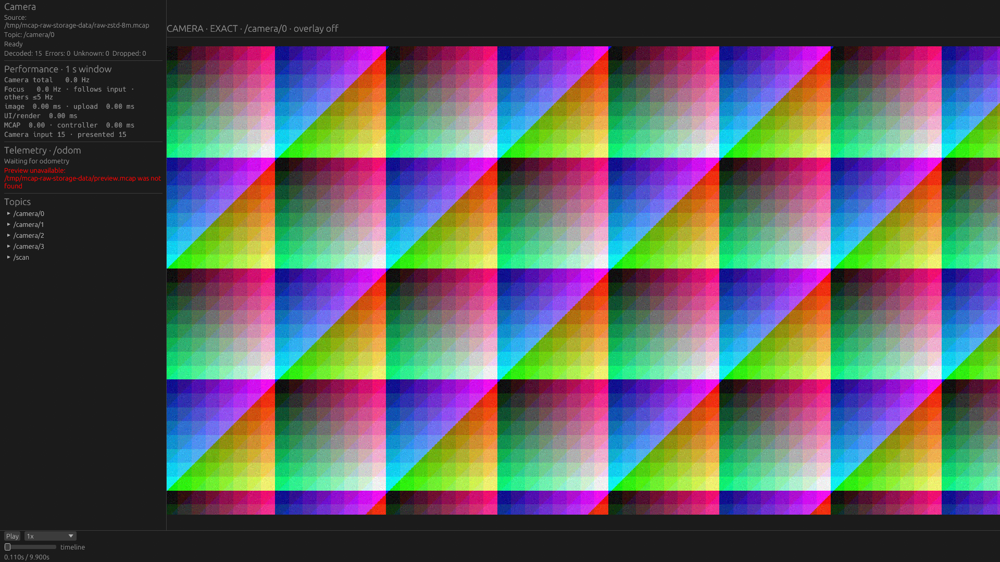
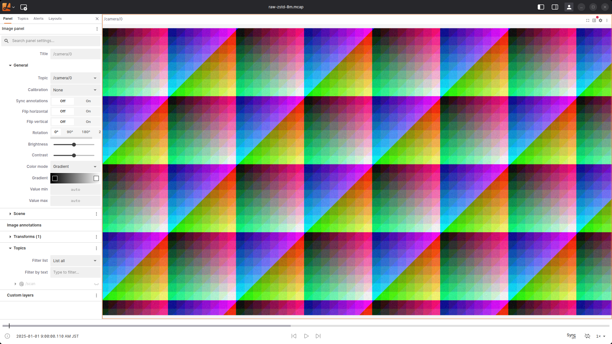
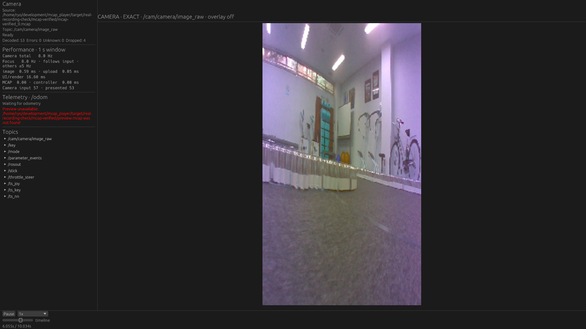

# Native Seek: decodeをsurface取得待ちと重ねる

2026-10-23。変更前の製品は`ad3ccf3`。前回の[実録確認・段階別計測](../2026-10-23-recorded-seek/README.md)を受け、画面反映までの待ちを改善した。

## 変更と理由

以前は、cameraの完了結果を回収してUIを組み立てた後に、FIFOのsurface取得で待っていた。その間にpixel変換が完了しても次のUI更新まで回収できず、新画像を組み込んだframeで再びsurface取得を待っていた。

今回のNativeは次の順番にする。

```text
再生・queryを進める
  → 最新のcamera画像を既存workerへ投入
  → FIFOのsurface取得を待つ（workerは並行して変換）
  → 完了結果を回収・GPUへupload・overlayを更新
  → UIを構築・Scene等を描画
  → 取得済みsurfaceへ描画してpresent
```

- `queue_camera_frames`と`upload_ready_camera_frames`に、既存のsubmitと回収/uploadを分けた。新しいqueueやmanagerではない。
- `SurfaceTexture`はappからrenderへ所有権を渡す。取得済みframeの暗黙の保持状態や、余分な画面外のrenderを追加しない。
- surface取得のエラー処理はappの既存のLost/Outdated/OutOfMemory対応へ返す。取得後の描画からは、不要になった`Result<_, SurfaceError>`を除いた。
- workerは既存の2個、inputは既存の64 MiB予算、完了channelは既存の2件、各cameraのpendingは既存の最新1件。decoded cacheや別の先読みは追加しない。
- source/feature state、Seekのtransaction、queue generation、古い結果の破棄、resize時のgeometry検査は維持する。overlayには実際に表示した画像の時刻・source寸法を使う。
- FIFOと`desired_maximum_frame_latency=2`は維持する。描画メトリクスには移動したsurface取得の時間も含め、待ちが消えたように見せない。

## 最初の対照: FIFO latencyを1にするだけでは改善しなかった

同じ測定用binaryで、frame latencyのhintを2/1へ切り替え、Lichtblickも各3回測った。
小Chunkの再訪中央値は2で86.2ms、1で85.7ms、Lichtblickで59.7ms。約1frame分の改善は見られず、製品には採用しなかった。

[fifo-summary.json](fifo-summary.json)に全結果を残す。このbackendがhintをどのswapchain構成へ反映したかは追跡していないため、「全GPUでlatency=1が無効」とは判断しない。
この段階の一時的な製品差分は[product.patch](product.patch)、実際の測定用差分は[native-seek-timing.patch](native-seek-timing.patch)。最終製品の設定とは区別する。

## シークの変更前後とLichtblick

最終binaryで、前回と同じFHD rgb8・4カメラ混在・Zstd 8 MiB設定の記録から1カメラだけ表示した。
1920×1080 window、画像領域約1600×900、RTX5070Ti / NVIDIA Vulkan、Lichtblick Desktop 1.29.1 hardware WebGL。
入力は合成記録で、実収録は別に機能確認した。

操作列は0.11, 0.21, 0.31, 0.41, 0.31, 0.21, 0.11秒を2周。毎回正しいpredecessorを画素で確認し、Nativeはtextureの絶対log time、Lichtblickは確定cursorも照合した。
2周目の先頭は直前と同じtargetなので除外し、残る6操作を再訪とした。各操作後の300ms待機はlatencyに含めない。

各3新規process。変更前・後・Lichtblickを順次起動し、反復ごとに順番を反転した。操作完了確認は両者5ms、画素再確認10ms。
操作はNativeの制御ファイル／Lichtblickの既存player APIへ渡す。通常のマウス操作全体のlatencyではない。

| 条件 | 各processの再訪中央値 ms | 代表値 ms |
|---|---|---:|
| Native変更前 | 83.4 / 84.1 / 82.5 | 83.4 |
| Native変更後 | 68.5 / 66.6 / 66.1 | 66.6 |
| Lichtblick | 63.2 / 60.4 / 59.1 | 60.4 |

Nativeは約20.2%短縮した。Lichtblickとの差は約23.1msから約6.2msになった。性能の全条件で同じ改善率を保証するものではない。

各process内の再訪6操作の中央値を求め、その3回の中央値を代表値にする。全操作・各runの値は[final-summary.json](final-summary.json)。
入力SHA256を起動前に読むcache-allowed条件。cold disk・ネットワーク・初回の巨大Chunk展開を速くした結果とは区別する。
今回のsource I/O、キャッシュ、codec、表示寸法は変更していない。PSS guardは4 GiBの実験用制限で、製品の上限ではない。

### 区間の確認

最終版の別トレースrun（再訪6操作）の中央値:

| 区間 | ms |
|---|---:|
| 復元全体 | 0.130 |
| Raw pixel変換 | 6.148 |
| 変換完了→結果回収 | 8.828 |
| surface取得 | 14.967 |
| 操作受理→新画像present呼び出し終了 | 16.842 |

前回のトレースでは最後の区間が約33.1msだった。最終版では約1frame短くなり、外部の画素確認でも改善した。短いCPU区間はログ負荷も含む。

表の区間は並行しているので加算しない。新しい順序では、surface取得待ちにpixel変換と結果回収待ちが重なる。
`present()`呼び出しの終了は物理的な画面表示完了ではない。外部画素確認までの残差には受理前の待ち、FIFO/compositor、観測が含まれ、GPU実行時間と断定しない。

## 連続再生への影響

最終binaryと変更前binaryを、各条件3回ずつ新規processで比較した。測定中にRustのビルド／テストは動かしていない。

- FHD Raw 30Hz: カメラ1台／4台。mixed・非圧縮・8 MiB設定、5秒記録から4秒を測る。表示ポリシーはfocus入力追従、背景5Hzで揃える。
- PointCloud2: 6万点、10Hz、Sceneだけを6秒測る。viewと着色・点サイズを揃える。
- 各cameraの画素から更新・画像時刻の進みを観測し、Sceneは画面CRC変化を観測する。単なるredraw要求回数を更新Hzにしない。
- CPUはprocess tree（1コア=100%）、メモリはsample PSS。これはGPU allocationの独立計測ではない。
- 同じFHD window内で、1台の画像領域は約1600×900、4台は各約795×447。4枚ともFHD出力した実験ではない。
- 実験用PSS guardはcameraで6 GiB、Sceneで4 GiB。全試行で上限に達していない。

| 条件 | 可視更新Hz 前→後 | 最低背景Hz 前→後 | CPU % 前→後 | peak sample PSS MiB 前→後 |
|---|---:|---:|---:|---:|
| FHD Raw 30Hz × 1表示 | 29.31 → 29.52 | — | 30.0 → 31.2 | 274.4 → 274.2 |
| FHD Raw 30Hz × 4表示 | 29.53 → 29.53 | 5.01 → 5.01 | 37.7 → 41.4 | 357.4 → 345.9 |
| PointCloud2 6万点・10Hz | 9.90 → 9.90 | — | 7.5 → 6.8 | 267.4 → 267.4 |

4台表示ではCPUが約3.7ポイント増加した。更新Hzは維持し、PSSの代表値は約11.5 MiB低かった。新しいcache/workerはないが、処理順変更がCPUや常駐量へ全く影響しないという結果ではない。短い3反復なのでCPU増加の内訳や小さいPSS差の原因までは断定しない。

[playback-summary.json](playback-summary.json)に試行別のCPU・PSS・各cameraの結果を保存した。4カメラではfocusのHzだけでなく、背景の最低更新頻度も確認する。
4秒のcamera測定を長時間の保証とはしない。画素観測は90Hzで、フレームを取り逃す可能性があるためvisible更新Hzは下限として扱う。

## 実収録rosbagと回帰検証

前回確認した2021年の実録ROS 2記録（SQLiteをCDRとlog timeを保ってMCAPへ変換、180×320 rgb8・約10Hz）も、最終binaryで再確認した。
1→7→4→9.9→1秒の前後Seekで、元画像100枚との画素照合と正確なpredecessor時刻を検査し、Seek後の5秒再生・pauseも確認した。

実録確認は成功。5地点すべてで元画像とtexture時刻が一致し、5秒再生では47回の新しい画像drawを確認した。coalescingにより全入力frameの表示を保証したものではない。[結果JSON](runs/recorded/actual/result.json.gz)に保存した。

workspaceのfmt、Clippy全target、全テスト、関連crateのWASM check、Web release build、ROS 2 Liveを有効にしたNative単体テストが成功した。
ROS Liveは84 passed / 3 ignoredで、DDS実機smokeを実施したという意味ではない。
Python compile、既存のcamera timing unit tests、集計・artifact hash・文書リンクも確認した。単なる定数やコード順の写経testは追加せず、実GPUでの画像一致と既存のseek rollback / generation / resize等の回帰を使った。

## 保存物と再現

[manifest.json](manifest.json)に、採用しなかったFIFO対照・最初の処理順prototype・最終版・連続再生・実収録を分けて保存した。全56試行が成功。主比較と初期試行を混ぜず、それぞれの結果を保存した。
prototypeと最終版の違いは、取得後の描画をinfallibleにした内部signatureの整理。最終比較の主集計には最終binaryだけを使用する。
最終製品の全Rust差分は[product-complete.patch](final/product-complete.patch)に保存した。測定時のbuilderは元々instrument対象fileだけをproduct.patchへ含めていたため、最終後にGraphics rootも含む完全な差分を別保存し、今後のbuilderにもそのfileを追加した。正確な測定時のbuilderもgzipで保存している。
元recordings・binaryはコミットしない。各resultに入力・binary・harnessのSHA256を含む。

```sh
# 変更済みの作業treeから測る場合のみ --allow-working-tree を指定する。
python3 tools/performance-probe/build_seek_timing_probe.py \
  --report docs/performance/2026-10-23-seek-latency/final \
  --binary-name viewer-native-seek-order-final
# data/binary/outputの絶対パスは実行環境に合わせる。
python3 docs/performance/2026-10-23-seek-latency/scripts/run_seek_order_final_matrix.py
python3 docs/performance/2026-10-23-seek-latency/scripts/run_playback_order_matrix.py
python3 tools/performance-probe/summarize_seek_timing.py \
  --runs /tmp/mcap-seek-order-final --output /tmp/new-seek-summary.json \
  --group before --group after --group lichtblick --group trace
```

変更前binaryを再ビルドする場合は`ad3ccf3`の別worktreeで[初期のproduct.patch](product.patch)を適用し、保存した`build_fifo_probe_measured.py.gz`を`tools/performance-probe/`へ展開する。`--allow-working-tree --latency-control`と新規report/output名を指定してビルドし、計測時は`MCAP_BENCH_FRAME_LATENCY=2`を指定する。初期patchのhint=1をoverrideして変更前の2へ揃えた条件である。

計測専用の配置・操作・時刻ログは一時的に適用し、ビルド終了時にfinallyで全製品sourceを復元する。
トレースは通常off、区間調査の別runのみon。変更前binaryのFIFO overrideは2を指定する。変更後binaryにはそのoverride自体を入れていない。

## スクリーンショット

同じ0.11秒へのSeek後。速度の証拠には静止画ではなく各操作の画素確認を使う。

| Native変更前 | Native変更後 | Lichtblick |
|---|---|---|
|  |  |  |

最終版の実録表示: 

[cleanup.json](cleanup.json)で今回の102 owned PIDがすべて終了したことを確認した。画面は計測開始時からOnだったため変更していない。他用途のprocessは停止していない。

## 残る課題

Lichtblickとの差はまだ残る。次は外部操作受理と内部clockの対応、FIFO/compositorのpresentation feedbackを測り、残差を分ける余地がある。
連続ドラッグ・重なるSeek/cancel、他のGPU/backend、画面電源Off、重い3Dと画像の同時表示、実収録のFHD/4K・巨大Chunkの性能は今回の主比較に含めない。
この変更だけで未訪問の巨大ChunkのI/O・展開が速くなるわけではない。新しいcacheやthreadを追加する前に、実際に残る区間を測る方針を続ける。
