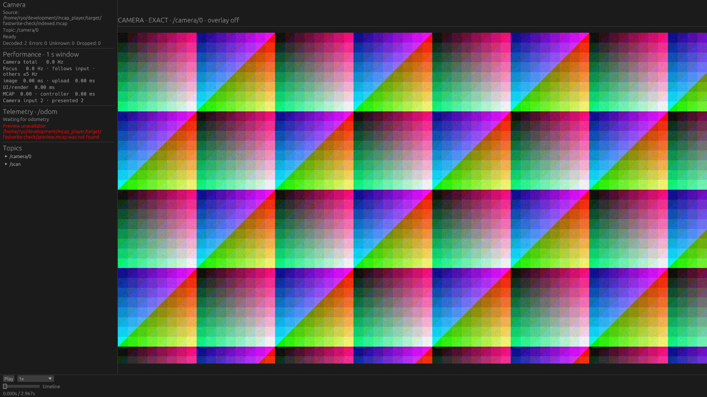
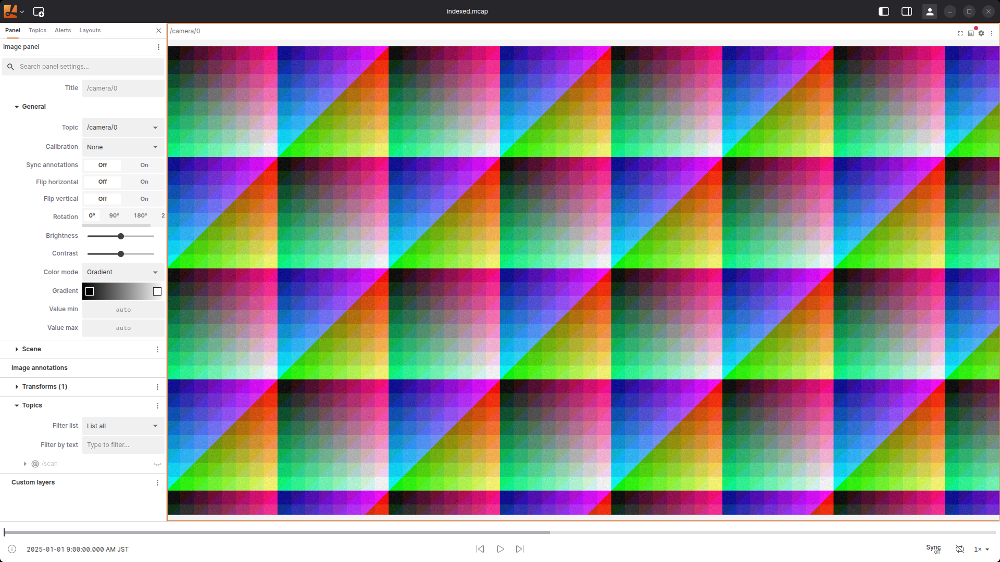

# fastwriteのNative / Lichtblick Desktop比較

同じROS 2 fastwrite出力と、公式CLIで索引・Zstd Chunkを付けた出力を使った。
Native mcap_player（15174eb）とLichtblick Desktop 1.29.1をRTX 5070 Tiで順番に実行し、各条件3反復。
全9試行が成功した。値は各runの指標の中央値。

| 入力・app | 画像更新 Hz | CPU %（1 core=100%） | 再生中PSS最大 MiB |
|---|---:|---:|---:|
| fastwrite・Lichtblick | 29.75 | 147.98 | 2018.83 |
| 変換後・mcap_player Native | 29.11 | 38.66 | 257.14 |
| 変換後・Lichtblick | 29.74 | 188.27 | 1458.92 |
| fastwrite・mcap_player Native | 直接再生は非対応 | — | — |

両アプリとも変換後の画像をほぼ30Hzで表示した。この条件ではNativeのCPU・PSSが小さい。
Lichtblickはfastwriteをそのまま開ける。変換でPSSが減る一方、Zstdの処理を含むCPUは増えた。
Nativeの非対応を高速なopenとして比較しない。変換時間・追加ストレージは再生値に含まれず、
直接利用できるLichtblickとの使い勝手の差が残る。

## 条件と限界

- 前の[fastwrite変換検証](../../verification/2026-10-24-fastwrite/README.md)と同じファイル。
  合成FHD rgb8、1カメラ30Hz＋Scan 10Hz、3秒・120メッセージ。実際のrosbag2 fastwrite writerで生成。
  保存順・payload・時刻等の一致を別途検証済み。
- 同じ`/camera/0`だけを表示する。Scene、Scan、overlay、サムネイル、Inspectorは表示しない。
  ウィンドウ1920×1080、画像領域1600×900。Native Vulkan / Lichtblick hardware WebGLを毎回確認。
- 実画像の画素を90Hz目標で観測し、アプリ別に校正した8種類の参照と照合する。
  8種類は約267msで循環する。sample gapが約133ms以上なら失敗させるが、画素だけで長時間の
  絶対フレーム時刻は証明しない。更新Hzは観測できた変化の下限。
- 連続再生は3秒、記録末尾は約2.967秒。長時間負荷や定常状態の一般的な比較ではない。
  各試行の前に独立したプロセス・Electron profileを作り、順番は反復ごとに反転。
  入力SHA256を先に読むcache-allowed条件。cold diskや巨大bagへ一般化しない。
- CPUとPSSは全子孫プロセスを含む。CPUは起動・校正を除き、再生中の値。PSSは約250ms間隔のsample最大。
  観測Python、X server、compositor、GPU VRAMは含まない。観測処理の負荷は測定環境に加わる。
  アプリ全体4GiB PSSの外部保護上限へ到達した試行はなかった。
- Nativeの画像とwall timeの位相差中央値は約67ms、Lichtblick変換後は約32msだった。
  Play操作の注入方法・観測位相が違うため、撮像から表示までの遅延やcodec速度の差とは扱わない。
- Nativeは表示配置・操作注入・時刻ログの[計測patch](native-measurement.patch)を適用した隔離ビルド。
  I/O、decode、cache、描画周期のアルゴリズムは変更していない。製品ソースは変更していない。

## 実画面

同じ先頭画像、同じ画像表示面積。sidebar等のUIは各アプリのまま。

| Native | Lichtblick Desktop |
|---|---|
|  |  |

[各試行と中央値](summary.json)、[実行順・コマンド](manifest.json)、`runs/*-result.json.gz`に
GPU、入力・binary・harness・patchのSHA256、全画素sample、CPU/PSSを保存した。
3件の校正結果と参照も含めて全試行を残す。元のfastwrite校正はmanifest以前に1回実行し、
`runs/calibrate-fastwrite-lichtblick-*`へ保存した。

再現には既存の`tools/performance-probe/measure_desktop_workload.py`を使う。
[fastwrite.json](fastwrite.json) / [indexed.json](indexed.json)のdata・binary・patchのパスを変更し、
`--app lichtblick --calibrate`、変換後のみ`--app native --calibrate`で参照を作る。
その後`--references path/to/references.json --seconds 3`で各3反復する。
[実行スクリプト](run-comparison.py)はこのホストのパスを含む実験記録。
