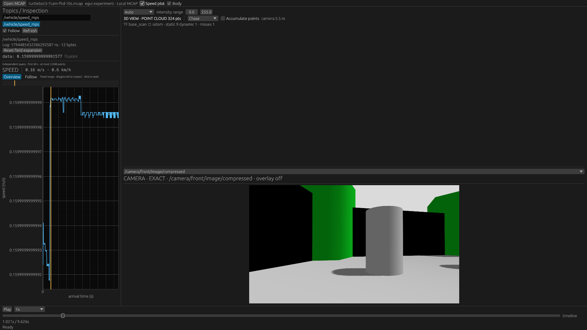

# Native / Web shared Camera, Scene and speed Plot

The three panels now have one implementation in `viewer-ui`. This experiment did not show a clear loss of camera update rate or a large steady-memory regression from sharing. It does **not** prove identical performance. Web FHD CPU was about 3% higher at the median; the short runs overlap, so neither a reliable slowdown nor an improvement can be claimed. The branch remains separate from main and published Pages.



## What changed

`viewer-ui::{camera,scene,plot}` owns the actual panels, configuration validation, local interaction/cache state and egui drawing. Their former Native implementations were removed, including the camera/scene/plot files under Native `graphics/views`. The existing shared playback controls and Inspector field tree remain shared. The common layout factory in `viewer-ui::panel::Panel` recognizes the migrated panel types. Native still wraps them in its panel runtime; the Web experiment calls the same concrete panel types.

Panels borrow presentation/query data and egui texture IDs. They return `ViewerAction` and `PanelRenderRequests`; they do not own files, loaders, playback clocks, decoded history or GPU textures. Plot errors are borrowed through `Display`, rather than depending on Native's query-error enum. `viewer-ui` does not depend on `viewer-mcap`, browser APIs, winit or ROS 2. The existing renderer dependencies remain platform-neutral.

Native keeps its synchronous/session-owned Query workers and texture upload path. Web keeps File/HTTP asynchronous loaders, Worker image decoding, generation checks and direct ImageBitmap-to-wgpu upload. Scene texture resize updates the existing egui texture binding; resizing no longer replaces an ID already referenced by the current UI frame. Neither host copies point clouds or images into a panel-owned history.

This removes duplicate **panel implementations**, not all platform integration. Layout placement, data acquisition and command execution remain host responsibilities. Creating an unrelated new data access mechanism may still require both hosts. The common factory handles registration/configuration, while Native's variant wrapping and the experimental Web's fixed layout still need wiring; automatic support for every future panel is not claimed. Other Native panels have not yet been migrated.

## The browser graph

Enable **Speed plot** after opening a Local MCAP. It uses the same `PlotPanel`, `egui_plot` drawing, point cache, Overview/Follow behavior and Seek output as Native. The host's `SpeedQuery` obtains a separate loader from the existing source and uses the existing `decode_odometry` and `SignalOverviewReducer`. It does not add Odometry to continuous playback selection.

The initial browser query is explicitly limited to the first 60 seconds, 100,000 selected input messages and 2,048 reduced points. It requests that bounded range once, so overlapping MCAP Chunks are not repeatedly decompressed for one-second graph windows. The existing loader's per-window/Chunk limits also apply. Aggregate 256 MiB read / 512 MiB decompression checks are performed after a returned window and before ROS decode; these are not pre-I/O reservations, and a single window can spend the existing loader allowance before the graph rejects it. This is a PoC limit, not a general recording-wide browser query implementation.

Disabled graphs create no query loader or graph reads. A fixed result survives Seek without rereading; Source replacement, disabling the graph and dropping a query invalidate/cancel its loader. Missing Odometry produces a graph-local error. Native's existing full-recording Plot query behavior is unchanged.

## Measurement conditions

- Baseline: `35a334e`, the initial egui host before moving the actual panels.
- Native: uninstrumented release binaries, the same `standard` layout (Camera/BEV/Scene/speed Plot), same TurtleBot3 recording and 1920×1080 client window.
- Web: initial egui host versus the shared-panel host, 1920×1080 viewport, DPR 1, NVIDIA GeForce RTX 5070 Ti, real WebGPU. This is **not a DOM-versus-egui comparison**.
- Native and Web use their existing distinct decoders and I/O. Compare before/after within a platform, not their absolute numbers against one another.
- Three repetitions per variant, interleaved before/after and reversed in alternating pairs. Five-second timed samples; the 3.9-second 4K fixture uses two-second samples so EOF is outside the interval.
- Display confirmed On. Native starts playback automatically. Two early Native probe attempts (an accidental Pause, then an unverified sleeping display) were discarded and are not in the summary.
- Web measurement copies fix both JPEG decode and offscreen Scene raster dimensions to 960×540. Both GPU texture dimensions were verified. The [before](before-measurement.patch) and [after](after-measurement.patch) patches apply **only to isolated copies**. They alter display pixels, not physical metre coordinates, source data or stream selection. Normal UI remains responsive to its actual display size.
- The recording contains seven FHD cameras, or eight 4K cameras; Web displays **one focused camera** and Scene. It does not render eight independent full-size camera panels. The Native standard layout also shows its configured thumbnails.
- Input files are SHA-256-read before launching, so these are cache-allowed client tests. CPU sums live process-tree CPU seconds; PSS is process-tree proportional resident memory. Separate GPU VRAM is not included. Web updates count GPU camera uploads, not compositor FPS or image freshness latency. Native screenshots establish visible playback qualitatively, not numerical presentation FPS.
- The source copies/binaries were frozen for timing before the final diagnostics, API visibility and stale-query regression changes. Binary hashes and all per-run scalar observations are in [summary.json](summary.json). The final application was separately rebuilt and functionally checked. These short samples are exploratory, not a release-wide performance guarantee.

## Results

Medians of the three runs. CPU `1.0` means one fully occupied logical core.

| Workload | CPU before → after | PSS MiB before → after | Focused camera uploads/s before → after |
|---|---:|---:|---:|
| Native, FHD recording, standard layout | 0.198 → 0.186 | 222.2 → 221.4 | Not instrumented |
| Web, FHD recording, Plot off | 0.486 → 0.501 | 439.8 → 440.3 | 10.03 → 10.01 |
| Web, 4K input, Plot off | 1.650 → 1.639 | 1266.1 → 1245.4 | 10.39 → 10.05 |
| Shared Web host, Plot off → on | 0.487 → 0.543 | 447.7 → 479.3 | 9.96 → 10.02 |

All Web cursor/wall-time ratios stayed approximately 1.0. The above-10 rates over short 4K windows reflect sampling/queue boundaries, not input rates above 10 Hz. FHD CPU ranges overlap: baseline 0.485–0.501, shared 0.493–0.511. The graph adds about 0.056 CPU cores and 31.6 MiB measured PSS in this workload; this additional functionality has a cost, even though camera cadence remains intact. Memory was not attributed to individual allocators or GPU resources, and GC/high-water allocation effects were not isolated. The graph's initial request-to-result observation was about 106 ms (50 ms polling granularity).

There is no evidence here that sharing itself causes a material playback regression, but the small FHD CPU increase must remain visible. Do not describe these measurements as proof that all Web functionality can be migrated without cost. A strict zero-overhead acceptance decision cannot be supported by this experiment.

## Checks

- Workspace formatting, Clippy with warnings denied, workspace tests.
- Native scene-extension / plugin-panel Clippy and tests, and ROS 2 Live tests in the Jazzy container.
- Shared UI and Web wasm32 checks; experimental and production Trunk release builds. The optional experimental wasm32 build still has unused-code warnings for production features it does not expose.
- Actual WebGPU Scene/Camera rendering, lazy Inspector, EOF, backwards touch Seek at a 390×844 emulated viewport, resume, source replacement and zero additional settled camera uploads.
- Actual speed Plot: 481 samples on the TurtleBot3 recording; no graph requests while disabled, one independent request when enabled, and no additional request on Seek.
- Hold an in-flight graph File read, replace the source, then release the old read: no old graph result appears. A new source without Odometry shows a graph-local error while ordinary playback remains Ready.

Desktop Chrome touch emulation is not Android device testing. Remote query I/O compiles through the existing Remote loader, but this experimental source picker still opens Local files only; a real Remote graph session has not been exercised.

## Reproduce

After committing the shared-panel implementation:

```sh
python3 tools/performance-probe/prepare_panel_sharing.py \
  --before 35a334e --after HEAD --output target/shared-panel-repro
```

Inside the development container, build each prepared copy using its own workspace, then save its Native binary and Trunk distribution separately. The display-size patches are already applied to those copies; do not apply them to the working application.

```sh
cd target/shared-panel-repro/before
cargo build -p viewer-native --release
cp /home/dev/target/release/viewer-native ../before-native
cd apps/viewer-web
trunk build egui.html --release --dist /workspace/mcap_player/target/shared-panel-repro/before-web
# Repeat in the after workspace, using after-native and after-web output names.
```

Run from the original repository root, one GPU experiment at a time:

```sh
python3 tools/performance-probe/measure_panel_sharing.py --kind native \
  --before target/shared-panel-repro/before-native --after target/shared-panel-repro/after-native \
  --data target/sample-data/release/turtlebot3-7cam-fhd-10s.mcap \
  --output target/shared-panel-repro/native --seconds 5 --repeats 3
python3 tools/performance-probe/measure_panel_sharing.py --kind web \
  --before target/shared-panel-repro/before-web --after target/shared-panel-repro/after-web \
  --data target/sample-data/release/turtlebot3-7cam-fhd-10s.mcap \
  --output target/shared-panel-repro/web --seconds 5 --repeats 3
```

For the optional graph cost, pass the shared distribution as both before/after and add `--plot`; only after runs enable it. For the 4K fixture use `target/performance-regression/data/jpeg-4k-8cam.mcap` and `--seconds 2`. The harness uses a dedicated Chrome profile/owned Native window, temporarily wakes the display and restores its previous power state. It never unlocks the desktop. Raw logs, screenshots and repeated samples stay under the ignored output directory; the repository retains the small summary, measurement patches and one representative figure.
