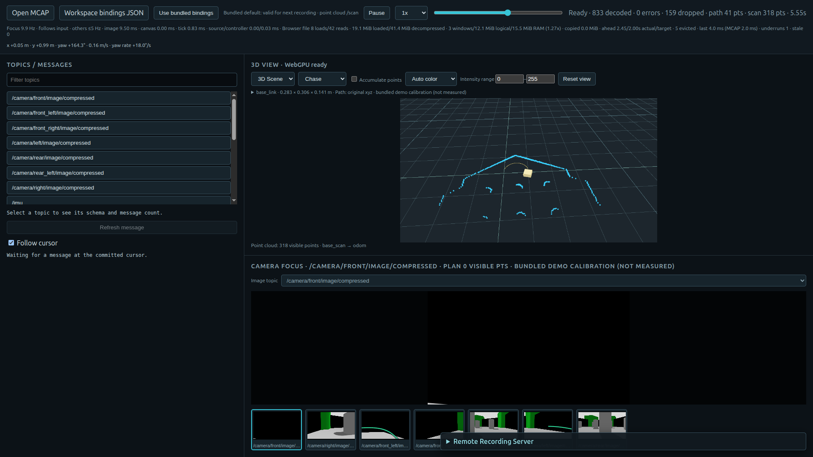
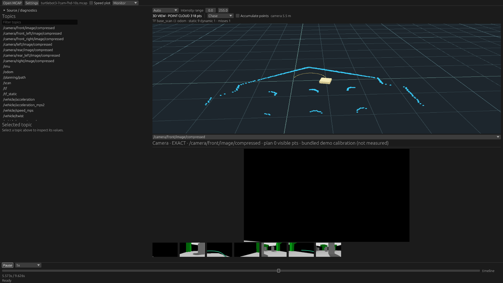

# Main DOM versus shared egui panels

The fuller egui host maintains the focused camera's input cadence in these tests. It does not show a steady-memory increase relative to main. CPU is lower in both measured workloads. This is evidence for continuing the migration, not a guarantee for every browser or recording. The feature branch remains separate from main and Pages.

| Median of three interleaved runs | Main DOM | Shared egui |
| --- | ---: | ---: |
| Seven FHD cameras: CPU cores | 0.802 | 0.682 |
| Process-tree PSS, MiB | 462.1 | 458.9 |
| Focus image updates/s | 10.09 | 10.01 |
| Slowest background updates/s | 4.90 | 4.91 |
| Eight 4K cameras: CPU cores | 2.782 | 2.599 |
| Process-tree PSS, MiB | 1374.9 | 1373.0 |
| Focus image updates/s | 10.21 | 10.36 |
| Slowest background updates/s | 2.43 | 2.71 |

CPU 1.0 is one fully occupied logical core. The 4K workload misses the background 5 Hz target on **both** hosts. Rates slightly over 10 Hz come from short sampling boundaries; the input is 10 Hz. No cursor stalls or browser errors occurred in the accepted runs. All scalar runs and binary hashes are in [summary.json](summary.json).

## Equivalent work and limitations

Main is `de8daed`. The migration source was frozen from the working tree based on `dcec372`, before the final error-display, missing-image and diagnostics refinements. The final application is rebuilt and checked separately. These measurements compare UI architectures, not one isolated refactor instruction.

Both hosts use a 1920×1080 viewport, DPR 1, NVIDIA RTX 5070 Ti and real Chrome WebGPU. They display Topics, one Scene, one focus image, all background thumbnails and projection overlays. Inspector is unselected and Plot is off. The TurtleBot3 FHD recording is 9.626 seconds; the synthetic eight-camera 4K fixture is 3.9 seconds. Files are SHA-256-read before launching; filesystem caches are allowed. No compiler or second GPU experiment runs during timing.

In isolated source copies only, focus decode and Scene raster are fixed at 960×540, thumbnails at 112×63. The camera helper is patched for **both** request and completion validation; patching only submission would cause main to discard every completed image. Physical metre coordinates, source bytes and scheduling policy are unchanged. Saved patches: [main](main-measurement.patch), [egui](egui-measurement.patch). The normal application sizes images and render targets to its actual panels. The arrangements and CSS/egui compositing differ; this is equivalent content and raster work, not pixel-identical output.

Three repetitions alternate main/egui order. Timing starts after all cameras have appeared; FHD has five-second samples, 4K two-second samples. Upload counters increment on distinct successful image imports/base-image updates, not every overlay recomposition. They are not compositor FPS, presentation latency or measurement-to-screen freshness. PSS includes the live Chrome process tree, excluding separately accounted GPU VRAM. Short runs leave allocator/GC and startup variability unresolved.

The `ready_ms` observations are retained for transparency but are **not a comparable startup metric**: main can expose a transient Ready immediately after installing a paused session, before its next buffering tick. In 4K this produced about 9 ms versus 547 ms. The probe must measure first usable image/seek completion for a sound startup-latency comparison; these numbers cannot establish an opening slowdown.

One early 4K attempt stopped because the probe incorrectly demanded at least 3 Hz from main's slowest background. The accepted probe records the observed rates instead of treating an existing baseline limit as a migration failure. That aborted attempt is excluded.

The download cost does increase: egui includes its UI host, fonts and plotting code. See the current bundle-size observation in the [design note](../../web_egui_ui_experiment.md). Steady playback results do not remove this tradeoff.

## Screenshots

Captured from real application windows at approximately 5.55 seconds. These are measurement copies with fixed rasters; panel layout and styles differ.

Main DOM:



Shared egui:



The dark front-camera view is present in the recording and appears in both hosts. Other camera thumbnails, projected paths, the physical body and the scan are visible. No image was reconstructed or edited to create these screenshots.

## Reproduce

From repository root, freeze main and the reviewed current source tree:

```sh
python3 tools/performance-probe/prepare_web_parity.py \
  --main de8daed --output target/web-parity-repro
```

In the development container, build `target/web-parity-repro/main/apps/viewer-web` with `trunk build --release`, and the egui copy with `trunk build egui.html --release`. Specify separate absolute `--dist` directories so neither build overwrites the other. Then:

```sh
python3 tools/performance-probe/measure_web_parity.py \
  --main target/web-parity/matched-main \
  --egui target/web-parity/matched-egui \
  --data target/sample-data/release/turtlebot3-7cam-fhd-10s.mcap \
  --output target/web-parity/new-fhd-run --seconds 5 --repeats 3
```

Use `--seconds 2` for the short 4K fixture. The helper explicitly wakes/restores the display, uses an isolated Chrome profile, and rejects software GPU fallback. Raw per-process samples/screenshots remain under ignored `target/`; only this summary and representative screenshots are checked into Git.
