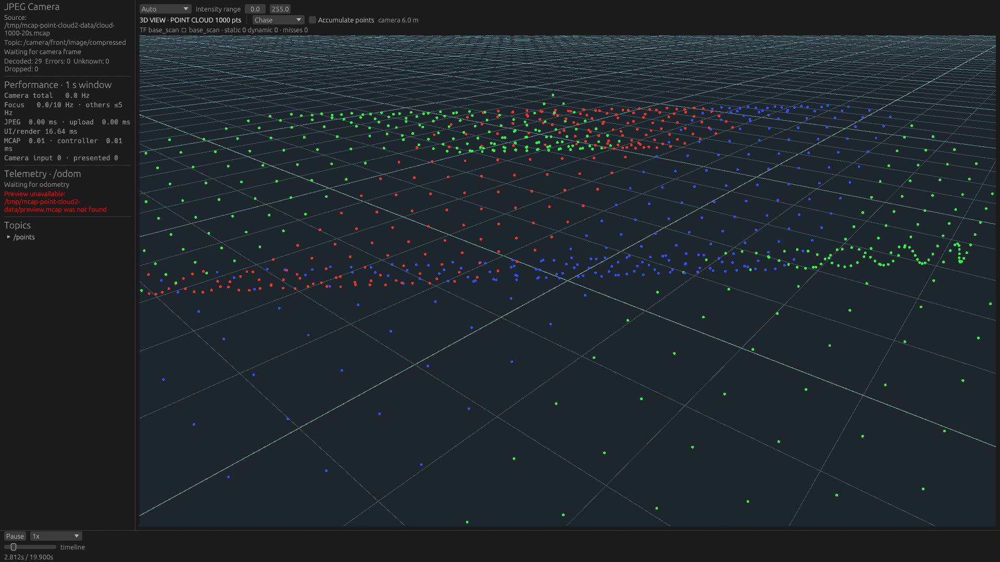
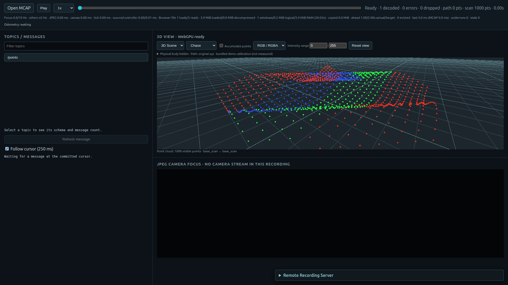
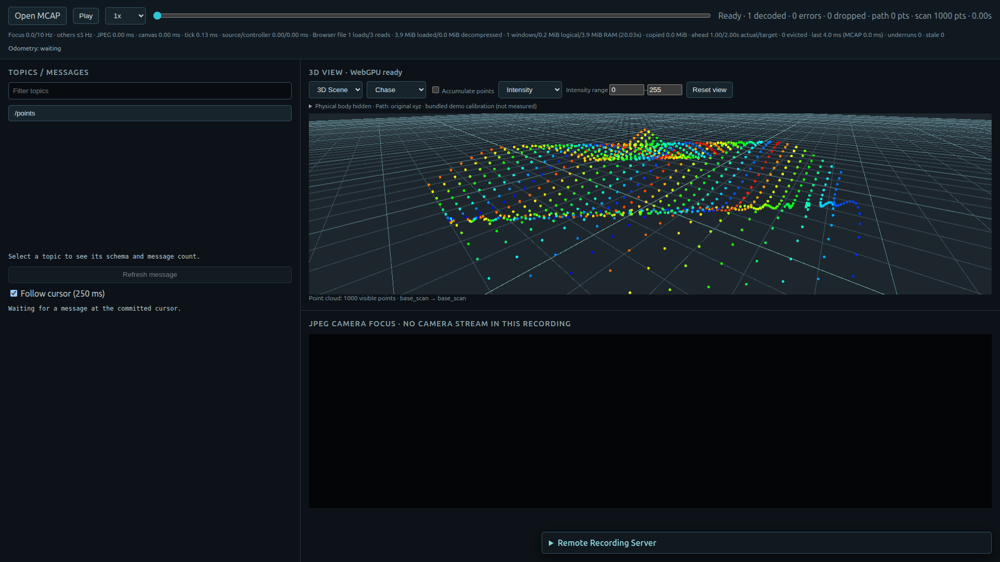
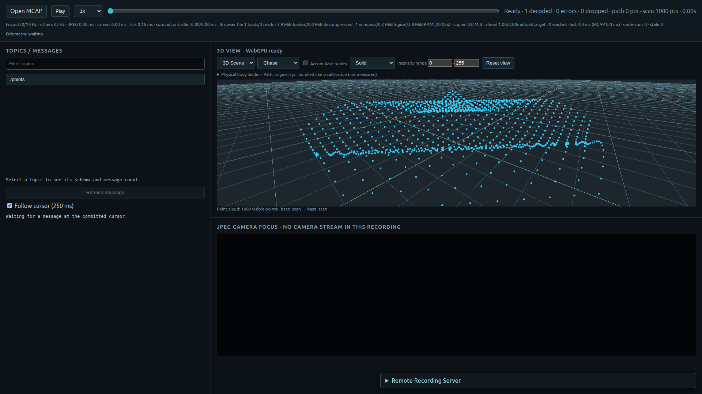

# PointCloud2 colored display verification

2026-10-20。1,000点×10 Hz・20秒のgeometry-only MCAPを通常の製品経路で開いた機能検証。
性能測定ではない。記録のXYZ、RGB/RGBA、intensityはcoreでdecodeし、shared presentationとrendererで描く。

| Native（実NVIDIA Vulkan） | Web（Chrome、WebGPU SwiftShader） |
|---|---|
|  |  |

| Web intensity | Web solid |
|---|---|
|  |  |

NativeはRTX5070Ti / NVIDIA610.57.04のDiscreteGpuを使用。
ChromeのANGLE compositorはNVIDIA OpenGLだが、実際にrequestAdapterが返したWebGPU adapterは
google / swiftshaderだった。この差をresult.jsonへ保存し、Webの結果をhardware GPU性能の根拠にしない。

単なるRGB分類ではなく、入力の3色(255,48,32)、(32,255,64)、(48,80,255)の±3 byte以内に
各色20 pixel以上が存在することを、両アプリの実スクリーンショットで確認する。
Nativeで各4,413 / 6,268 / 4,651 pixel、Webで各6,065 / 3,420 / 3,245 pixel。
WebはRGB・Intensity・Solidそれぞれの実画素も確認し、uncaptured WebGPU errorは0だった。
時刻・画像領域・構成は揃えた性能比較ではない。

この検証でNativeのsRGB textureをeguiが二重decodeする問題と、
Webの非sRGB canvasへlinear値を直接出す問題を発見し、修正後に元RGB値を再確認した。
headless Chromeの白いcanvasは主検証に採用せず、専用profileの通常X11 Chromeを使う。
通常終了で専用アプリ・Chromeを閉じる。

~~~sh
target/gpu-native/performance-probe generate-geometry /tmp/cloud-1000-20s.mcap cloud 1000 20
python3 tools/performance-probe/check_point_cloud2.py \
  --data /tmp/cloud-1000-20s.mcap --output /tmp/point-cloud2-check-new
~~~

[result.json](result.json)にdata/binary識別情報・画素数・GPU情報、
[build-sha256.json](build-sha256.json)にWeb buildと検証scriptの識別情報を保存。
全workspace clippy/tests、WASM check、Web release、ROS Live regressionの実行ログも保存する。
ROS Liveの2件のignored testはそのままで、実際のROS配信end-to-end試験は実施していない。
