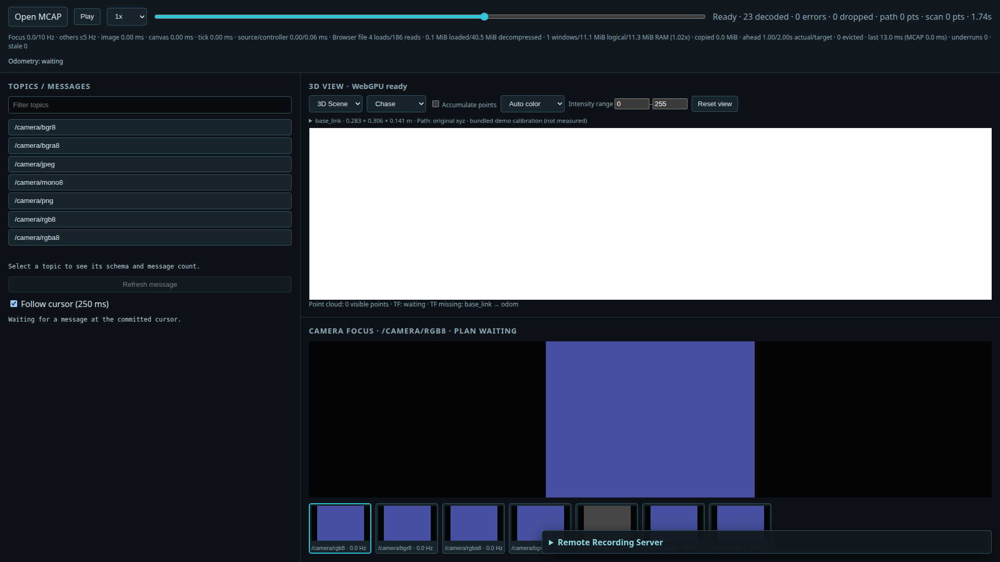

# Raw Image / PNG Camera verification — 2026-10-21

[実装範囲・制限](../../issue/016-camera-image-formats/README.md)

## データと再現

[生成仕様](../../../tests/fixtures/camera-formats/README.md)。7形式それぞれ30枚、10 Hz、320×240、7カメラを同じMCAPへ格納。
Rawには行パディングを入れ、is_bigendianを交互にする。known-colorからSeek後のsequenceも判定する。

```sh
cargo run -p ros-fixture -- camera-formats /tmp/camera_formats.mcap
python3 tools/performance-probe/check_web_camera.py \
  --data tests/fixtures/camera-formats/camera_formats.mcap \
  --camera-formats --output /tmp/camera-formats-browser.json
```

## 結果

Nativeのintegration testは、log開始+2秒、+0.5秒のexact predecessorを全7形式で読み、元画像320×240の全画素を検査する。
PNG/Rawは完全一致、JPEGは各成分±3。Native decoderの160×120出力・source寸法保持・resize後のtarget判定も確認した。
CDR/rendererの単体テストはtruncation、無効layout・サイズ・overflow、共有Bytes、channel順、非不透明alpha、coalescing、失敗restoreを扱う。

[ブラウザ生データ](browser.json)は、正規release buildをFile inputから開き、timelineの80%→20%→60%にSeekした結果。
7枚のthumbnail Canvasの中心RGBAは、各位置の正しいlatest-before sequence（23→5→17）と一致した。
例: 80%時にRGB/BGR/RGBA/BGRA/PNGは[89,80,160,255]、mono8は[89,89,89,255]、JPEGは[89,80,159,255]。
ブラウザerror/unhandled rejectionは0。

FHD 1920×1080、headless Chrome、SwiftShader、`--disable-accelerated-2d-canvas`。
これは入力形式とSeekの機能確認であり、ハードウェアGPU性能・4K多数カメラのthroughput・全プロセスメモリ上限の証明ではない。
以前のheadless accelerated Canvas2Dの透明化は今回解決したとは扱わない。
このfixtureにPath/PointCloud/TFはなく、Scene表示はこの検証の対象外。



## チェック

DockerのRust 1.91.1 / ROS 2 Jazzy環境で`docker compose run --rm dev mcap-dev-check`成功:

- `cargo fmt --all -- --check`
- `cargo clippy --workspace --all-targets --locked -- -D warnings`
- `cargo test --workspace --locked`
- viewer-core / viewer-mcap / viewer-renderer / bev-renderer / scene-renderer / viewer-webのWASM check
- Web `trunk build --release`
- `cargo test -p viewer-native --locked --features ros2-live`（80 passed、2 ignored）

ホストでもcore/renderer（native-jpeg有効）、Web、performance-probeの対象テストを実行した。
ホストのWASM checkはclang未導入で停止したため、WASMはDockerの成功結果を採用する。
既存のJPEG worker budget・壊れた画像の分離・generation破棄テストも成功した。

## セルフレビュー

入力CDRのadmission後にだけ形式を解釈し、画素変換はpresentation側に残した。
Raw追加でchunk backingを画素workerが保持しないこと、既存の入力コピー予算・stale generationの扱いが継続することを確認。
PNGのUI側検査でdecoderを構築するとancillary metadataを展開し得るため、固定長IHDRの検査へ限定した。
形式ごとの状態・パネルは作らず、Camera見出しと表示時間メトリクスからJPEG専用の名前を取り除いた。
上記の確認範囲で未修正の不具合は見つからなかった。Raw ROS liveとsidecar previewの範囲はissueに明示した。
