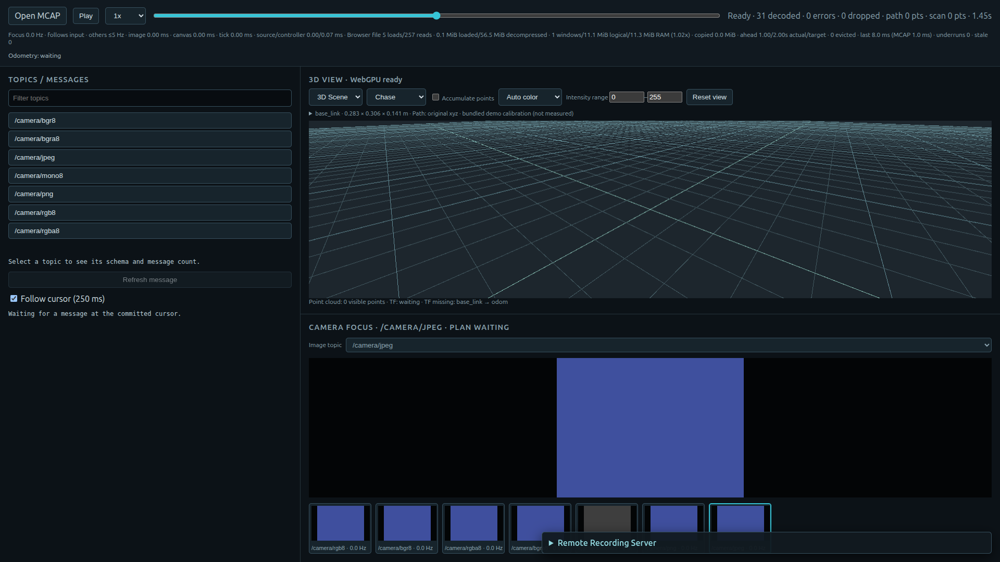
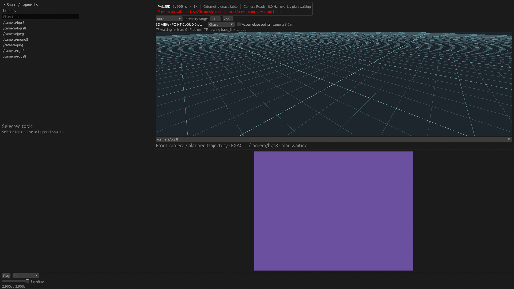

# Camera topic selection verification — 2026-10-27

Native / Webにschemaベースの画像トピック選択を追加した変更の検証。
動作・制約は[設計メモ](../../camera_topic_selection.md)を参照。

## Functional checks

- `mcap-dev-check`: fmt、workspace Clippy（warningsをエラー化）、workspace tests、WASM checks、Trunk release build、ROS Live testsを通過。
- Native UIテストを最後に追加し、`cargo test -p viewer-native dropdown_emits`とNative all-targets Clippyを追加実行。
- 画像schemaとCDR encodingによる候補抽出。名前がcameraらしい非画像や非CDR画像を除外。
- Native: 任意名への初期fallback、Raw/Compressedの切り替え、停止時刻維持、最新predecessor、切り替え後のforward、無効な選択のrollback、画像なし、source交換。
- MCAP transport: restore callback失敗後も旧cursorと選択のforward traversalを維持。成功後は新streamだけを読み、復元したtargetを重複配信しない。
- Web: 停止中のexact restore、seek中の要求先維持、表示中のfocus変更で余分なrestoreを起こさない。
- GPU Chrome / FHDから実際にdropdownを操作。Raw mono8→PNG→Raw rgb8→JPEGで1.45sを維持し、期待画素[62,62,62] / [62,80,160]を確認（JPEG誤差≤3）。別fixture交換で候補が7→3→7に更新され、非画像は候補に含まれない。
- 実録rosbag由来の`/cam/camera/image_raw`も画像候補1件となり、中間時刻の実画素[92,93,77,255]を確認。録画ファイル自体は既存のlocal検証データで、このディレクトリには再配布していない。
- Native releaseをNVIDIA RTX 5070 Ti / Vulkanで起動し、固定presetのtopicがない記録でも`/camera/bgr8`へfallbackして表示。Native dropdownの実操作・action発行は決定的egui入力テストでも確認。

Web UI script:

```sh
python3 tools/performance-probe/check_camera_topics.py \
  --output target/camera-topic-ui \
  --wake-display --vulkan-icd /usr/share/vulkan/icd.d/nvidia_icd.json
```

最初のUI script試行ではWASMのイベント登録前にファイルを選ぶraceと、記録先頭に画像がないfixtureでの待ち条件を見つけ、scriptを修正した。production codeの問題とは判定していない。`web-ui.json`は修正後の全チェック結果。

## Performance

編集前に保存したrelease assets / performance-probeと変更後を比較。
Core Ultra 7 265KF、RTX 5070 Ti、Chrome 143、FHD viewport、focus 960×540。
fixtureは既存regression suiteのSHA-256を照合し、各ケースの起動前に同じwarm readを実施。
Nativeは実際のGUIではなくproduction transport/controller/image経路を使う既存performance-probe。
Webはrelease browserを操作する。ビルドと計測を並行実行していない。
試験時のworking tree hashとは別に、suite内のprobe/dist hashが実際に使用した成果物を識別する。

Native 5ケース×3 fresh processes（中央値）: 既存の全回帰検出基準を通過。

| Case | Metric | Before | After |
| --- | --- | ---: | ---: |
| native/raw-fhd-30hz | workload_ms | 806.33 | 802.50 |
| native/jpeg-4k-8cam | workload_ms | 5012.23 | 4959.49 |
| native/selected-scan | workload_ms | 1102.13 | 1068.78 |
| native/cloud-60k | workload_ms | 24.81 | 25.81 |
| native/seek-revisit-512m | seek_revisit_ms | 0.01 | 0.01 |

Web初回3回では2項目が不合格:

- 512MiB Chunk heartbeat max: 35.30→57.20ms。
- Raw FHD Seek: 89.30→114.85ms。

この初回は削除せず`web-after-comparison.json`へ保存。
コードも閾値も変更せず、保存済み旧distの対照3回と新distの追加3回を固定実行した。
旧distのSeek中央値も113.75msとなり、初回との差は変更前でも生じた。
追加対照との比較（`web-confirmation-comparison.json`）は全基準を通過。
初回＋追加の全観測を各6回として集計した比較も全基準を通過した。

Web各6回の中央値（省略した指標もsuite/comparisonで判定）:

| Case | Metric | Before | After |
| --- | --- | ---: | ---: |
| web/raw-fhd-30hz | focus_content_hz | 29.21 | 29.52 |
| web/raw-fhd-30hz | seek_focus_ms | 102.80 | 116.20 |
| web/jpeg-4k-8cam | focus_content_hz | 9.67 | 9.47 |
| web/jpeg-4k-8cam | background_min_content_hz | 2.04 | 2.05 |
| web/jpeg-512m | focus_content_hz | 9.67 | 9.64 |
| web/jpeg-512m | heartbeat_max_ms | 36.05 | 52.60 |

これは「どの指標も同じ値」という主張ではない。特にheartbeatは変更後の方が大きいが、
全6回の中央値の差は既存の相対・絶対閾値を同時に超えなかった。
新しいdropdownを操作する時間そのもののSLOは定義していない。
Native/Webともこの変更で選択トピック数を増やす既定方針には変更していない。

再計測は[regression harness](../../../tools/performance-probe/README.md)のrun/checkを使用する。
全suite、初回不合格、追加対照の比較、checks logを同梱。

## Screenshots

Webの既知色fixtureでPNG/JPEG/Raw切り替え後（1.45sで停止）:



Native monitorで未知のtopic名へfallback（2.9s、EOFで停止）:


