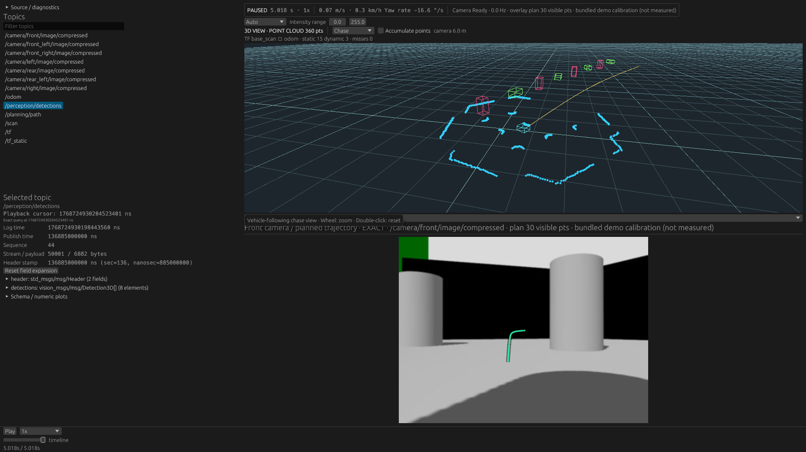

# Detection3DArray -> Wasm -> Native Scene — 2026-10-28

Continues `4125dbc` on `feature/scene-visualization-extension`.
[Architecture, limits, ABI 3 and reproduction commands](../../scene_visualization_extensions.md).

## What actually ran

The production Native application plays an indexed MCAP with
`/perception/detections` of type `vision_msgs/msg/Detection3DArray`. The host's shared
CDR decoder preserves the supported full ROS message; its fixed selected stream
feeds a latest-only Detection3D controller. Typed input crosses the common SDK wire
into an independently compiled **detection-boxes.wasm**, which chooses string-ID
handles, bbox pose/size and class-dependent colors. Host TF and the existing Scene
renderer place/draw its returned Boxes alongside the original Path and point cloud.

This is synthetic perception data over the bundled simulation-derived camera/scan
recording, not real detector output. The fixture adds 23 arrays with 8 objects and
2 classification hypotheses each. Their rate is half Path's, log time is +5 ms,
and original measurement time/frame is preserved. Original Path/camera/scan messages
are unchanged. Source, native executable, guest hashes and exact commands are in
`captures.json`. Both FHD captures use the same EOF cursor and RTX 5070 Ti/Vulkan.

| Extension disabled | Real Detection3DArray + independent Wasm |
| --- | --- |
|  |  |

The Inspector independently recognizes the complete ROS schema and shows the
8-element detections array. Selecting it deliberately creates an Inspector query
in both captures; this is separate from continuous extension selection. No images
were composited and no render/UI instrumentation was added for capture. The
optional Preview 2 sidecar was built normally. Actual GUI forward playback was
observed; exact seek/reset/failure assertions use integration tests, not claimed
OS mouse automation.

## Independent ROS interoperability evidence

A disposable Jazzy container installed `ros-jazzy-vision-msgs`
**4.1.1-3noble.20260911.140407**. Official `rclpy.serialization.serialize_message`
generated the committed 985-byte [CDR fixture](../../../tests/fixtures/ros2-detection3d/README.md).
The decoder was checked against Unicode/empty IDs, distinct bbox/hypothesis poses,
multiple classes/scores, nontrivial rotation, every covariance value and empty
results. This is not only a self-consistent repository encoder roundtrip.

All 985 truncation prefixes and malformed counts/strings/encapsulation/trailing
fields are tested. The optional fixture-regeneration script needs ROS; ordinary
playback and tests using committed bytes do not. The MCAP fixture includes full
ros2msg dependencies for generic Inspector/query interpretation.

## Semantics tested

- Disabled plan adds no detection stream; repeated demand selects/materializes it
  once. Latest-in-batch admission drops superseded invalid CDR before decoding,
  preserves deterministic ties and increments drop/decode/error counts correctly.
- Malformed seek restoration leaves both feature state and counters unchanged;
  exact predecessor restoration and no-predecessor clearing work.
- Shared SDK binary input roundtrips the complete model, including covariance and
  headers, and rejects truncated/trailing/oversized fields. No plugin parses CDR.
- Actual Wasm uses bbox pose/size and highest-score classification. Reordering
  nonempty string IDs leaves output unchanged; changing winning class changes the
  guest-selected color while retaining object ID. Empty arrays clear objects.
- Real indexed MCAP -> Wasm -> Scene: end -> first Path time (before the first
  detection) -> start -> end is compared with an independent indexed predecessor
  query. Metric TF centers, original dimensions and class colors match. Runtime
  counters prove presentation/guest adds no second host CDR decode.
- Malformed Detection3D inserted into a real indexed seek candidate leaves cursor
  and prior overlay intact. A newly configured source starts empty even when
  StreamIds are reused. Mixed per-detection headers produce an explicit error;
  the complete input facts remain in core.
- Existing Path guest and its independent input/restore integration still pass
  after rebuilding for ABI 3.

## Execution and isolation

The SDK shares typed wire encoding rather than ROS decoding. Directly linking the
original timed core initially introduced wasm-bindgen browser imports; actual wasmi
loading rejected them. Core timing is now an optional feature **enabled by default**
in Native/Web, disabled in standalone guests. Only timing instrumentation is gated.
Both independently built guests now pass the no-import policy; no embedded VM,
WASI or JS shim was added to a guest.

ABI 3 adds input-kind/variable-byte typed messages and changes update's argument to
input byte count. Output remains the bounded 60-byte Box record. ABI 1/2 artifacts
require rebuilding; current descriptors/examples/callers/tests were updated together.

## Verification and observations

`docker compose run --rm dev bash docker/check.sh` passed using the checked-out
script: workspace fmt, Clippy/all targets, workspace tests, both independent guest
builds/execution, extension-enabled Native tests, both real-recording integrations,
core without timing, WASM checks, Web release build and ROS 2 live tests. The
script is invoked directly so an older cached Docker image cannot silently run a
stale copied script. Full output is in `full-checks.log`.

The first full build stopped because the disk filled. Reproducible host debug
artifacts were cleaned (`cargo clean --profile dev`, 35.5 GiB), then checks passed.
No performance inputs/recordings were deleted. Actual GPU tests passed (2): opaque
point depth ordering and independent Box/Line buffer reuse (`gpu-tests.log`).

Existing representative cases/hashes/harness/thresholds were unchanged. Three
fresh processes per case: **15 Native + 9 hardware Browser observations passed**
existing regression tolerances, with no selective reruns. Complete before/after
suites and comparison hashes are committed. This checks ordinary playback without
the extension; it is not proof of exact zero overhead or arbitrary guest performance.

| Native case | Median ms before / after | Peak RSS MiB before / after |
| --- | ---: | ---: |
| FHD raw 30 Hz | 779.51 / 786.75 | 74.98 / 75.26 |
| 4K JPEG 8 cameras | 4970.52 / 4983.68 | 227.78 / 228.21 |
| Selected scan | 1072.52 / 1055.43 | 200.00 / 200.18 |
| 60k cloud | 24.93 / 26.85 | 14.45 / 14.61 |
| 512 MiB seek revisit | 0.0127 / 0.0132 | 1026.91 / 1027.16 |

| Browser case | Focus Hz before / after | Max heartbeat ms before / after | Peak PSS MiB before / after |
| --- | ---: | ---: | ---: |
| FHD raw 30 Hz | 29.02 / 29.46 | 31.8 / 32.3 | 1134.50 / 1161.59 |
| 4K JPEG 8 cameras | 9.47 / 9.62 | 63.2 / 60.7 | 1675.90 / 1720.84 |
| 512 MiB chunk | 9.49 / 9.71 | 42.8 / 49.1 | 1584.34 / 1594.09 |

Minimum background content rate: 4K8cam 2.290 -> 2.285 Hz; 512 MiB chunk
2.045 -> 2.044 Hz. Raw seek: 110.95 -> 104.0 ms. These tolerances do not establish
statistical equivalence; slower individual metrics remain visible. Native probe
is not the GUI rendering loop, and Browser has no plugin loader in this slice.

Release micro-measurement on the same Core Ultra 7 265KF: 1000 guest updates,
8 detections x 2 hypotheses, full covariance, 6,706 input bytes -> 480 output bytes.
Median **0.14350 ms**, p95 0.18608 ms, max 0.98729 ms (`guest-timing.log`). This
includes host SDK encoding, guest SDK decoding/execution, copies and output
validation; excludes CDR materialization, TF placement and GPU upload/draw. An
earlier build observation was 0.14292 / 0.19347 / 0.67815 ms; both logs are retained.
No performance assertion was chosen from them. This is not comparable to the
previous minimal Path-position guest as an equal workload.

Remaining limits: one Native runner; supported vision_msgs 4.x layout only; array
and detection headers must match for current Scene placement; string IDs use a
sample hash mapping (collisions fail, empty-ID index fallback is not tracking).
Fuel is not a wall-time deadline, and valid messages at count ceilings can still
exceed guest execution budget. Browser plugin execution, Live detections, picking,
labels, arbitrary custom ROS decoding and long-duration maximum-load extension
stress were not implemented/tested. No real detector-produced recording was used.
