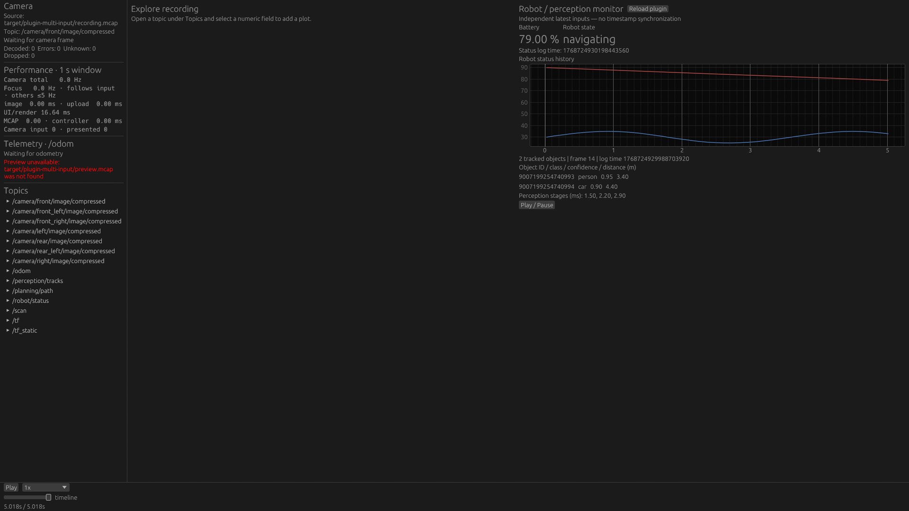
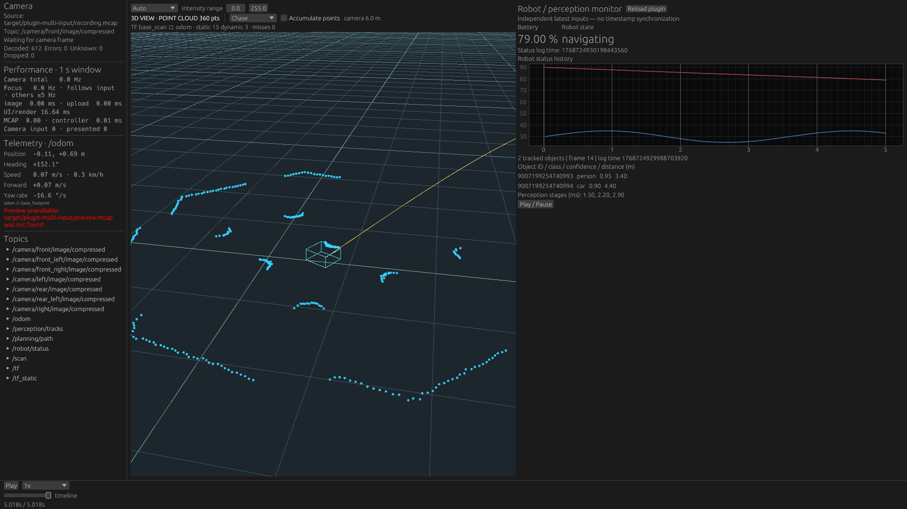

# Variable arrays + multiple PluginPanel inputs — 2026-10-29

[Architecture and execution instructions](../../wasm_plugin_panels.md) ·
[Standalone robot-monitor-panel sample](../../../examples/robot-monitor-panel/README.md).

## What runs

Panel API **2** accepts up to four named inputs. The sample combines the independent
`my_robot_msgs/msg/RobotStatus` and `my_robot_msgs/msg/TrackedObjects` topics, neither
of which has a corresponding host Rust message model. Definitions and payloads come
from the indexed MCAP. The new guest receives status/history and selected variable
arrays, and chooses the object rows, values, labels and graph references itself.

The synthetic fixture has 45 status messages and 15 perception messages; perception
is intentionally slower and offset in log time. Counts cycle 0–3 objects and 1–3
stage durations. The guest shows IDs above 2^53 without float rounding. It preserves
object-column correspondence and distinguishes zero objects from a missing input.

These are actual unmodified FHD Native window captures using NVIDIA RTX 5070 Ti /
Vulkan. The same host executable runs both layouts. Hashes and commands are in
`capture.json` / `scene-capture.json`. No special render or read path was added.

| Query-only Explore layout | Existing Scene + independent custom panel |
| --- | --- |
|  |  |

The default sidebar's waiting-camera/odometry labels in Explore are expected because
that layout selects no continuous features. Preview-unavailable refers to the optional
sidecar, which was not generated for this fixture. It is unrelated to panel decoding.
The Scene capture confirms normal point-cloud/Path/platform rendering remains usable
beside the panel. Browser plugin execution remains outside this implementation.

## Contracts exercised

Core projection tests check primitive/string/struct-array fields, nested/fixed arrays,
empty arrays, stable indices, uint64 precision, all truncated payload prefixes,
malformed/oversize length prefixes, shared value/string budgets, and invalid paths.
Array elements consume their full wire record so selecting a field near the beginning
of a record still locates the next element correctly. Root projections stop after
the selected value. No complete generic message tree is created.

Actual independent Wasm + real MCAP integration checks:

- Status and perception have separate latest-before timestamps at one requested cursor;
  perception can have no predecessor while status is already ready.
- Repeated backward/forward seeks restore the exact expected array length/column shape,
  including nonempty -> empty transitions without old object IDs in the new output.
- Scalar numeric history remains available from the separate status input.
- Resuming after a paused exact query does not round the requested cursor backwards
  and expose cached history newer than that request.
- In-flight old-source results are rejected while switching recordings; alternate labels
  do not mix with the previous recording.
- A malformed or 129-element perception array clears only perception; healthy status
  stays ready. Missing status leaves perception usable, and vice versa.
- Existing single-input sample, hot replacement/reset, failed-seek rollback, disabled
  Query behavior, output limits and user-event command permissions remain tested.

All `docker/check.sh` gates passed: workspace fmt/Clippy/tests, Native with Scene +
PluginPanel (97 passed / 7 ignored, then all four real-Wasm integration tests explicitly
executed), independent Scene guests, wasm32 checks, Trunk release build, and ROS Live
(92 passed / 4 ignored). Additional strict Clippy checks enable Scene, PluginPanel and
ROS Live together. No ROS installation is required by ordinary file playback.

## Limits and deliberate exclusions

Inputs are independent latest snapshots, not synchronized message joins. Their exact
log times cross the ABI so a guest can implement a freshness policy. On committed Seek
or Source replacement all panel inputs/results are cleared together; a failure within
one input does not hide another healthy input. Query is separate from SessionPlan and
FeatureRuntime and does not add playback streams.

Each input has at most 16 selected paths, 128 elements per array, 512 selected value
nodes and 8 KiB total selected string bytes. All field projections share those budgets.
The complete per-input snapshot (including reduced histories) must fit 24 KiB. A
counting writer checks serialized size without allocating another JSON buffer. Invalid
input clears values/history/log time and reports an explicit input error. The total
panel input remains capped at 128 KiB, with at most four scalar history series overall.

Structured arrays are projected as corresponding selected columns; selecting an entire
arbitrary message-valued object is not implemented. Numeric time-series queries still
require scalar fields, so array aggregation/history needs a separate follow-up. There
is no interpolation, automatic synchronization, dynamic subscription broker, Browser
plugin loader, or new MCAP I/O implementation. Identical demands across separate panel
inputs/instances may still repeat extraction; their decoded full histories are not kept.

## Performance regression check

Five existing Native cases × three fresh processes ran after compilation and GUI
capture completed. All 15 succeeded; no regression exceeded the harness's configured
relative/absolute tolerances. This measures normal playback with plugins disabled,
not the cost of four dense PluginPanel inputs. No Browser performance rerun was done.
The last resume-rounding fix touches only the optional panel Query cadence and is
covered by the final Native integration tests. Screenshot binaries predate that fix;
the displayed normal EOF state is unchanged.

| Case | Metric | Previous median | Current median |
| --- | --- | ---: | ---: |
| cloud-60k | peak_rss_mib | 14.672 | 14.570 |
| cloud-60k | workload_ms | 24.957 | 26.802 |
| jpeg-4k-8cam | peak_rss_mib | 228.266 | 228.148 |
| jpeg-4k-8cam | workload_ms | 4937.592 | 4930.057 |
| raw-fhd-30hz | peak_rss_mib | 75.352 | 75.156 |
| raw-fhd-30hz | workload_ms | 790.705 | 832.411 |
| seek-revisit-512m | peak_rss_mib | 1027.445 | 1027.176 |
| seek-revisit-512m | seek_revisit_ms | 0.013 | 0.013 |
| selected-scan | peak_rss_mib | 200.398 | 200.141 |
| selected-scan | workload_ms | 1057.741 | 1052.139 |

Metrics, fixture hashes and source/harness metadata are committed in `native-suite.json`.
The baseline is the original PluginPanel suite. Recheck with:

```sh
python3 tools/performance-probe/regression.py check \
  --baseline docs/verification/plugin-panel/native-suite.json \
  --current docs/verification/plugin-panel-arrays/native-suite.json
```
