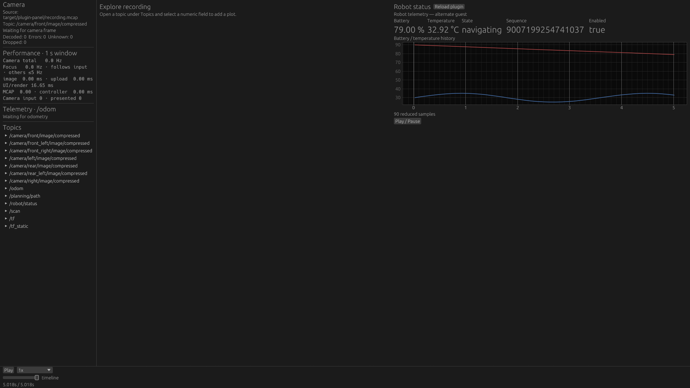

# Wasm PluginPanel — 2026-10-28

PoC on `feature/scene-visualization-extension`, following `c3bea0d`.
[Architecture, limits and build/run instructions](../../wasm_plugin_panels.md).

## Actual Native runs

The host reads the unknown `my_robot_msgs/msg/RobotStatus` schema from the MCAP,
extracts selected fields and numeric histories through its existing indexed Query
paths, and runs an independently compiled Wasm to define an additional Workspace
panel. The recording has 45 synthetic status messages alongside the original
bundled camera/scan/Path/TF messages. No RobotStatus Rust model exists in the host.

These unmodified FHD window captures use NVIDIA RTX 5070 Ti / Vulkan. Both runs
use the **same Native executable hash**; only the guest module changes. The viewer
was restarted between these two captures. The captured binary predates the final
wall-time cadence adjustment; that adjustment is covered by the Native integration
tests below. Independent reload integration tests
also replace the guest in an existing panel, retaining its input definition and
clearing prior output/events. OS mouse automation did not confirm the Reload button;
no claim of a GUI hot-reload assertion is made.

| Original guest | Independently rebuilt alternate guest, unchanged host |
| --- | --- |
|  |  |

`captures.json` records executable/source/module hashes and commands. The Explore
layout intentionally selects no continuous camera/Scene stream; the displayed
status and history are entirely Query products. Waiting-for-camera/odometry labels
are expected in its existing sidebar. A preview sidecar was generated through the
standard preview-builder. An additional Scene + Panel GUI capture was obscured by
the desktop lock screen and is excluded; combined feature tests passed.

## Tests and lifecycle

`docker compose run --rm dev bash docker/check.sh` passed after the final API change:

- workspace fmt, strict Clippy and tests;
- combined Native Scene + PluginPanel strict Clippy, 97 tests passed / 6 ignored;
- explicitly executed all 3 RobotStatus Native integration tests (normally ignored
  until the independent guest and fixture have been built);
- standalone real-Wasm guest/output/reset tests, plus existing Scene guest tests;
- Native Scene-only tests and actual indexed Detection3D/Path seek tests;
- wasm32 checks including core/MCAP/renderer/extension/Web, Trunk release build;
- ROS 2 Jazzy `ros2-live` tests: 92 passed / 4 ignored.

Focused assertions cover selected fields with large skipped arrays, exact uint64,
bounded strings/bool, latest-before/no predecessor, history at or before cursor,
Seek generation invalidation, failed Seek preserving data/generation/cursor, in-flight
old Source replacement, missing topic, malformed CDR, bad replacement module,
traps/fuel/invalid output, undeclared Plot inputs and unsolicited host commands.
A fast-playback test checks that the latest Query starts no extra I/O within the
wall-time interval, history refresh stays throttled, and pause bypasses both limits.
Session tests assert no added playback streams and no Query-induced cursor change.
The disabled-query test asserts no worker is started. There is no Browser plugin
loader or Browser plugin-execution test; its normal application build is checked.

## Costs and regression measurements

Release `actual_robot_status_panel_update_timing`, 200 updates, 2 histories × 128
points, 7,149-byte JSON input, same machine:

| Cost including JSON + wasmi + output validation | Milliseconds |
| --- | ---: |
| median | 0.464 |
| p95 | 0.573 |
| maximum | 2.255 |

This excludes indexed Query I/O/decompression, egui painting and GPU presentation.
The VM is still on the UI thread; its bounded fuel budget can delay a frame. The
measurement is one short workload, not a worst-case execution guarantee. The
repaint path reuses the validated UI and plot buffers and does not invoke the guest.

Normal playback regression suite: five representative Native cases × three fresh
processes, compared to the prior Detection3D baseline with the existing harness
thresholds. All 15 runs succeeded; **no regression beyond configured tolerances**.
The final suite ran after compilation/GUI capture had finished. It measures ordinary
playback with plugins disabled, not the cost of four simultaneous PluginPanels.
It includes raw FHD/30Hz, JPEG 4K/eight cameras, selected scan, 60k-point cloud and
512MiB-chunk repeated seeks. Browser performance was not remeasured in this change.

| Case | Metric | Prior median | Current median |
| --- | --- | ---: | ---: |
| cloud-60k | peak_rss_mib | 14.605 | 14.672 |
| cloud-60k | workload_ms | 26.846 | 24.957 |
| jpeg-4k-8cam | peak_rss_mib | 228.215 | 228.266 |
| jpeg-4k-8cam | workload_ms | 4983.683 | 4937.592 |
| raw-fhd-30hz | peak_rss_mib | 75.258 | 75.352 |
| raw-fhd-30hz | workload_ms | 786.751 | 790.705 |
| seek-revisit-512m | peak_rss_mib | 1027.164 | 1027.445 |
| seek-revisit-512m | seek_revisit_ms | 0.013 | 0.013 |
| selected-scan | peak_rss_mib | 200.184 | 200.398 |
| selected-scan | workload_ms | 1055.427 | 1057.741 |

The committed suite JSON files preserve run metrics, fixture/source hashes and
machine/harness metadata. Compare with:

```sh
python3 tools/performance-probe/regression.py check \
  --baseline docs/verification/plugin-panel/baseline-native-suite.json \
  --current docs/verification/plugin-panel/native-suite.json
```

## Remaining limits

Native indexed files only; plain CDR1/ros2msg scalar projections; one stream/schema
per input topic; bounded latest/history updates rather than every message. No custom
3D panel component, raw-CDR guest mode, Browser loading, TS/Python SDK or persisted
user layout editor is included. Shared demands across multiple panel instances may
still repeat Query/extraction work. Dense 60-second histories can be expensive even
though retained output is bounded. The next useful experiment is a second real panel
sharing an input, then profiling shared-demand execution and moving guest work off
the UI thread if necessary.
