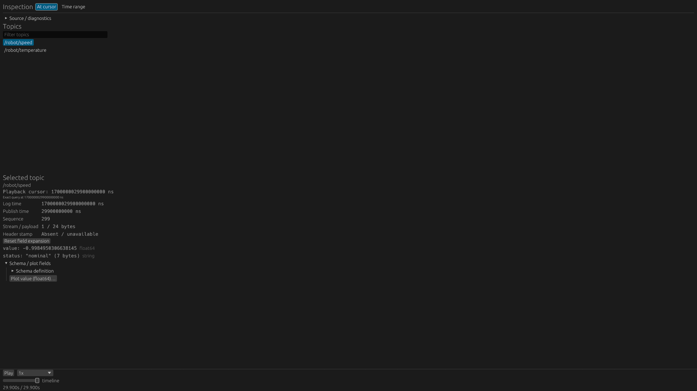
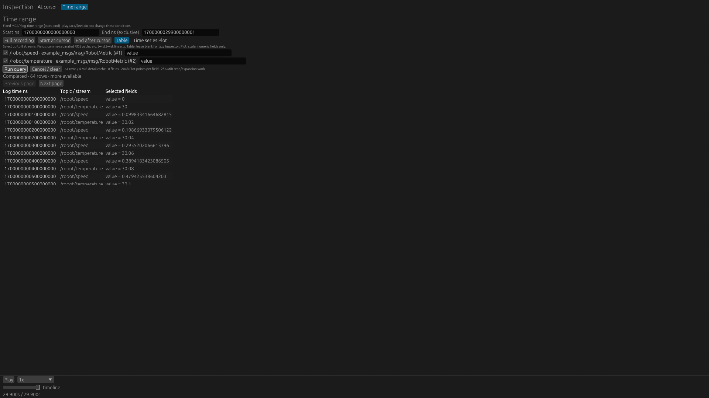
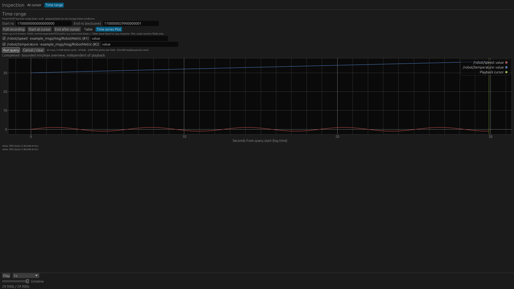

# Inspection / Query Service 検証（2026-11-05）

[使い方・設計と制限](../../query_panel.md)。作業branchは`feature/query-panel`。

## 実画面

通常Native release（features指定なし）、`--layout inspection`。
独自ROS型RobotMetricの2 topicを使い、At cursorの値とTime rangeのTable / Plotを確認した。

- Tableは64 row、Next pageで続きへ移動。
- Plotは2系列、各300入力、decode error 0。
- At cursorのPlot field操作は同じTime rangeのdraftを準備し、Idleのまま。自動取得しない。
- タブを戻すと以前の`/robot/speed`が再選択され、scalar / stringを確認できた。
- fixtureは29.9秒で、対話確認中に再生終了へ到達した。再生中・Seek前後の状態独立性は別の回帰テストで確認している。

[撮影情報](capture.json)にbinary / fixture / image hashを保存。
専用Xephyrとllvmpipe Vulkanで操作した機能確認で、GPU性能を測った試験ではない。

## 自動確認

`docker/check.sh` 全体が成功した：Python tests、storage policy、fmt、workspace Clippy / tests、
scene-extension / plugin-panels有効時のClippyとNative tests、独立Wasm guestとfixture、
Bindings/Seek/Camera、WASM check、Trunk release、ROS Live。
通常Nativeは99 passed / 2 ignored、ROS Liveは102 passed / 5 ignored。
ignoredの生成fixture gatesはcheck.shの個別コマンドで別途実行した。

今回追加・更新した検証：

- Inspectionのタブ操作はカーソルqueryを解除し、戻ると以前のtopicを復元。Source交換でtopic記憶を破棄。
- field選択はrangeを変更せず、同じfieldを重複追加しない。入力追加だけではread/decodeしない。8 field制限を明示。
- Inspectionを開くだけではPlaybackRequirements / signal / Inspector demandを追加しない。重複Inspectionはplaceholder。
- 削除したquery/topics panel typeはaliasで復活させない。
- Query Serviceの既存testsで、固定範囲、exclusive end、同時刻のページ継続、worker世代・取消・Source交換、予算・巨大payload・field errorを確認。
- 実録画で再生対象外のcameraをqueryしてもroute/cursorは不変。その後のSeekでCamera / Scanを復元。
- 再生用Plotのfollow / overview / preview、Camera切替など既存テストを維持。

ログは作業環境の`target/query-panel/refactor-full-checks.log`。
今回FPSやSeek latencyの比較計測はしていない。QueryのI/O・CPUコストがゼロという意味ではない。

## 明示的な変更と制限

任意fieldのField plots popup / NumericPlotLoaderを削除し、Query Serviceのbounded overviewに統合した。
既存の速度・ヨーレートPlotはnavigation等に維持し、Inspectionでは自動取得しない。
任意fieldの最大表示点数は従来4000点から2048点へ、work予算はQuery共通256 MiBへ統一した。
広い範囲・巨大単一Chunkは予算で拒否し得る。範囲を絞って実行し、単一Chunk超過時はrechunkが必要。
複数topicのPlotでは混在Chunkの再読があり得る。
WebのInspection統合、Live履歴、join / XY / 派生信号、条件永続化は未実装。
