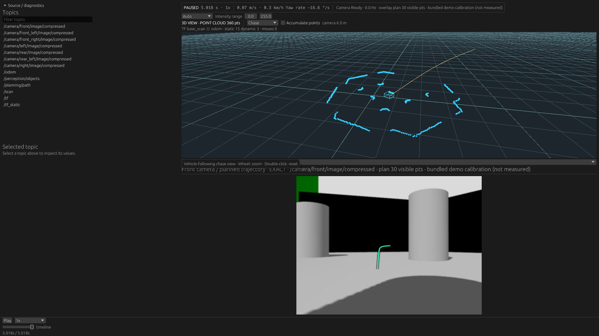
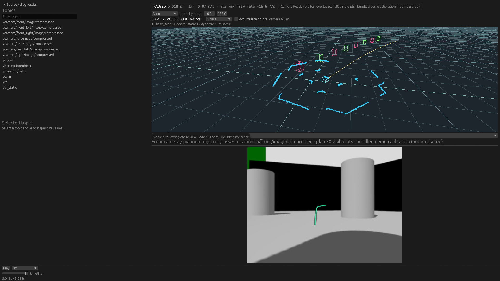

# Independent extension input and identified Box verification — 2026-10-28

Continues `c2dce06` on `feature/scene-visualization-extension`.
[Current architecture, ABI 2 and reproducible commands](../../scene_visualization_extensions.md).
The first experiment shared the displayed Path and returned anonymous edges. This
change checks two separate contracts rather than claiming custom ROS decoding.

## Independent input

Fixture: original bundled recording plus `/perception/objects` as `nav_msgs/msg/Path`.
The original `/planning/path` and its timestamps/payloads are unchanged. Additional
input contains eight synthetic positions displaced 2 m left, publishes every other
Path message (23 input messages versus 45 displayed-Path messages), and has log
time shifted +5 ms. Its measurement/header stamp remains unchanged. See the fixture
example and `fixture.log`; the generator refuses to overwrite existing files.

Native SessionPlan adds this input only when enabled. It resolves one additional
StreamId/LatestBefore requirement without replacing the Scene's Path binding.
Both states coexist in FeatureRuntime; presentation explicitly borrows the resolved
extension input, not `runtime.path()`. Multiple demands for the same stream share
one controller/decoder; extra-only inputs decode one latest message per source
batch, dropping superseded serialized inputs before CDR. No raw backing/history
is retained after batch processing.

Tests verify:

- Disabled selection excludes the input; unused `/unused/path` also stays excluded.
- Shared built-in/extension topic has one physical route, one restore requirement
  and one decode. Independent topic has separate state and unique selection.
- Admission chooses greatest MCAP log time, then final batch order; superseded
  malformed input is never decoded. Drop/decode/error counters reflect this.
- A malformed restore rolls back **both** Path states and counters; a seek without
  predecessors empties both. Missing/wrong-encoding input and too many demands fail
  planning explicitly.
- Real Wasm + indexed MCAP: seeks end -> first displayed Path timestamp -> start
  -> end; each extension result is checked against an independent indexed
  `latest_before` lookup. At the first Path time, the display has a value and the
  delayed extension input has none. Nonempty results have different input/display
  log times. Measurement-time TF placement, IDs, no extra CDR decode and failed
  restoration retaining cursor, both revisions and previous overlay are asserted.

## Box/Object ID

Wasm returns one oriented Box per object, with 64-bit ID, metric center, unit ROS
quaternion, full local-axis size and opaque linear RGB. Host resolves TF once,
transforms centres/orientations while retaining sizes/IDs, and renderer expands
12 edges only on overlay revision changes.

Full snapshots use replacement semantics: same ID updates the object, omitted ID
removes it. IDs are unique across lines/boxes. Canonical ordering prevents output
reordering alone from changing the revision. No persistent graph/diff cache is
introduced. Tests cover rotated metric extents, TF composition/corner agreement,
IDs above 32 bits, duplicate IDs across kinds and in guest bytes, changed/removal
snapshots, invalid size/orientation/coordinates and output caps.

This is a mock recognition input: IDs come from position indices, colors from the
guest. It is **not Detection3DArray/custom-msg support**, tracking, picking or labels.
Native Rust can emit both lines and Boxes through the same validated contract;
the ABI 2 guest returns Boxes only. ABI 1 guests require rebuilding.

## Actual Native GUI

Both runs use the same file, EOF cursor, monitor layout, FHD viewport and NVIDIA
RTX 5070 Ti/Vulkan. Guest, source and binary hashes/commands are in `captures.json`.
The optional Preview 2 sidecar was generated normally (`preview-build.log`), not
hidden through UI changes. No image compositing or app patching was used.

| Disabled | Independent input + Wasm Boxes |
| --- | --- |
|  |  |

The Scene camera, point cloud, Path and Camera panel remain the production ones.
GUI forward playback was observed; seek/failure/reset assertions use automated
integration tests rather than claimed OS mouse automation.

## Checks and performance

Full Docker check passed: workspace fmt/Clippy/tests, separately built real Wasm,
extension-enabled Native tests and indexed-seek integration, Native/WASM checks,
Web release build and ROS 2 Jazzy live tests. The optional feature is checked
separately from the ordinary Native build. See `full-checks.log`.

Actual GPU tests passed (2): Box+Line upload contains 26 vertices; overlay-only
changes don't upload Path/cloud; camera orbit doesn't reupload objects; removal
clears draw count. Existing opaque-point depth ordering also passes (`gpu-tests.log`).

Existing representative suite, unchanged recipes/input hashes/harness/thresholds,
3 fresh processes per case: **15 Native + 9 hardware Browser runs succeeded**, no
regression beyond existing tolerances. No selective reruns. Baseline is the saved
initial extension implementation; all before/after observations and environment
are in `native-*.json.gz`, `web-*.json.gz`; comparison files contain empty problems.
Native probe covers source/materialization/image workloads, not the GUI renderer.
Browser has no extension loader; its measurements check effects of the shared core/
Scene contract. These are tolerance checks, not proof of exact zero overhead.

| Native case | Median ms before / after | Peak RSS MiB before / after |
| --- | ---: | ---: |
| FHD raw 30 Hz | 788.43 / 779.51 | 75.17 / 74.98 |
| 4K JPEG 8 cameras | 5022.04 / 4970.52 | 228.13 / 227.78 |
| Selected scan | 1060.34 / 1072.52 | 200.40 / 200.00 |
| 60k cloud | 24.72 / 24.93 | 14.70 / 14.45 |
| 512 MiB seek revisit | 0.0134 / 0.0127 | 1027.46 / 1026.91 |

| Browser case | Focus Hz before / after | Max heartbeat ms before / after | Peak PSS MiB before / after |
| --- | ---: | ---: | ---: |
| FHD raw 30 Hz | 29.49 / 29.02 | 32.8 / 31.8 | 1147.40 / 1134.50 |
| 4K JPEG 8 cameras | 9.72 / 9.47 | 67.0 / 63.2 | 1697.03 / 1675.90 |
| 512 MiB chunk | 9.66 / 9.49 | 32.1 / 42.8 | 1650.45 / 1584.34 |

Raw-image seek median: 104.4 -> 110.95 ms. Minimum background content rate:
4K8cam 2.046 -> 2.290 Hz; 512 MiB chunk 2.288 -> 2.045 Hz. Focus and background
observations are both retained; the single-camera raw case has no background.

Release guest micro-measurement, same CPU, 1000 calls, 1024 input points -> 32
Boxes: median **0.02048 ms**, p95 0.02067 ms, max 1.03511 ms (`guest-timing.log`).
An earlier observation before sharing the TF rotation helper was 0.02064 / 0.02171 /
0.14020 ms. No timing assertion or threshold was chosen from these observations.
The historical line guest measured ~0.1964 ms; this is not an end-to-end renderer
speedup claim. Transfer is 1,920 bytes for 32 Boxes instead of 15,360 bytes for
384 ABI 1 edges (1/8), while the renderer still draws 384 edges. Box outputs now
also include orientations. Timings include encoding, execution, output copies and
validation; exclude TF placement and GPU upload/draw. No arbitrary guest or
long-duration enabled-extension stress was benchmarked.

Remaining constraints: one Native runner, Path-position projection only, up to
1024 points per VM call and 256 output Boxes, fuel rather than hard wall-time
isolation. The full latest Path is still materialized by the common bounded CDR
path before the VM input limit check; no independent early point-count cap was
added. Browser execution, a bounded typed detection decoder and host per-object
picking/diffs are separate next steps. Next useful input step is Detection3DArray
with actual IDs/pose/extents, not more Path-specific plugin plumbing.
