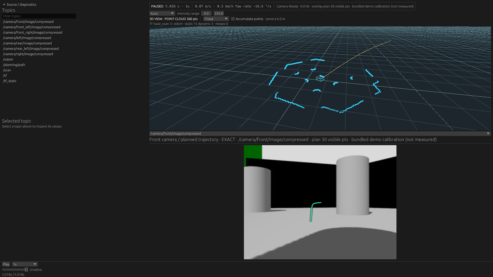
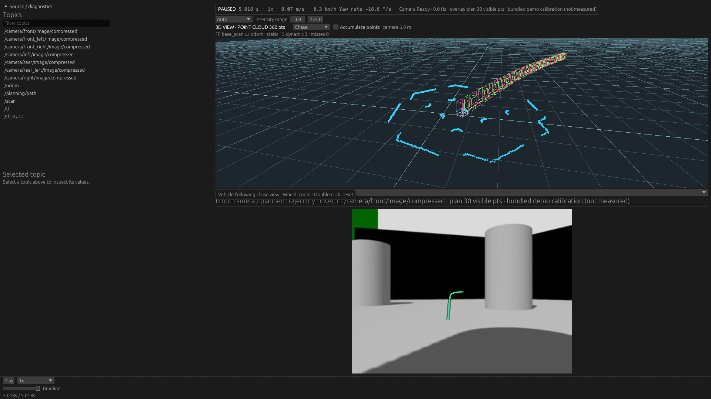

# Scene extension verification — initial ABI 1, 2026-10-28

Historical results for `c2dce06`. Current input/Box contract and commands are in
[the updated design](../../scene_visualization_extensions.md); these screenshots
and measurements intentionally retain the original shared-input/line-output setup.

Branch: `feature/scene-visualization-extension`; design, scope and reproducible
build/run commands: [Scene Visualization Extension](../../scene_visualization_extensions.md).

## Actual Native application

The independently compiled `examples/path-boxes` Rust cdylib runs as a genuine
Wasm module in the production Native application. FHD captures use the same
recording, EOF cursor, layout and RTX 5070 Ti / Vulkan adapter.
`captures.json` records the actual source, guest and executable SHA-256 values.
No compositing or renderer patch was used. The source is the complete-schema
[README fixture](../../screenshots.md); its Path is synthetic, its camera calibration
a demo value. These are not real object detections.

| Extension disabled | External Wasm enabled |
| --- | --- |
|  |  |

The guest owns box dimensions, line generation and colors. Host code only
validates and places its returned lines with the Path measurement-time TF.
The original Path coordinates are used, independently of the built-in Path's
optional ground presentation policy.

Actual GUI playback was exercised for both modes. Repeated seek, failed restore,
missing input and source-generation reset are covered by deterministic tests
below; we do not claim automated OS mouse/drag-and-drop coverage for those actions.
Browser execution of the extension is **not implemented**.

## Checks

- `docker compose run --rm dev mcap-dev-check`: passed, including workspace fmt,
  Clippy/all targets, workspace tests, separate guest build, real-guest execution,
  extension-enabled Native tests, Native indexed-seek/guest test, WASM check
  (including extension contracts without wasmi), Web release build and ROS 2
  Jazzy live tests. See `full-checks.log`.
- Final acquisition-time placement change: Native feature-enabled Clippy passed;
  **95 tests passed, 2 manual tests ignored**, then the ignored actual-Wasm MCAP
  seek regression explicitly passed. See `native-extension-checks.log`.
- Actual GPU regressions: **2 passed on NVIDIA RTX 5070 Ti / Vulkan**, see
  `gpu-tests.log`. Existing opaque-point depth ordering passes. Overlay changes
  upload only the overlay buffer; camera orbit does not reupload it; removal
  clears draw count without touching point/Path uploads.
- ABI tests cover version mismatch, forbidden imports/start, initial/growing
  memory limits, infinite update/init, traps, oversized input/output, invalid
  output coordinates and out-of-bounds pointers. Full Rust guest output is checked
  before and after fresh-instance reset.
- Native Rust implementation tests exercise the same output contract, unchanged
  revision reuse, no repeated guest calls, missing-TF retry, fixed-frame changes,
  acquisition placement surviving TF history eviction, failure latching and
  seek/source reset. The real MCAP integration test verifies no extra host decode
  and failed restore retaining cursor, Path revision and old overlay.

A test initially assumed a Path existed at the recording's first timestamp. It
correctly found an empty predecessor there. The test now explicitly checks this
empty overlay boundary as well as nonempty forward/backward restoration.

## Disabled-extension regression suite

Existing representative recipes, fixtures, thresholds and harness were unchanged.
Three fresh processes per case, with the harness's SHA-256 input read warming OS
cache, compared with the committed prior implementation's saved results
(`18787dc`, production code unchanged through `45958f2`). No threshold changes or
selective reruns. All **15 Native and 9 hardware Browser runs** succeeded; both
comparisons report no regression beyond their existing tolerances.

These measure normal playback with the extension disabled, not a guarantee of
zero CPU cost or of performance for arbitrary guest code. Native probe includes
source/materialization/image workloads but is not the Native GUI render loop.
GPU upload reuse is verified separately above. Small timing changes remain visible
in the retained data; this is a tolerance test, not statistical equivalence.

Native medians (ms; seek row is cache revisit latency):

| Case | Before | After | Peak RSS before / after MiB |
| --- | ---: | ---: | ---: |
| FHD raw 30 Hz | 781.024 | 788.432 | 74.96 / 75.17 |
| 4K JPEG, 8 cameras | 4966.441 | 5022.036 | 227.91 / 228.13 |
| Selected scan | 1078.465 | 1060.343 | 200.02 / 200.40 |
| 60k point cloud | 24.989 | 24.715 | 14.43 / 14.70 |
| 512 MiB chunk seek revisit | 0.0081 | 0.0134 | 1027.02 / 1027.46 |

Browser medians:

| Case | Focus Hz before / after | Max heartbeat ms before / after | Peak PSS MiB before / after |
| --- | ---: | ---: | ---: |
| FHD raw 30 Hz | 29.05 / 29.49 | 33.2 / 32.8 | 1165.33 / 1147.40 |
| 4K JPEG, 8 cameras | 9.62 / 9.72 | 66.3 / 67.0 | 1698.89 / 1697.03 |
| 512 MiB chunk | 9.70 / 9.66 | 35.6 / 32.1 | 1610.99 / 1650.45 |

Raw-image seek: 110.7 -> 104.4 ms. Minimum background content rate in 4K8cam:
2.048 -> 2.046 Hz, and 512 MiB: 2.043 -> 2.288 Hz. Single-camera Raw has no
background images. Both focus freshness and background observations are retained.

Before/after suites are `native-*.json.gz` and `web-*.json.gz`;
`*-comparison.json` records baseline digests and empty problem lists. Environment,
all repetitions, metrics and input hashes remain in the suites.

## Enabled guest cost

On the same Core Ultra 7 265KF, release test, 1000 calls, 1024 input points,
384 output lines: **median 0.1964 ms, p95 0.2137 ms, max 0.9298 ms**.
See `guest-timing.log`. Includes ABI encoding, Wasm execution, returned-byte copy
and host output validation. Excludes TF placement and GPU upload/rendering.
An earlier release observation was 0.1964 / 0.2125 / 1.0020 ms; no timing threshold
was selected from these observations. Reproduce with:

```sh
cargo test --release -p viewer-extension measure_independent_guest_updates -- --ignored --nocapture
```

Current release executable sizes on this Linux build: ordinary Native 23,246,912
bytes, extension-enabled 25,904,176 bytes (about 2.53 MiB additional).
`cargo tree -p viewer-native --edges normal` contains neither viewer-extension nor
wasmi without the optional feature. No extra streams or decode routes are added
when the extension is disabled.

The guest is capped at 8 MiB linear memory, 1M fuel per update/init, 1024 input
points, 4096 output lines and 2 MiB module bytes. Compiled code/host allocations,
GPU buffers and temporary old/new Store overlap on reset are additional memory.
A new Path runs at most one update per presentation tick; an unchanged Path runs
none. A successful placement is frozen at measurement time; missing TF retries
without another guest call. Built-in Path CDR decode remains unchanged and is
shared, not coalesced by this extension.

The remaining performance risk is executing a fuel-bounded guest on the Native UI
thread: fuel is not a hard wall-time deadline. Larger inputs/outputs need a measured
admission/worker design, not larger unbounded buffers. Arbitrary guest workloads
and long-duration stress were not benchmarked. Browser Worker isolation and custom
message decoding remain separate future work.
