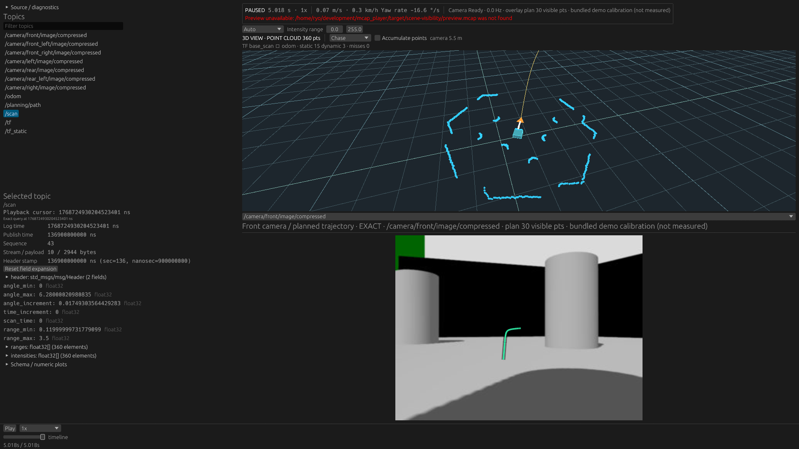
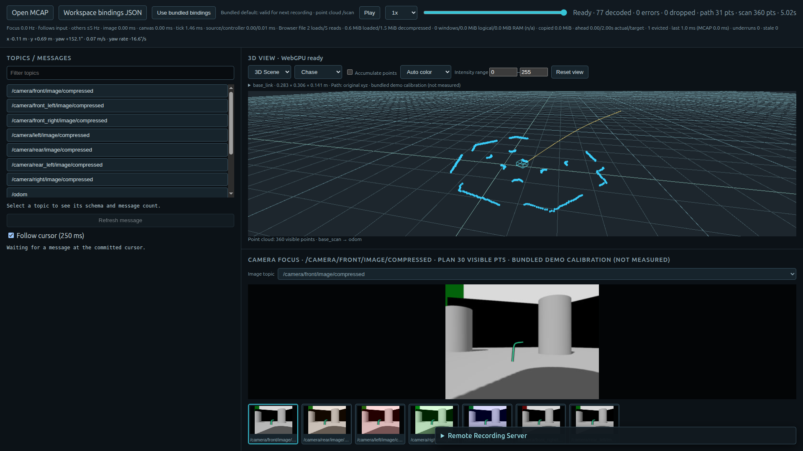
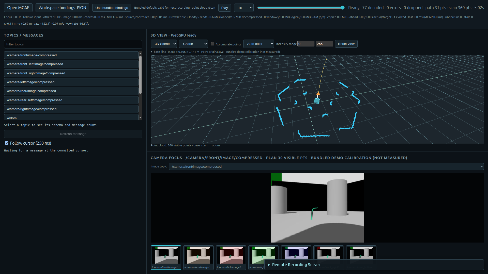

# 3D Sceneの視認性（2026-11-11）

同じTurtleBot3デモ、同じ末尾log time `1768724930204523401 ns`、1920×1080の比較。
点群蓄積off、Chase、1 m grid、同じ物理geometryを使用した。

| | 変更前 | 変更後 |
| --- | --- | --- |
| Native |  |  |
| Web |  |  |

## 原因と採用した表示

変更前は6 mの距離・約27.5°の仰角・約40°の斜め方位で、幅0.306 mの機体を細い線だけで表示していた。
車体の前後を判別する要素がなく、近くのScan点と区別しにくい。
姿勢欠損時の既定forwardや、異なるworld frameのOdometryから計算したyawも、方向表示に使うべきではなかった。

採用したChaseは距離5.5 m、仰角約47°、後方からの方位ずれ約12.6°、垂直画角56°。
注視点は機体中心から前方0.165 m。4.5 m・強い前方注視の試行では後方Scanが切れたため、その設定は採用しなかった。
最終構図では周辺Scanの後方輪郭も確認でき、車体と進行方向を同時に見つけやすい。
15 mのPath全体を必ず画面内に収める方針ではない。遠方の確認には既存ズームを使う。

- **物理外形**：PlatformGeometryから渡された8頂点のまま、opaqueな色付き面とwireframeを描く。上面は青緑、物理+x側の前面はオレンジ。乗用車寸法やTurtleBot3寸法はrendererへ埋め込まない。
- **方向annotation**：白いshaftとオレンジのarrowhead。物理外形とは別のナビゲーション記号として、機体上端より0.18 m上に配置する。長さはview radiusから0.65..1.5 mに制限した表示policyで、車体・Path・Scanを拡大しない。
- **姿勢の有無**：presentation / SceneFrameのforwardをOptionにする。TFがあればその回転、なければfixed frameとreference child frameが一致する有限なOdometryを使う。両方なければ矢印を描かない。
- **カメラ**：姿勢不明時のChaseはworld軸のoverview。VehicleEyeも姿勢不明ならoverviewへfallbackする。既知姿勢では従来同様にheadingへ追従し、Freeのworld orbit、zoom、resetを維持。

ROS xyzからrenderer xyzへの変換は引き続き `[-y, z, -x]`。`1.0 = 1 metre`を維持する。
同梱boundsの辺長0.2825 / 0.306 / 0.14125 mもTF回転後に維持することをテストした。
PlatformGeometryの設定、Path／PointCloudのdecodeや単位は変更していない。

## 描画とcache

同じ共通SceneRendererをNative / Webが使う。アプリ側の倍率補正や専用shapeは追加していない。
既存のVertexとshaderを再利用するTriangleList pipelineを追加した。
車体36頂点＋方向記号9頂点は既存dynamic bufferへlineと一緒に格納し、geometry revisionが変わった時だけuploadする。
線はLessEqualで同一面上の外形線を表示できるようにし、面と点群は既存のdepth bufferで遮蔽する。always-on-topではない。
headingのSome/NoneやTF回転はgeometry revisionに反映され、cloud revisionは変えない。
カメラ移動だけならgeometry・point buffersを再uploadしない。Seek / Source変更のinvalidateも維持する。

## 撮影方法と制限

- Nativeは通常releaseの`--layout monitor --inspect-topic /scan`を専用Xephyr上で起動し、末尾の自動停止後にX11のwindow imageを保存。before / afterともllvmpipe Vulkan。
- Webは通常releaseを専用Chrome 143で開き、CDPでfile inputとtimelineを操作し、Page.captureScreenshotで保存。before / afterともNVIDIA Vulkan。必要な間だけdisplayを起こし、終了後に休止状態へ戻した。画面ロックは解除していない。
- headless / SwiftShaderでは3D canvasが白く写る試行があったため、比較画像には採用しなかった。before Webは画像保存後に撮影メタデータ書出しの型エラーが起きたが、保存された実画面は確認できた。製品コードの例外ではない。
- 画像は実画面そのまま。合成、描画要素の後付け、撮影専用UIへの差し替えはしていない。
- Nativeの赤いPreview unavailable表示は、今回はpreview sidecarを生成しなかったため。Sceneの描画エラーではなく、before / afterとも残している。
- NativeとWebでGPU経路が異なるため、性能比較には使えない。[入力・binary / Wasm・画像hashと撮影条件](capture.json)を保存した。

入力は`readme_fixture`で既存デモのschemaを補完したもの。Gazebo由来のCamera / Scanと生成Pathであり、実機走行や実測calibrationの検証ではない。

## 確認したこと

- Core：TFのみのpose、0 / 90 / 180°回転、実寸辺長、TF欠落、異なるframeのOdometry、対応するOdometryのfallback、cold seek、geometry / cloud revisionの分離。
- Renderer CPU：8 tests成功。ROS axis mapping、1 m grid、実寸面、方向の有無、不正headingの抑制、回転時の後方・上方追従、Free / VehicleEye fallback、zoom / reset。
- NVIDIA RTX 5070 Ti / Vulkan：GPU tests 3件すべて成功。点群の深度遮蔽、extension独立更新、heading変更時のcloud buffer再利用、camera操作時のgeometry再利用。
- `docker/check.sh`全体成功。workspace Clippy / tests、optional plugins、生成fixture、WASM check、Trunk release、ROS Liveを含む。
- その後の最終カメラ定数調整でrenderer testsとNative / Web release buildを再実行し、採用画像を撮影。最終定数でもGPU testsを再実行した。

ログは作業環境の`target/scene-visibility/full-checks.log`、`final-camera-check.log`、`gpu-tests-final.log`。
FPS / RSS比較、全姿勢のGUI自動操作、他ロボットの実データ検証は今回行っていない。
