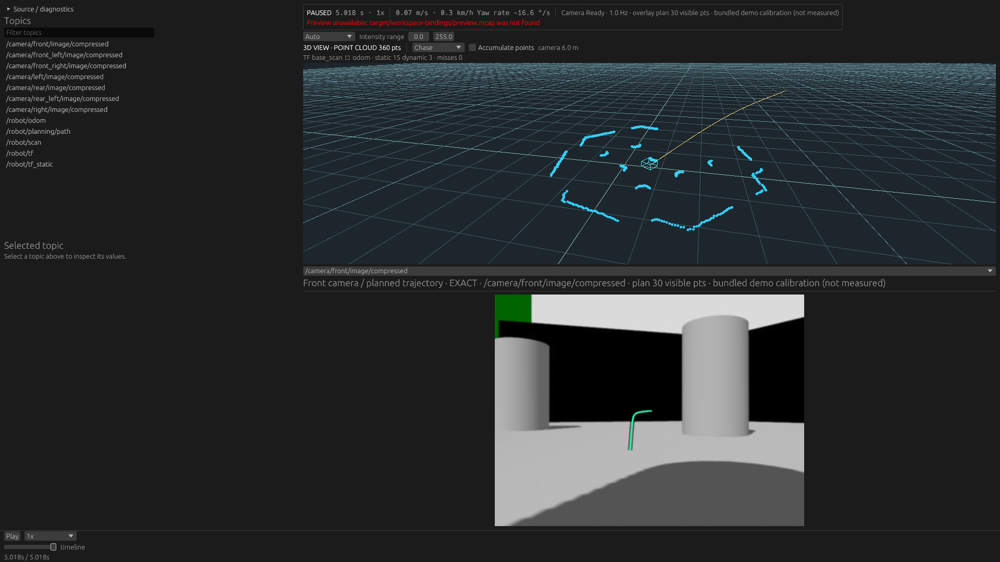
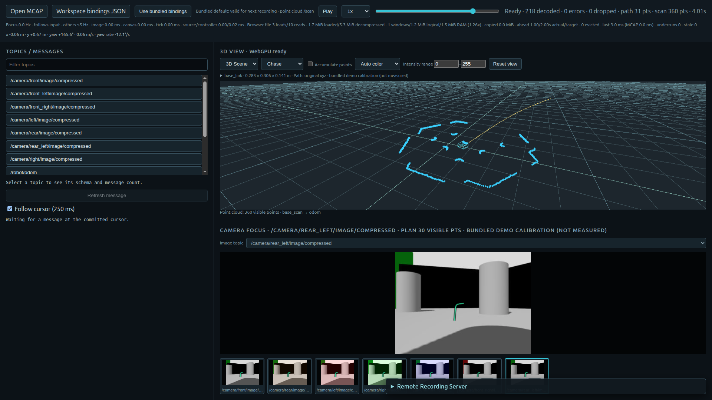
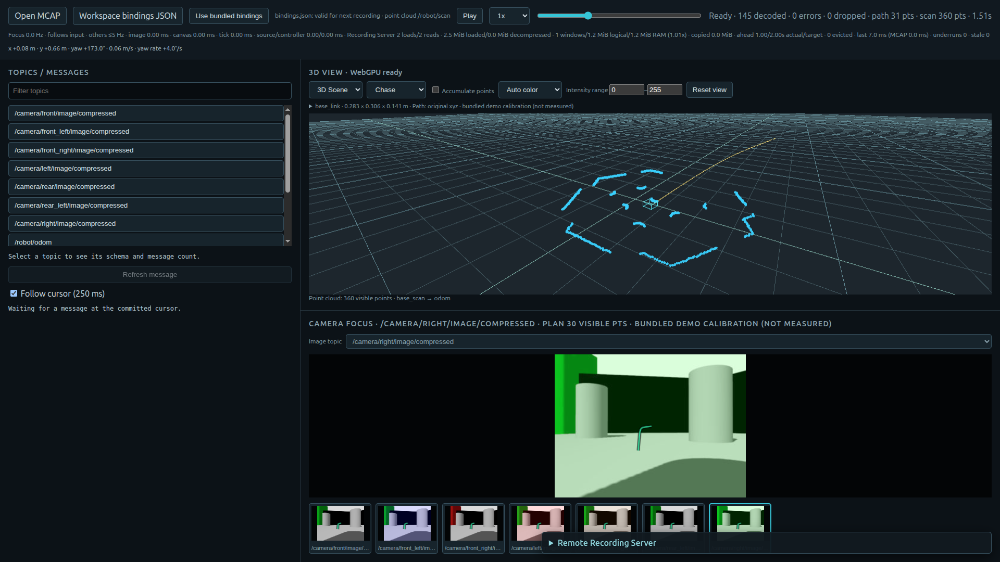

# Runtime WorkspaceBindings — 2026-10-29

Implemented on `main`, starting from `45958f2`. This change does not merge the
experimental Scene/PluginPanel branch into the release branch.

## Boundary and precedence

`WorkspaceBindings::from_json` and validation live in viewer-core alongside the
existing data model. They perform no filesystem/browser IO. The JSON shape and
bundled defaults are unchanged; all five fields are required. Unknown/missing/duplicate
keys, wrong types, empty/whitespace/control-character topics and oversize input fail.
JSON is bounded to 16 KiB UTF-8 and each topic to 1,024 bytes. Full ROS name expansion
or automatic schema-based topic guessing is not introduced.

Native reads the bounded file before EventLoop/session creation, validates it, applies
an explicit `--point-cloud-topic`, then stores the result in NativeWorkspace. The same
startup path runs for recording and ROS Live. Precedence is explicit CLI > external
JSON > bundled defaults. A malformed external JSON is not rescued by a CLI override.
No new per-frame reads/decodes, history, cache or subscription mechanism is added.

Browser `BindingsSelection` owns only the settings for the next source. Its File API
adapter reads JSON entirely in the browser and uses a generation to reject stale
completions. Loading/error states block both Local and Remote Open. Selecting valid
JSON or explicitly choosing bundled bindings recovers; a failed selection never
silently uses old/default JSON. The PointCloud input is initially empty and overrides
JSON only when the user fills it. Clearing it restores the JSON/default value.
The bundled-reset button changes the JSON selection; an explicit PointCloud override
continues to win.

Local and Remote adapters receive a concrete bindings snapshot explicitly when
constructing the catalog's SessionPlan. Playback no longer reaches into the DOM for
bindings. Local opening temporarily locks the settings controls. Active SessionPlan,
restore inputs and feature routes do not read mutable settings, including during
Seek and Camera selection. Settings can be prepared for the next recording without
changing an already-open session. Source/Query/FeatureRuntime and the Recording
Server's protocol remain unchanged. GitHub Pages needs no new API/backend.

## Automated checks

Passed `docker compose run --rm dev bash docker/check.sh`:

- workspace fmt, strict Clippy and all workspace tests;
- explicit Native indexed-recording bindings/seek/camera-reselection integration test;
- core/MCAP/renderers/Web wasm32 checks and Trunk release build;
- ROS 2 Jazzy `ros2-live` tests: 95 passed, 5 ignored (including the recording-only
  integration gate, which was explicitly run separately).

New regressions cover strict JSON, invalid UTF-8/missing/oversize Native files,
CLI override priority, Live argument acceptance, selection/read errors and stale
completion after reset, all-five-topic remapping, required versus optional/schema
mismatch rules, and explicit Local/Remote catalog bindings. Existing Local/Remote
seek/failure/generation and Native Camera-selection tests also pass.

The deterministic fixture keeps original payloads and Camera names while changing:

| Semantic input | Fixture topic |
| --- | --- |
| Path | `/robot/planning/path` |
| Odometry | `/robot/odom` |
| PointCloud | `/robot/scan` |
| Dynamic TF | `/robot/tf` |
| Static TF | `/robot/tf_static` |

It is created with `workspace_bindings_fixture`; no full recording scan is introduced
into normal playback. The generator intentionally rewrites a small known fixture.

## Actual applications

Native was launched with the external JSON on NVIDIA RTX 5070 Ti/Vulkan. Its ordinary
monitor layout displays the changed topics, point cloud/TF, odometry, Path and camera
overlay. Hashes/command are in `native-capture.json`. Unknown key, empty topic and
missing file all exited with code 1 before GUI initialization (`native-errors.json`).



Actual Chrome loaded the production static Web build. The same JSON was selected
locally for both Browser Local and the existing Recording Server. At multiple seek
times, both report zero decode errors, nonzero Path/point counts, valid TF placement
and Odometry. Camera selection and a later seek retain the configured semantics.
After resetting *next-source* settings to defaults, an already-open Local session
still restores the custom topics correctly.

| Browser Local | Recording Server |
| --- | --- |
|  |  |

The Local screenshot intentionally shows bundled settings **for the next recording**
after the retention test; the current session still uses `/robot/...` bindings.
Native's missing-preview banner concerns an optional sidecar not generated for this
fixture. It is unrelated to config loading or playback correctness.

The disposable Chrome also exercised unknown-key/empty-topic errors, manual PointCloud
override and clearing, injected `File.arrayBuffer` rejection, and a delayed file read
that completes after explicit reset. Invalid/loading settings blocked both Open paths;
the delayed old result did not replace the reset selection. Fault injection modifies
only the test browser's File prototype, not product sources. `web-result.json` records
assertions, renderer/version, input hashes and Web asset hashes.

Reproduce from the repository root (fixture creation refuses overwrite):

```sh
mkdir -p target/workspace-bindings
cargo run -p ros-fixture --example workspace_bindings_fixture --locked -- \
  target/workspace-bindings/recording.mcap
cargo build -p viewer-native -p recording-server --release --locked
cp target/release/viewer-native target/workspace-bindings/viewer-native
cp target/release/recording-server target/workspace-bindings/recording-server
(cd apps/viewer-web && trunk build --release)
python3 docs/verification/workspace-bindings/check_web.py
```

For the development container, build outputs are under `/home/dev/target` inside the
container; copy the two executables into the mounted target/workspace-bindings path.
The optional Chrome check uses an authorized `:1` X11 session and NVIDIA Vulkan ICD
through existing probe helpers, and creates only a loopback static server and the
normal loopback Recording Server.

## Deliberate limits

No active-session bindings mutation, save/persistence, config editor, schema inference
or Live subscription switching is added. Camera selection stays independent. Real ROS
network subscriptions with these custom topic names were not exercised; shared startup
loading, CLI acceptance and existing ROS Live tests were checked. These tests are
functional checks, not new performance measurements; playback's hot data path is
unchanged and settings are read only during configuration/source opening.
