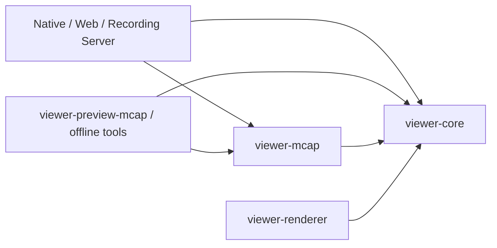

# viewer-core / viewer-mcap boundary

`viewer-mcap` isolates the existing MCAP implementation from the viewer domain.
The initial extraction changed ownership and imports without changing algorithms.
Subsequent focused changes add latest-query work budgets and separate pure health
reducers; see issues 011–013 for their behavior and verification.

`viewer-core` must not depend on `viewer-mcap`, including through dev-dependencies.
It has no `mcap`, `zstd`, `lz4` or `crc32fast` dependency. The renderer's MCAP fixture
tests use a dev-dependency on `viewer-mcap`; rendering itself depends only on core.

## Existing code moved into viewer-mcap

- Chunk decompression and record traversal, Message Index planning and predecessor
  selection, Summary identity and derived-artifact fingerprint conversion.
- `McapSource`, file range backing, `FileMessageStream`, `LatestMessageReader`, exact
  range queries, their source errors and read diagnostics.
- `McapPlayback`, including the existing transactional seek and persistent archive.
- MCAP-backed numeric/builtin Plot loading and Topic Health/Diagnostics queries.
  Source-bound request/error types and Topic Health metadata snapshots stay here.
  Pure Diagnostics DTOs and aggregation now belong to core.
- All MCAP fixture integration tests, including feature-runtime regressions that
  load a recording before exercising the shared runtime.

## Code remaining in viewer-core

`RawMessage`, `SourceCatalog`, schema bytes and stream descriptors, source
capabilities, `SessionPlan`, playback requirements and `RestorePlanner` remain
source-neutral domain contracts. Clock/effects, bounded data windows, CDR codecs,
schema-driven inspection/numeric extraction, feature runtime, presentation,
bookmarks/preview products, Plot products and the pure `SignalOverviewReducer`
also remain in core. `DiagnosticAggregator` owns bounded CDR aggregation and
`TopicTimingFacts` computes statistics from sorted log times and an explicit
predecessor. Neither performs recording I/O or owns a worker.

The only method-to-function adjustment is `SchemaDefinition::from_mcap` becoming
`viewer_mcap::schema_definition_from_mcap`: its allocation and byte-preservation
behavior are unchanged. A foreign crate cannot add an inherent method to the
core-owned schema type. No compatibility facade or reverse re-export is retained.

Compression features `mcap-zstd` and `mcap-lz4` now belong to `viewer-mcap`, with
the same default codec set. Browser Local enables `mcap-zstd` and `mcap-lz4-rust`;
the latter uses a portable LZ4 frame decoder without the native LZ4 C dependency.
Native keeps its C decoder. Both reject size mismatches and truncated LZ4 frames.
Existing specialized MCAP
readers/writers in the server and preview crate keep their direct format-library
dependencies; this step does not redesign those implementations.

Native `McapSource::open_file` also accepts a directory of indexed MCAP parts;
`open_files` accepts an explicit list. `recording::segments` combines metadata into
one internal address space and maps physical channel IDs to logical recording IDs.
The existing traversal, query budgets, caches and transactional `McapPlayback` work
across parts. Core/controllers/renderers have no part concept. The combined
`summary()` contains internal read addresses, not an on-disk MCAP image. Summary
facts and channel maps are shared across independent readers.

## Verification

Run `cargo test -p viewer-core -p viewer-mcap` before the workspace tests and
Clippy. WASM checks should include `viewer-mcap` as well as core and the renderers,
followed by the Web release build. Test `ros2-live` only in the sourced ROS environment.

Inspect `cargo tree -p viewer-core --edges all` and Cargo metadata to verify there
is no direct, dev, build or transitive edge from core to the MCAP crate/codecs.
The supported direction is `viewer-mcap -> viewer-core`.

## Internal module layout

The source now separates forward traversal from physical Message Index access,
latest-before caches and exact range queries under `recording::source`. Pure index
selection is `recording::message_index`; demand admission is `latest_limits`.
All source-bound feature queries live under `query`; fingerprints remain derived
products. See [module_structure.md](module_structure.md) for the placement map.
Open, read and query failures share the current `McapSourceError` API.
